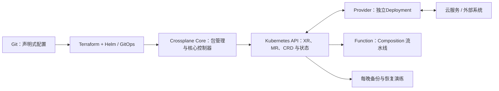
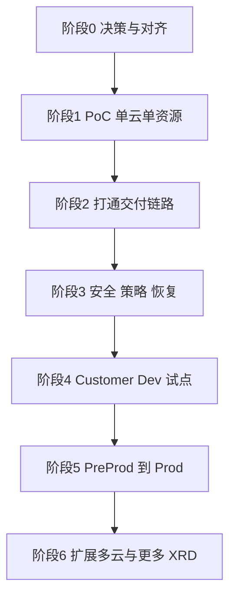
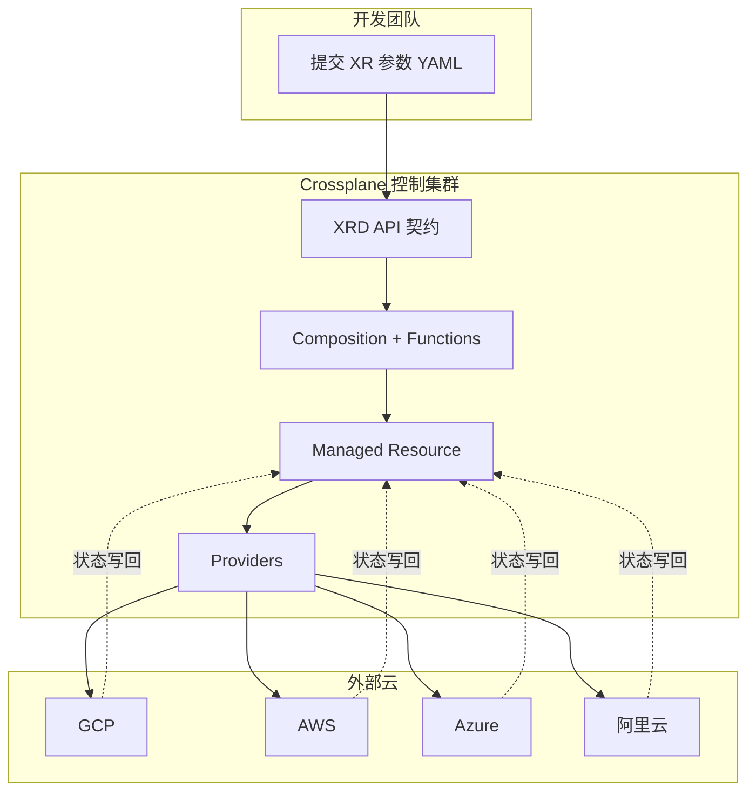
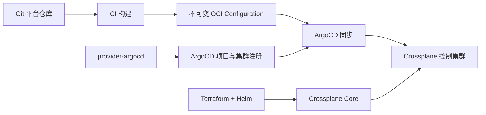

# requirement
<https://github.com/crossplane-contrib/provider-argocd>
<https://github.com/crossplane/crossplane> 你现在可以读这两个 Branch。我们其实有这样一个需求：公司内部有很多云平台，比如 GCP、AWS、阿里云，还有zure 就是说各个团队使用的这些云平台都不太一样 你帮我看一下，基于这些需求我们应该做什么？怎么样才能实现一个好的管理？下面是一些简单的信息供你参考。首先梳理整个 Follow 流程，特别是从架构角度来考虑 我现在不求细化，我只需要一个大的框架，需要了解在整个环境中需要做些什么，需要有哪些资源
目标：把 Crossplane 作为跨云「平台
构建块」，向开发团队提供统一
Kubernetes 风格资源接口，通过持续调谐减少配置漂移；各云仍保有其专有能力与治理责任。
请求链路：开发团队依据 XRD（API 契约(Composite Resource,
复合资源）→ Composition与
Functions 生成 MR (Managed
Resource, 托管资源) → Provider 调用
外部云 API→状态写回 Kubernetes API.
控制边界：平台团队负责 Core、
Provider, Function, XRD,
Composition、打包和发布；开发团队负责在批准 XRD 契约内提交XR 参数。
交付分工：Terraform + Helm 管
Crossplane Core; ArgoCD/GitOps #
Provider、Function、平台配置及相关集群侧资源；CI构建并发布不可变 OCI
Configuration E.

环境路线：先在 
Platform Development 
Customer Development → Customer PreProduction → Customer Production
推广。跨云能力不等于每个云必须单独建控制集群。
恢复关键：Git 保存声明式定义，但XR/MR 等运行状态保存在 Kubernetes API 只从git 在空集群重建，可能错误创建，重复管理，或影响外部资源，需要备份，恢复演练及外部资源身份核对。

ownership Boundaries
所有权边界

| Tool               | Description                                                                 | Owner             |
|--------------------|-----------------------------------------------------------------------------|-------------------|
| Terraform          | Rolling out Core Crossplane Configuration                                  | Platform          |
| GitHub Actions     | Running the Terraform workflow for version and configuration changes        | Platform          |
| ArgoCD (GitOps)    | Rolling out and Lifecycle of Crossplane Providers and Configuration including XRDs | Platform |
| ArgoCD (GitOps)    | Rolling out and Lifecycle of Crossplane Managed Resources                   | Platform          |
| Compositions       | Describing Infrastructure to be created from XRDs                          | Platform          |
| XRDs               | Contract between Platform / Development with required fields for Infrastructure | Platform      |
| XRs                | Requests for Resources to Create in Cloud Environments e.g. Storage Buckets | Development Team(s) |
| Functions          | Performing specific operations within a Composition Pipeline                | Platform          |
| Providers          | Managing external systems and exposing APIs to the Composition Pipeline    | Platform          |



那么现在看来，其实我的目标应该这么去确定来说比较合适。我首先得安装一个 Crossplane，比如说我们现在就找一个最简化的环境，我要在我的 GCP 的工程上安装这个Crossplane，也就是在我的 GCP 的 GKE 里面。然后我管理的目标现在也比较单纯，如果我只管理对应的 GCP 里面的 GKE，然后我把这一个打通之后再扩展到其他的云平台，是不是这样做起来就比较合理？如果是基于这个最简单的需求的话，我应该去做哪些处理？比如说就需要去对应的部署，那么部署怎么去找这些对应的资源？你能不能帮我去探索？比如说，我找一个集群来部署这个Crossplane 然后我就用这个集群去管理我其他 GCP Project 里的 GKE 这样的流程看起来是不是就简单了？然后也就容易去实现 然后我一个简单的 POC 也就做完了

## 1. 问题分析

按这张表，你们是**平台提供方**，既是产品方（定义 API 契约），也是运维方（运行控制面）。开发团队只是 XR 的使用者，所以**平台要为控制面的稳定性、安全性和可用性负全责**。

先指出表中几处需要澄清的地方，它们会直接影响后续设计：

| 疑点 | 说明 | 建议 |
|---|---|---|
| **"ArgoCD 管理 MR"** | MR 通常是 Composition 根据 XR 自动生成的，不应该由 ArgoCD 直接 apply，否则会和 Composition 打架 | 只有"手写 MR"的特例（如平台自己的基础资源）才走 ArgoCD。常规路径是 ArgoCD 管 **XR**，Crossplane 生成 MR |
| **XR 的交付路径** | 表里 XR 属于开发团队，但没说他们怎么提交：kubectl、Git PR，还是 Portal | 需要明确入口，推荐 Git PR + ArgoCD，每个团队一个 ArgoCD Project 或 ApplicationSet |
| **ProviderConfig 和凭据** | 表中没有出现，但它是多云场景最敏感的部分 | 归平台，但云账号侧权限由各云治理方批准 |
| **运行时状态备份** | 表中只有"声明式定义"，没有状态保存 | 平台必须负责备份和恢复 |
| **值班和支持** | 谁处理 XR 卡在 `Synced=False` | 需要定义平台与开发团队的支持边界 |

## 2. 平台需要考虑的事项

### 2.1 产品化：XRD 是你们的"产品"

| 关注点 | 要做什么 |
|---|---|
| **API 设计** | 只暴露业务参数（规格、区域、环境、数据分级），不暴露云细节；避免把云资源字段原样透传 |
| **版本策略** | XRD 使用 `v1alpha1 → v1beta1 → v1` 的版本演进，规定破坏性变更的弃用周期 |
| **多云抽象的取舍** | 不是所有资源都适合抽象成统一接口。对象存储、基础数据库适合；网络、IAM 差异太大，容易做成"最小公分母" |
| **逃生通道** | 想清楚高级用户需要云专有能力时怎么办：开放可选字段、提供云专有 XRD，还是走例外流程 |
| **文档与示例** | 每个 XRD 配套示例 XR、字段说明、SLA 说明 |

### 2.2 安全与隔离（最容易出事）

| 关注点 | 要做什么 |
|---|---|
| **云侧身份** | 用 Workload Identity / IRSA / Azure Workload Identity / 阿里云 RRSA 等联邦方式，**避免长期 AK/SK** |
| **权限边界** | 一个 ProviderConfig 的权限等于所有使用它的 XR 的权限上限，按**团队 × 环境 × 云**拆分，遵循最小权限 |
| **谁能用哪个 ProviderConfig** | 在 Composition 内固定映射，不让开发团队在 XR 里自选 |
| **K8s RBAC** | 开发团队只能在自己 namespace 创建**批准的 XRD**，不能直接创建 MR、ProviderConfig、Composition |
| **准入策略** | 用 Kyverno 或 OPA 校验 XR 参数（区域白名单、规格上限、必填标签） |
| **控制集群本身** | 它握有所有云的写权限，是最高价值目标：限制 API Server 访问、审计日志、最小化 cluster-admin |

### 2.3 可靠性与恢复

| 关注点 | 要做什么 |
|---|---|
| **删除保护** | 关键资源 `deletionPolicy: Orphan`，用 Crossplane `Usage` 保护依赖；防止 XR 被误删级联删除云资源 |
| **备份** | Velero 或 etcd 备份 XR、MR（含 status 和 `crossplane.io/external-name` 注解） |
| **恢复流程** | 先暂停调谐（暂停 Provider 或使用 `managementPolicies: ["Observe"]`），核对外部资源身份，再逐步恢复 |
| **恢复演练** | 定期演练，并记录 RTO / RPO |
| **控制面可用性** | 控制集群宕机不影响已创建的云资源，但影响变更和漂移修复，要定义可接受的停机窗口 |
| **爆炸半径** | 决定是单控制集群还是按环境、合规域拆分。至少 Platform Dev 与 Customer Prod 要隔离 |

### 2.4 变更与版本管理

| 关注点 | 要做什么 |
|---|---|
| **组件版本固定** | Core、Provider、Function、Configuration 全部固定版本，禁止 `latest` |
| **Provider 升级** | 升级可能改变 MR schema 或默认行为，需要先在 Platform Dev 验证 |
| **Configuration 推广** | 同一个不可变 OCI 包逐级推广，不重新构建 |
| **Crossplane 大版本** | v1 到 v2 在 Claim、XR 作用域等方面有变化，**先定版本再设计 XRD**，避免返工 |
| **CRD 数量与性能** | 大型 Provider 的 CRD 很多，会增加 API Server 和内存压力；优先使用 provider family 的拆分包，只装需要的 |

```yaml
# 示例：Provider 手动激活版本，避免意外自动升级
apiVersion: pkg.crossplane.io/v1
kind: Provider
metadata:
  name: provider-aws-s3
spec:
  package: xpkg.upbound.io/upbound/provider-aws-s3:v1.x.y   # 固定版本，按实际替换
  packagePullPolicy: IfNotPresent
  revisionActivationPolicy: Manual
```

### 2.5 可观测与运营

| 关注点 | 要做什么 |
|---|---|
| **状态可见** | 监控 XR / MR 的 `Ready`、`Synced` condition，卡住超过阈值就告警 |
| **控制器指标** | 采集 Crossplane 和 Provider 的 Prometheus 指标：调谐耗时、错误率、云 API 限流 |
| **云 API 配额** | 大量 MR 调谐会触发云侧 API 限流，需要调整 poll interval 和并发 |
| **审计** | 谁提交了什么 XR、变更了什么，通过 Git 历史和 K8s 审计日志追溯 |
| **成本归属** | Composition 统一打成本标签（团队、环境、项目） |

### 2.6 组织与流程

| 关注点 | 要做什么 |
|---|---|
| **云账号归属** | 各云账号、订阅、项目由谁创建，是否也由 Crossplane 管理（建议先不做，从手动或 Terraform 开始） |
| **与云治理方的责任划分** | 你的目标里说"各云仍保有专有能力与治理责任"，要落成书面的 RACI |
| **服务目录与支持模型** | 哪些 XRD 已 GA、哪些是实验性，对应的支持级别和响应时间 |
| **开发团队接入** | 提供接入指南、示例仓库、申请流程 |
| **例外处理** | 开发团队需要未覆盖的资源时，是等平台开发、走 Terraform，还是自助 |

## 3. 推进路线



| 阶段 | 目标 | 退出标准 |
|---|---|---|
| **0 决策与对齐** | 确定 Crossplane 版本、控制集群拓扑、首批资源、首批云、RACI | 评审通过的一页纸设计 |
| **1 PoC** | Platform Dev 环境，1 个云、1 个 XRD（建议对象存储），跑通 XR → MR → 云资源 | 能创建、更新、删除，状态回写正确 |
| **2 交付链路** | Terraform + Helm 装 Core；GitHub Actions 产出 OCI Configuration；ArgoCD 同步 Provider 和 Configuration | 一次提交走完整流水线，版本可回滚 |
| **3 安全、策略、恢复** | 联邦身份、ProviderConfig 隔离、RBAC、准入策略、备份与恢复演练 | **完成一次恢复演练**并有记录 |
| **4 试点** | 选 1~2 个友好团队，在 Customer Dev 上线 | 团队能自助完成申请，收集反馈 |
| **5 逐级推广** | PreProd 到 Prod，用同一个 OCI 版本 | 具备值班、告警、升级手册 |
| **6 扩展** | 加第二个云，再加其他 XRD | 第二个云复用同一套 XRD，仅新增 Composition |

## 4. 最先要做的事（前 2~4 周）

**第一优先级是决策，而不是写代码**，因为下面几项一旦选错，返工成本很高。

1. **选定 Crossplane 版本**（v1 还是 v2），并确认 Composition Functions 的使用方式。
2. **选定首个云和首个资源**，建议选团队需求最多、云差异相对小的（如对象存储）。
3. **摸清各云 Provider 的成熟度**，尤其是阿里云，必要时用 provider-terraform 兜底。
4. **确认控制集群的网络能否访问各云 API**（私有网络、出口 IP、代理）。
5. **确定身份方案**：各云的联邦身份是否可用，是否需要云治理方审批。
6. **画出 RACI**：特别是云账号、权限、计费、故障响应这四项。
7. **确定 XR 的提交入口**：Git PR + ArgoCD 或 Portal。
8. **搭建 PoC**：在 Platform Dev 验证完整链路。

## 5. 需要准备的资源清单

| 类别 | 内容 |
|---|---|
| **人员** | 平台工程师（Crossplane 和 Composition 开发）、各云联络人（权限审批）、安全评审人、1~2 个试点团队代表 |
| **集群** | Platform Dev 控制集群，后续按环境增加 |
| **云账号** | 每个云、每个环境至少一个测试账号或项目，并有预算上限 |
| **代码仓库** | Terraform 仓库（Core）、Platform 仓库（XRD、Composition、Function，产出 OCI 包）、GitOps 仓库（Provider、Configuration、XR） |
| **OCI Registry** | 存放 Configuration 包，需要访问控制和镜像保留策略 |
| **CI** | GitHub Actions 流水线：校验、构建、签名、发布 |
| **策略工具** | Kyverno 或 OPA |
| **备份工具** | Velero 或等价方案 |
| **监控** | Prometheus 规则、告警通道、仪表盘 |
| **文档** | XRD 使用手册、接入指南、故障排查手册、恢复手册 |

## 6. 注意事项

- **不要一开始就做"全云覆盖"**：先把一个云、一个资源做到可恢复、可审计，再复制模式。
- **不要让开发团队直接碰 Composition 和 MR**，否则治理就失效了。
- **Crossplane 管理云资源的生命周期，而不仅是创建**：删除、升级、漂移修复都会发生，要提前设计保护机制。
- **XRD 一旦发布就是公共契约**，改动要有版本和弃用流程。
- **控制集群本身需要被保护和备份**，它是新的单点和高价值目标。
- 如果有已存在的云资源（Terraform 或手工创建的），要规划**是否纳管、何时纳管**，纳管时使用显式 external-name 和 `managementPolicies`，避免重复创建。

如果你需要，下一步我可以帮你产出以下任一份：**RACI 表模板**、**阶段 0 的一页纸设计文档大纲**，或**对象存储 XRD 的多云 Composition 结构示意**。

## 1. 问题分析

核心诉求是：**各团队使用不同云（GCP / AWS / 阿里云 / Azure），平台侧提供一套统一的 API 契约，把云差异收敛到平台团队维护的 Composition 里**。

先说明一点：我没有实际读取这两个仓库，以下基于我对 Crossplane 和 provider-argocd 的了解。其中 `provider-argocd` 是用 Crossplane 声明式管理 **ArgoCD 自身的对象**（Application、Project、Cluster、Repository 等），不是管理云资源的 Provider。它在你们的架构里适合用来"自动注册目标集群、创建 ArgoCD 项目"。

## 2. 总体分层架构



## 3. 需要做的事情（按层次）

| 层 | 内容 | 责任方 | 交付方式 |
|---|---|---|---|
| **L0 控制集群** | GKE（或任一托管 K8s）运行 Crossplane Core | 平台团队 | Terraform + Helm |
| **L1 Provider / Function** | provider-gcp、provider-aws、provider-azure、阿里云 Provider、function-patch-and-transform 或 function-go-templating 等 | 平台团队 | ArgoCD / GitOps |
| **L2 API 契约** | XRD，例如 `Database`、`ObjectStorage`、`Network`、`KubernetesCluster`，**只暴露业务参数**（规格、区域、环境），不暴露云细节 | 平台团队 | OCI Configuration 包 |
| **L3 实现** | 每个 XRD 对应每个云一个 Composition（或一个 Composition + 云选择参数） | 平台团队 | 同上 |
| **L4 认证与权限** | 每个云一个 ProviderConfig，使用 Workload Identity / IRSA / OIDC 联邦，**避免长期密钥**；按团队或环境拆分 ProviderConfig 实现权限隔离 | 平台 + 各云治理方 | GitOps + Secret 管理 |
| **L5 使用者入口** | 开发团队在自己的 namespace 提交 XR；RBAC 限定只能创建批准的 XRD | 开发团队 | Git 仓库 + PR 审批 |
| **L6 治理** | 命名/标签规范、配额、成本标签、策略校验（Kyverno 或 OPA Gatekeeper）、审计 | 平台团队 | GitOps |

## 4. 交付链路



要点：
- **Terraform + Helm**：只管 Crossplane Core 和控制集群本身，避免鸡生蛋问题。
- **ArgoCD**：管 Provider、Function、ProviderConfig 和 Configuration 版本。
- **CI**：每次变更产出带版本号的 OCI 包，禁止使用 `latest`。
- **provider-argocd**：可选，用来自动化 ArgoCD 的集群注册和项目创建。

## 5. 环境推广路线


- 同一个 OCI Configuration 版本逐级推广，**不重新构建**。
- 每一级使用独立的 ProviderConfig 和云账号/订阅/项目。
- **不要求每个云一个控制集群**。一个控制集群通过多个 ProviderConfig 即可管理多云，但要按以下原则决定是否拆分：爆炸半径、合规隔离、网络可达性。

## 6. 恢复与风险（关键）

| 风险 | 说明 | 对策 |
|---|---|---|
| **只靠 Git 重建不安全** | XR/MR 的运行状态（外部资源 ID、`crossplane.io/external-name` 注解）在 K8s API 中，空集群重放可能重复创建或误管 | 定期备份（Velero 或 etcd 快照），备份 XR/MR 及其 status 和注解 |
| **误删除** | 删除 MR 默认会删除云资源 | 关键资源设置 `deletionPolicy: Orphan`，启用 Usage 保护 |
| **接管已有资源** | 恢复时需让 MR 指向已有资源 | 使用 `managementPolicies` 和显式 external-name，恢复前核对外部资源身份 |
| **恢复演练** | 没演练等于没有 | 定期在隔离环境演练：恢复控制集群 → 核对资源 → 再开启调谐 |
| **Provider 成熟度不一** | 阿里云 Provider 多为社区维护，覆盖度和更新速度可能不及 AWS/GCP/Azure | 评估后必要时用 provider-terraform 兜底 |
| **版本升级** | Crossplane v2 与 v1 在 Claim、XR 作用域等方面有变化 | 先确认选用版本，再设计 XRD |

## 7. 建议的落地顺序

1. 定范围：先选 2~3 个高频资源（如对象存储、数据库、网络）作为 XRD。
2. 在 Platform Development 环境搭好控制集群，只接入 **1~2 个云**。
3. 打通 CI → OCI → ArgoCD 的链路和版本推广机制。
4. 补齐 RBAC、策略校验、标签和成本规范。
5. 完成一次备份与恢复演练后，再推广到 Customer 环境。
6. 最后再扩展到其余云。

## 8. 需要先和各方确认的问题

- 各云是否允许控制集群的网络访问其 API（私有网络、出口 IP 白名单）？
- 各云账号体系和权限边界由谁管理？
- 选用 Crossplane v1 还是 v2？
- 阿里云的资源覆盖度是否满足需求？

如果你愿意，下一步我可以针对其中一个资源（比如"对象存储"）画出完整的 XRD → Composition → 多云 MR 的示意结构。


