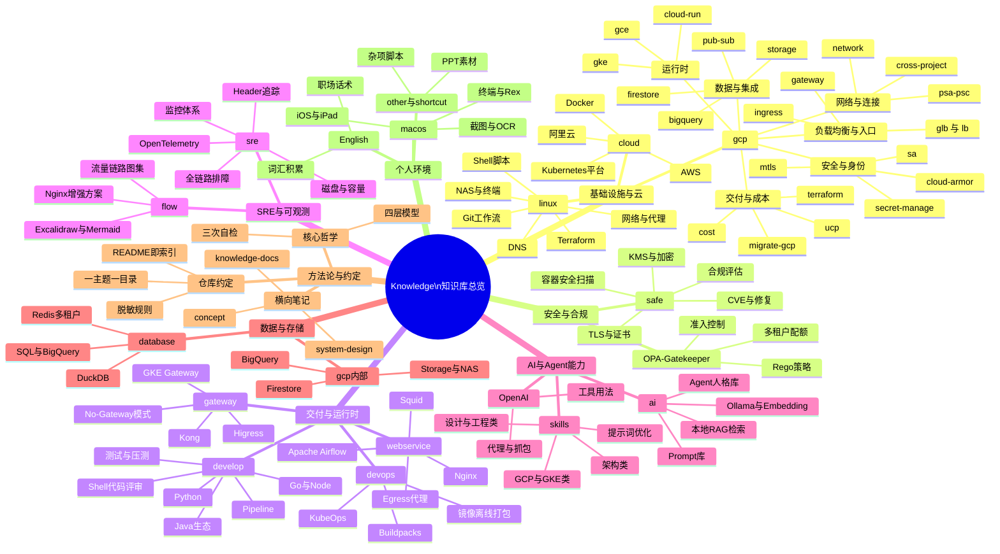

# Knowledge 知识库总览分析

Analyze the `knowledge/` repository structure and content. Categorize the top-level domains, explain what each one is for, and present the whole knowledge base as a Markdown document with a Mermaid mindmap.

本文档是整个 `~/git/knowledge` 知识库（**~9000 个 Markdown 文件**）的**导航图**。
它不重复任何一篇子文档的内容，只回答一个问题：**这个仓库每个目录到底是干什么的、该从哪读起。**

> **一句话结论**
> ★ 这是一个 **"从命令驱动到模型驱动"** 的个人工程知识库：主线是 **GCP / GKE / 网络 / 安全**，
> 辅线是 **应用开发 + SRE + AI Agent 能力沉淀**；
> 所有内容共用一套 **四层模型（Concept → Resource Model → Dependencies → Command）**
> 和 **三次自检（Position / Dependencies / Abstraction）** 的写法。

---

## 文档体系分析

| 顶层目录 | md 数 | 定位 |
|---|---:|---|
| `skills/` | 6643 | AI Agent Skill 定义（跨 10+ 个 AI 客户端目录分发） |
| `gcp/` | 938 | **绝对主线**：GCP 架构实战，40+ 子域 |
| `cloud/` | 343 | 多云（Ali / AWS）+ Docker + Kubernetes 平台 |
| `linux/` | 240 | DNS / 网络 / Shell / Git / Terraform / NAS |
| `develop/` | 232 | Java / Go / Node / Python / Pipeline / 测试 |
| `safe/` | 192 | **安全主线**：TLS / CVE / Cloud Armor / KMS / 合规 |
| `webservice/` | 163 | Nginx / Apache / Squid / Egress 代理 |
| `gateway/` | 87 | Kong / Higress / GKE Gateway / No-Gateway 模式 |
| `ai/` | 58 | Agent 人格库 + Prompt + 本地 RAG 检索 |
| `database/` | 49 | Redis / SQL / BigQuery 查询 |
| `OPA-Gatekeeper/` | 48 | 准入控制与策略即代码 |
| `sre/` | 39 | 排障方法论 / 监控 / Header 追踪 |
| `macos/` | 39 | 本机环境与终端工具 |
| `English/` | 35 | 英文词汇 + 职场话术模板 |
| `flow/` | 27 | **流量链路与架构图集** |
| `other/` | 18 | 杂项 + PPT + 已有 mindmap 范例 |
| `concept/` | 15 | 方法论（模型驱动、RFC） |
| `devops/` | 13 | Buildpacks / KubeOps / 镜像离线打包 |
| `OpenAI/` | 11 | AI 工具用法与 mTLS 验证 |
| `knowledge/docs/` | 8 | 系统设计权衡、pURL、Akamai 等横向笔记 |

---

## 知识点 MindMap



---

## 主要知识领域详解

### 1. 基础设施与云（主线，占仓库一半以上）

#### `gcp/` —— 绝对主线，40+ 子域
按"资源类型"而非"产品名"组织，每个子域都有 `README.md` 说明定位：

| 子域 | 定位 | 是否有独立 mindmap |
|---|---|---|
| `glb/` `lb/` `ingress/` | 负载均衡：GLB 类型选择、Backend Service、URL Map、Ingress Controller | `ingress/ingress-control-mindmap.md` |
| `mtls/` | 客户端证书、Trust Config、CA Onboarding | ✅ 本次生成 |
| `cloud-armor/` | WAF 策略、API 级隔离、优先级规划 | ✅ 本次生成 |
| `cross-project/` | 跨项目 PSC NEG、SNI/域名语义、Firewall 决策树 | ✅ 本次生成 |
| `psa-psc/` `network/` | PSA vs PSC、NEG、PSC Subnet 容量规划 | — |
| `asm/` | ASM / Istio / Ambient Mesh / Gloo | ✅ 本次生成 |
| `gke/` | 集群、节点池、升级、Gateway、蓝绿 | ✅ 本次生成 |
| `cloud-run/` `gce/` | Serverless、实例、MIG、静态 IP | — |
| `pub-sub/` `bigquery/` `firestore/` `storage/` | 数据与集成 | — |
| `ucp/` | Argo CD × GitHub Enterprise 统一控制面 | `ucp/argocd-mindmap.md` |
| `migrate-gcp/` `cost/` `terraform/` | 迁移、成本治理、IaC | — |

#### `cloud/` —— 多云对照 + 平台侧 K8s
- `ali/`：阿里云 K8s 集群迁移（POC、灰度、DNS 切换、ExternalName 代理方案）、MaxCompute、Logstore 加密。
- `aws/`：AWS CLI 与 S3 基本操作（轻量）。
- `docker/`：BYOC、multi-stage build、distroless、最小镜像、镜像生命周期与 prune。
- `k8s/`：**平台侧 K8s 运营手册**——HPA 公式推导、PDB 与升级冲突、NetworkPolicy 跨 namespace、
  探针最佳实践、Gateway API、镜像替换、标签规范、资源优化脚本。

#### `linux/` —— 基础设施的"底层手感"
DNS 解析链路（4 层）、正反向代理对比、NHF 固定出网 IP、Shell 脚本工程化（retry / source / 默认值）、
Git 工作流（rebase / CODEOWNERS / BFG）、Terraform 状态与轮询、QNAP NAS 上的 Docker 与 K3s。

### 2. 安全与合规

#### `safe/` —— 与 `gcp/mtls`、`gcp/cloud-armor` 高度互补
- **TLS 纵深**：`ssl/`（握手流程、truststore、SAN/SNI、Cipher Suites、GLB 证书管理）、
  `cert/`（DigiCert EKU 影响评估与迁移）。
- **CVE 闭环**：`cwe/`（CWE-16/287/319/326/798 等逐条 + Nginx 安全头）、
  `fix-cve/`（Dependabot、base image 受限、Argo CD 镜像重建、上游镜像持续维护）。
- **云上安全**：`gcp-safe/`（KMS 跨项目加解密 + 权限校验脚本）、`cyberflows/`（FOSS / SBOM / Sonar / Trivy / DAST / Checkmarx）、
  `how-to-fix-violation/`（检测 → 修复 → CI 集成）。
- **合规**：`Control-and-Compliance/`（GKE 安全基线、韧性评估）。

#### `OPA-Gatekeeper/`
准入控制三件套：Rego 策略语言、ConstraintTemplate/约束模板、GKE Policy Controller 落地；
含多租户资源配额与例外处理、OPA 报告 CronJob 设计。

### 3. 交付与运行时

| 目录 | 核心问题 |
|---|---|
| `gateway/` | Kong CP/DP 职责、插件与鉴权、GKE Gateway API、**No-Gateway 模式**（把版本控制与平滑切换做进网关） |
| `webservice/` | Nginx（L7/L4、buffering、TLS session、Ingress Controller）、Apache Airflow、Squid（能不能当 L4？）、Egress 代理架构 |
| `develop/` | Java（Spring Boot / JVM 调优 / Maven 依赖冲突 / HTTPS 证书验证）、Go / Node / Python 平台适配、CI/CD Pipeline、测试（9 类 API 测试 / 压测 / PLE / DR）、**Shell 脚本评审方法论** |
| `devops/` | Buildpacks / CNB、KubeOps Operator 范式、Docker 镜像离线打包 |

### 4. SRE 与可观测

- `sre/`：**方法论重于工具**——502 全链路调试、Header 多层追踪（Kong → Nginx → Runtime 三层语义）、
  监控体系（GKE 内存 / 代理磁盘 / 容量预测）、OpenTelemetry Operator、Support 话术模板。
- `flow/`：**流量链路图集**——外部/内部/公网入口三种 flow、L7-L4 请求流、
  Nginx 增强方案（金丝雀、平滑切 HTTPS）、Excalidraw 与 Mermaid 的取舍。

### 5. AI 与 Agent 能力

- `skills/`（6643 个 md，**注意**含 `.agents/`、`.claude/`、`.qwen/` 等 10+ 个客户端目录的**同源分发副本**，
  真正的技能源在 `skills/<name>/SKILL.md`，共 18 个）。
  能力域：架构（archify / architectrue / dark-architecture）、图（architecture-diagram）、
  设计与工程（design / engineering / testing）、GCP（GCP-expert / gcp / gke-basics / recipe-*）、
  提示词与效率（prompt-refiner / tokeneconomizer / eli5）、业务（marketing / product / ob / maitreya）。
- `ai/`：30+ 个 **Agent 人格**（设计/工程/营销/产品/项目管理/测试/运营）、
  Prompt 库（架构技术合作伙伴、SRE、PM）、本地知识库 RAG 检索系统（Ollama + embeddinggemma）。
- `OpenAI/`：工具用法、Cloudflare 直连策略、**GLB mTLS 上线前验证清单**。

### 6. 数据与存储

- `database/`：Redis 多租户（不同 DB index）、GKE 跨工程连 Redis、SQL/BigQuery 查询技巧与成本、DuckDB。
- `gcp/storage/`：ADR-009（Pod 挂 NAS）、ADR-011（Pod 跨项目访问 Bucket）、SMB/NFS/Bucket 三协议对照、PV/PVC 与 StorageClass。

### 7. 方法论与约定

这是整个仓库真正的"元知识"，写在 `README.md` 与 `AGENTS.md` 里：

**四层模型**
```
Concept → Resource Model → Dependencies → Command
```
> Command 不是设计工具，只是执行工具。

**三次自检**
1. **Position** —— 这个资源在架构的哪个位置？
2. **Dependencies** —— 它依赖哪些前置资源？
3. **Abstraction** —— 命令打的是哪一层 API（REST / Terraform / gcloud / Console）？

**仓库约定**
- 一主题一目录，每个目录一个 `README.md` 说明定位与检索方式。
- **脱敏规则（`AGENTS.md`）**：这是 **public** 仓库，项目号 / 团队代号 / 内部域名一律替换为
  `example-project`、`appteam`、`internal` 等占位符；路径也要改（`git mv`）；
  提交前用 `scripts/sanitize-check.sh` 自动阻断。
- 文档命名沿用 **编号前缀**（如 `01-`、`02-`）表示阅读顺序，`.md` 里保留 `Summary` `TL;DR` 习惯。

### 8. 个人环境

`macos/`（launchd / Apple Container / Rex 终端 Markdown 预览 / Kitty 图形协议 / OCR）、
`English/`（每日词汇积累 + 邮件/假期/绩效话术模板）、`other/`（PPT 素材、`pr-knowledge-mindmap.md` 范例）、
`shortcut/`、`gif/`、`md/`。

---

## 四条阅读路线

```
路线 1 · 第一次进这个仓库（30 分钟）
  README.md（哲学 + 结构）→ AGENTS.md（脱敏约定）→ best-practices/README.md（全仓导航）
  → 本文档

路线 2 · 想搞懂 GCP 平台主线（1 天）
  gcp/gcp-mindmap.md → gcp/ingress/ingress-control-mindmap.md
  → gcp/ucp/argocd-mindmap.md → gcp/cross-project/cross-project-mindmap.md

路线 3 · 想接一个 API 平台需求（半天）
  concept/docs/model-driven-thinking.md（方法论）
  → gcp/gke/gke-mindmap.md → gateway/gateway-mindmap.md
  → webservice/webservice-mindmap.md → sre/sre-mindmap.md

路线 4 · 只想找"某个命令/报错怎么解"（5 分钟）
  直接进对应目录的 `README.md` 快速检索表
  → gcp/*/README.md · safe/ssl/README.md · webservice/*/README.md
```

---

## 结论

1. **主线只有一个：GCP/GKE 上的企业级 API 平台**。`gcp/` `safe/` `gateway/` `webservice/` `sre/`
   五个目录反复在讲同一件事的不同切面——**公网 TLS 入口 → 跨项目 → 多租户网关 → 后端服务 → 可观测**。
2. **辅线是能力沉淀**：`skills/`（给 Agent 用的能力包）、`ai/`（人格与 Prompt）、
   `develop/`（应用侧落地）——它们服务的是同一条主线的"人机协作"面。
3. **风格极其统一**：几乎每篇都遵循
   `TL;DR → 事实基线 → 严格定义 vs 简化解释（双栏）→ 决策树/矩阵 → 实施步骤 → 验证与回滚`。
   这不是巧合，是 `concept/docs/model-driven-thinking.md` 那套方法论的落地。
4. **每个目录的 `README.md` 就是它的索引**，写"目录描述 / 目录结构 / 子目录说明 / 快速检索"四段式——
   所以本仓库的"文档地图"其实是**已经写好的**，只是没有被合成一张图。

---

## 本库 MindMap 索引

本仓库已生成的思维导图文档（全部沿用 `other/pr-knowledge-mindmap.md` 的结构）：

| 目录 | 思维导图 | 覆盖 |
|---|---|---|
| 全库 | [knowledge-mindmap.md](./knowledge-mindmap.md) | 顶层目录地图 + 方法论 |
| GCP | [gcp/gcp-mindmap.md](./gcp/gcp-mindmap.md) | 40+ 子域总览 |
| GCP · ASM/Istio | [gcp/asm/asm-mindmap.md](./gcp/asm/asm-mindmap.md) | Ambient Mesh 主线 |
| GCP · mTLS | [gcp/mtls/mtls-mindmap.md](./gcp/mtls/mtls-mindmap.md) | Trust Config / Onboarding |
| GCP · 跨项目 | [gcp/cross-project/cross-project-mindmap.md](./gcp/cross-project/cross-project-mindmap.md) | PSC NEG / SNI / Firewall |
| GCP · Cloud Armor | [gcp/cloud-armor/cloud-armor-mindmap.md](./gcp/cloud-armor/cloud-armor-mindmap.md) | 规则模型 / API 级隔离 |
| GCP · GKE | [gcp/gke/gke-mindmap.md](./gcp/gke/gke-mindmap.md) | 集群 / 升级 / 多租户 |
| GCP · Ingress | [gcp/ingress/ingress-control-mindmap.md](./gcp/ingress/ingress-control-mindmap.md) | Ingress Controller（既有） |
| GCP · UCP | [gcp/ucp/argocd-mindmap.md](./gcp/ucp/argocd-mindmap.md) | Argo CD（既有） |
| Cloud | [cloud/cloud-mindmap.md](./cloud/cloud-mindmap.md) | 阿里云 / AWS / Docker |
| Cloud · K8s | [cloud/k8s/k8s-mindmap.md](./cloud/k8s/k8s-mindmap.md) | HPA / PDB / NetworkPolicy / 探针 |
| Linux | [linux/linux-mindmap.md](./linux/linux-mindmap.md) | DNS / 网络 / Shell / Git |
| Develop | [develop/develop-mindmap.md](./develop/develop-mindmap.md) | Java / Pipeline / 测试 / Shell 评审 |
| Safe | [safe/safe-mindmap.md](./safe/safe-mindmap.md) | TLS / CWE / CVE 闭环 / 合规 |
| WebService | [webservice/webservice-mindmap.md](./webservice/webservice-mindmap.md) | Nginx / Squid / Egress |
| Gateway | [gateway/gateway-mindmap.md](./gateway/gateway-mindmap.md) | Kong / No-Gateway 模式 |
| Skills | [skills/skills-mindmap.md](./skills/skills-mindmap.md) | 18 个技能 + 多端分发 |
| AI | [ai/ai-mindmap.md](./ai/ai-mindmap.md) | Agent 人格 / Prompt / 本地 RAG |
| SRE | [sre/sre-mindmap.md](./sre/sre-mindmap.md) | 排障方法论 / Header 追踪 / 监控 |
| Database | [database/database-mindmap.md](./database/database-mindmap.md) | Redis 多租户 / SQL / BigQuery |
| OPA | [OPA-Gatekeeper/opa-gatekeeper-mindmap.md](./OPA-Gatekeeper/opa-gatekeeper-mindmap.md) | 准入控制 / 配额例外 |
| DevOps | [devops/devops-mindmap.md](./devops/devops-mindmap.md) | Operator 范式 / CNB / 离线打包 |
| Concept | [concept/concept-mindmap.md](./concept/concept-mindmap.md) | 方法论 / API 平台设计 |
| Flow | [flow/flow-mindmap.md](./flow/flow-mindmap.md) | 流量链路图 / Nginx 增强 |
| macOS | [macos/macos-mindmap.md](./macos/macos-mindmap.md) | 终端 / 截图 / 系统 |
| English | [English/english-mindmap.md](./English/english-mindmap.md) | 词汇机制 / 职场话术 |
| OpenAI | [OpenAI/openai-mindmap.md](./OpenAI/openai-mindmap.md) | GLB mTLS 验证 / 代理 |
| Other | [other/other-mindmap.md](./other/other-mindmap.md) | mindmap 范例 / 知识库管理 |

---

## 关联文档

- 仓库元信息：[README.md](./README.md) · [AGENTS.md](./AGENTS.md) · [best-practices/README.md](./best-practices/README.md)
- 方法论：[concept/docs/model-driven-thinking.md](./concept/docs/model-driven-thinking.md) ·
  [concept/docs/rfc.md](./concept/docs/rfc.md) ·
  [knowledge/docs/system-design-tradeoffs.md](./knowledge/docs/system-design-tradeoffs.md)
- 领域总览：[gcp/gcp-mindmap.md](./gcp/gcp-mindmap.md) ·
  [cloud/cloud-mindmap.md](./cloud/cloud-mindmap.md) ·
  [linux/linux-mindmap.md](./linux/linux-mindmap.md) ·
  [develop/develop-mindmap.md](./develop/develop-mindmap.md) ·
  [safe/safe-mindmap.md](./safe/safe-mindmap.md) ·
  [webservice/webservice-mindmap.md](./webservice/webservice-mindmap.md) ·
  [gateway/gateway-mindmap.md](./gateway/gateway-mindmap.md) ·
  [skills/skills-mindmap.md](./skills/skills-mindmap.md) ·
  [ai/ai-mindmap.md](./ai/ai-mindmap.md) ·
  [sre/sre-mindmap.md](./sre/sre-mindmap.md) ·
  [flow/flow-mindmap.md](./flow/flow-mindmap.md) ·
  [macos/macos-mindmap.md](./macos/macos-mindmap.md) ·
  [database/database-mindmap.md](./database/database-mindmap.md) ·
  [OPA-Gatekeeper/opa-gatekeeper-mindmap.md](./OPA-Gatekeeper/opa-gatekeeper-mindmap.md) ·
  [devops/devops-mindmap.md](./devops/devops-mindmap.md) ·
  [concept/concept-mindmap.md](./concept/concept-mindmap.md) ·
  [OpenAI/openai-mindmap.md](./OpenAI/openai-mindmap.md)
