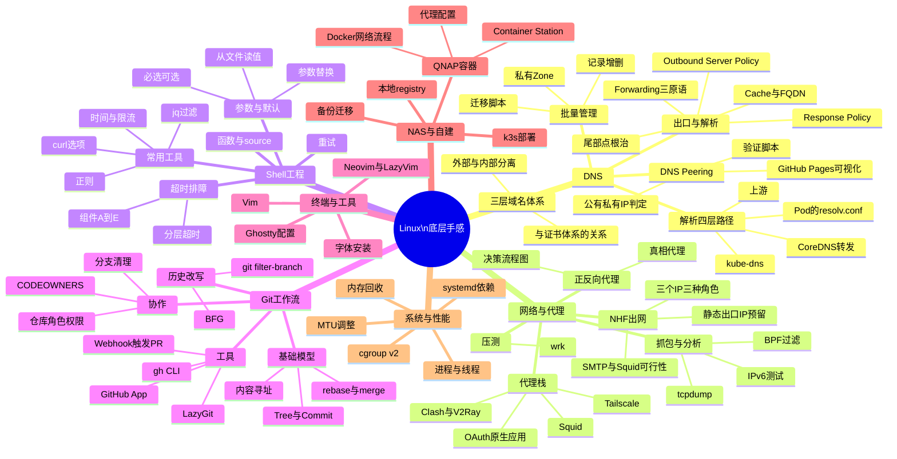

# Linux 知识点分析

Analyze the `linux/` knowledge base. Categorize the Linux / networking / shell / git documents by technical domain, summarize the key knowledge points, and present everything as a Markdown document with a Mermaid mindmap.

本文档覆盖 `linux/` 下的 **240 篇文档 / 17 个子目录**——这是全库
**"底层手感"** 的一层：DNS 到底怎么解析的、出网 IP 到底是哪个、Git 到底怎么 rebase 的。

> **一句话结论**
> ★ 这个目录的独特价值在于 **"把黑盒打开"**：
> DNS 解析画出**四层路径**、出网拆出**三个 IP 三种角色**、
> 正反向代理给出**决策流程图**、Git 用**三种视角**讲同一个 commit id。
> 它不是命令速查，而是**机制解释**。

---

## 文档体系分析

1. **DNS（最大子域，~55 篇）** — `dns/`、`dns/docs/`、`dns/dns-peering/`
2. **网络与代理** — `network/`（正反向代理、NHF 出网 IP、tcpdump、Squid、Tailscale）、`vpn/`
3. **Shell 脚本工程** — `shell-script/`、`scripts/`、`docs/`（curl/jq/regex/超时）
4. **Git 工作流** — `howgit/`（rebase、CODEOWNERS、BFG、gh CLI、LazyGit、GitHub App）
5. **Terraform** — `terrafrom/`（state 轮询、依赖销毁顺序、TLS role 403）
6. **终端与工具** — `Ghostty/`、`neovim/`、`vim/`、`ish/`、`tools/`
7. **NAS 与自建服务** — `nas/`（QNAP 上的 Docker / k3s / 本地 registry）
8. **系统与性能** — `docs/`（cgroup v2、systemd 依赖、MTU、限流、内存回收）

---

## 知识点 MindMap



---

## 主要知识领域详解

### 1. DNS（`linux/dns/`）—— 本目录最大的子域

#### 1.1 解析的四个层次
`docs/gke-dns-resolution-flow.md`：**GKE Pod 里的 DNS 有四层**——
Pod 的 `/etc/resolv.conf` → kube-dns/CoreDNS → 上游转发 → 权威。
配合 `docs/kube-dns.md`（递归配置与 `curl --resolve` 的区别）、
`docs/verify-kube-dns.md`（验证脚本）。

#### 1.2 三层域名体系
`docs/three-layer-domain-architecture.md` + `docs/external-internal-dns-separation.md`：
**外部域名与内部域名必须分离**，并分三层（外部 / 内部 / 平台），
同时说明**三层域名与证书体系的关系**——这一层没设计对，后面证书全要返工。

#### 1.3 Cloud DNS 三大原语
`docs/gcp-cloud-dns-forwarding.md`：**Cloud DNS 的三个原语**是什么、
"Applied to VPC" 到底什么意思；
`docs/gcp-cloud-dns-response-policy-explorer.md`：Response Policy（Wildcard Override、Pod 出口与 API 入口分流）；
`docs/gcp-cloud-dns-outbound-server-policy-explorer.md`：Outbound Server Policy
与 Alternative Name Servers 的三种类型。

#### 1.4 一个真实故障：缓存 + FQDN
`dns-cache-ttl-with-fqdn.md`：**GKE Java Pod 外部域名解析出错**的根因分析，
给出根治手段——**应用代码层强制尾部点 FQDN**。

#### 1.5 DNS Peering 工具链
`dns/dns-peering/`：`verify-pub-priv-ip.sh`（多 DNS 服务器解析 + 判断公有/私有 IP）、
Docker 版本、GitHub Pages 可视化页，以及一次 **IPv6 修复的 before/after 指标对照**。

### 2. 网络与代理（`linux/network/`）
- `forward-reverse/compare-and-migrate-reverse-to-forward.md`：
  **反向代理 vs 正向代理**——用"真相代理（Truth Proxy）"这个比喻讲清差异，
  并给出**迁移决策流程图**；
- `nhf-static-egress-ip.md`：**三个 IP，三种角色**（地基 / 出口 / 绑定对象），
  再讲怎么把 MIG 的出口 IP 固定成静态 IP；
- `nhf-egress-ip.md`：给 on-prem 邮件服务器授权白名单该填什么；
- `smtp-egress-nhf-squid-analysis.md`：**NHF 三层路由 + Squid 的可行性**（关卡 A/B/C）；
- `docs/`：tcpdump + BPF 过滤、IPv6 测试、OAuth2 原生应用（RFC 8252）+ 代理配置、
  `socat`、Domain Explorer、`curl-503.md`。

### 3. Shell 脚本工程（`linux/shell-script/`）
把"写脚本"变成"写可复用脚本"：
- `docs/default-value.md`：**参数替换三态**（给没设的变量默认值 / 可选参数 / 必选参数）+ 从文件读值；
- `docs/fun.md`：函数定义、返回值、作用域；
- `docs/source.md`：把环境变量抽到可 source 的脚本里；
- `docs/retry.md`：重试循环；
- `docs/cheatsheets-bash.md`：快捷键与历史。

`linux/docs/` 则是**命令语义手册**：curl 的每个选项、jq 过滤、
正则（`(?i)`、`^`、`(?!curl/)`）、HTTP 状态码、SSE 与 Streamable HTTP、
QUIC、MTU、`nc`、限流与内存回收。

### 4. Git 工作流（`linux/howgit/`）
- `How-to-understand-tree-id-and-commit-id.md`：**三种视角**看同一件事——
  Git 是**内容寻址的键值数据库**；
- `How-to-understand-git-pull-rebase.md`：引用 Pro Git 原文讲机制；
- `codeowners-guide.md`：**CODEOWNERS 决策表** + "生效规则比放哪里更容易翻车"；
- `github-repo-role-permissions.md`：Collaborator 5 档权限逐项核对；
- `docs/bfg.md`：BFG 替代 `git filter-branch`；
- `why-to-using-githubapps.md`：GitHub App vs OAuth App vs PAT vs Webhook——**actor / token / permission 三个轴**；
- `lazygit-guide.md`、`gh-user-guide.md`：工具实操。

### 5. Terraform（`linux/terrafrom/`）
- `docs/terrafrom-stat.md`：**Terraform 为什么轮询操作状态**、
  **Destroy 时资源间依赖导致失败**（先单独销毁有依赖的上层资源，再整体 destroy）；
- `docs/tls-role.md`：解决 `ServerTlsPolicy` 创建时的 **403 Permission Denied**；
- `docs/person-group.md.md`：把人/组找到 IAM 绑定的可视化定位流程。

### 6. 终端与自建（`Ghostty/`、`neovim/`、`nas/`）
- Ghostty 配置语法、Neovim + LazyVim 插件管理、字体安装；
- `nas/`：**QNAP Container Station 架构**、Docker 网络与代理配置、
  **k3s 部署与启动流程**、**本地私有 registry**、容器备份迁移。

### 7. 系统与性能（`linux/docs/`）
- `cgroup.md` / `Linux-control-group-v2.md`：**cgroup v2 检测与 Java OOM 日志分析**；
- `Linux-start-services.md`：**systemd 服务启动顺序与依赖管理**（`After`/`Requires`/`Wants`）；
- `mtu.md`、`tcp-large-send-offload.md`、`Networkmanager.md`（重启 NetworkManager 导致静态路由丢失）；
- `status-499.md`（Nginx 499）、`limit.md`（ulimit 与 Nginx）。

---

## 三条阅读路线

```
路线 A · 排查一个"域名解析不出来"（1 小时）
  dns/docs/gke-dns-resolution-flow.md → dns/docs/kube-dns.md
  → dns/docs/three-layer-domain-architecture.md
  → dns/dns-cache-ttl-with-fqdn.md → dns/dns-peering/README.md

路线 B · 搞清楚"我的流量从哪出去"（2 小时）
  network/forward-reverse/compare-and-migrate-reverse-to-forward.md
  → network/nhf-static-egress-ip.md → network/nhf-egress-ip.md
  → network/smtp-egress-nhf-squid-analysis.md

路线 C · 提效日常（1 小时）
  shell-script/docs/default-value.md → shell-script/docs/retry.md
  → howgit/How-to-understand-git-pull-rebase.md
  → howgit/codeowners-guide.md → howgit/lazygit-guide.md
```

---

## 结论

1. **这个目录最独特的是"解释机制"的写法**：DNS 四层、Git 三视角、
   代理"真相代理"比喻——它教你**为什么**，不是**敲什么**。
2. **DNS 是最值得深挖的子域**：三原语（Forwarding / Response Policy / Outbound Server Policy）
   + 三层域名体系 + 四层解析路径，构成一个完整的 DNS 心智模型。
3. **出网 IP 是多租户平台的隐形主角**：三个 IP 三种角色这层不分清，
   防火墙白名单、SMTP 发信、外部 IP 授权会全部出错。
4. **Shell 部分体现了一种工程态度**：参数默认值三态、函数、source、重试——
   让脚本可以被**别人复用**，而不是一次性产物。

---

## 关联文档

- [../knowledge-mindmap.md](../knowledge-mindmap.md) ·
  [../cloud/cloud-mindmap.md](../cloud/cloud-mindmap.md) ·
  [../webservice/webservice-mindmap.md](../webservice/webservice-mindmap.md) ·
  [../sre/sre-mindmap.md](../sre/sre-mindmap.md)
- [README.md](./README.md) ·
  [dns/README.md](./dns/README.md) ·
  [dns/docs/gke-dns-resolution-flow.md](./dns/docs/gke-dns-resolution-flow.md) ·
  [dns/docs/three-layer-domain-architecture.md](./dns/docs/three-layer-domain-architecture.md) ·
  [network/forward-reverse/compare-and-migrate-reverse-to-forward.md](./network/forward-reverse/compare-and-migrate-reverse-to-forward.md) ·
  [network/nhf-static-egress-ip.md](./network/nhf-static-egress-ip.md) ·
  [shell-script/docs/default-value.md](./shell-script/docs/default-value.md) ·
  [howgit/How-to-understand-git-pull-rebase.md](./howgit/How-to-understand-git-pull-rebase.md)
