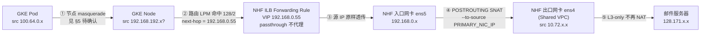

# NHF 出网源 IP 定位:给 on-prem 邮件服务器授权白名单该填什么

> **一句话结论**:你的理解**方向正确** —— 出局 IP 就是 NHF 组件在 Shared VPC 里的地址(形如 `10.72.x.x`),所以"填网段"在技术上是可行路径。但有三件事必须先处理:
> 1. **它不是一个固定值**。NHF 是 MIG 多实例 + 临时内网 IP,单 IP 白名单会**间歇性失败**。
> 2. **白名单不是全部**。企业侧还必须有一条**回程路由**能回到该网段,否则白名单加了也收不到回包。
> 3. **直接填 Shared VPC 整段会过宽授权**。该网段里还有别的资产(例如 `10.72.0.188` 的 L7 Nginx、`10.72.21.119` / `10.72.25.50` 的 https_proxy),它们会顺带获得进邮件服务器的权限。

---

## 1. 场景与问题

| 项 | 值 |
| --- | --- |
| 发起方 | GKE 业务 Pod,Private VPC,Pod CIDR `100.64.0.0/14`(128-bit) |
| 目标 | on-prem DRD 邮件服务器 `128.171.x.x`(企业内网数据中心) |
| 中间件 | NHF(Next-Hop Forwarder)MIG,双网卡 SNAT 转发集群,europe-west2 |
| 要产出 | 邮件服务器侧的**源 IP 白名单**条目 |

本仓库中该链路的权威描述见 `nhf-flow-enhance.html`(可视化)与 `~/git/gcp/linux/networking/nhf.md`(实现细节:路由表、防火墙三段、iptables 脚本)。本文档只回答"**填什么**",链路机制不重复。

---

## 2. 结论:出局 IP 是什么

**出局 IP = NHF 实例 Shared VPC 主网卡(ens4 / nic0)的内网 IP,形如 `10.72.x.x`。**

换句话说:填给邮件服务器的不是 Pod IP、不是 Node IP、也不是 ILB 的 VIP `192.168.0.55`,而是 **NHF 自己的 Shared VPC 地址**。

推导链条(逐跳,标注源 IP 在哪一跳被改写):



第 ② ③ 跳不改变源地址。GCP 静态路由的 `--next-hop-ilb` 下一跳指向**内部 passthrough Network Load Balancer** 的转发规则[3],而这种 LB 不终结客户端连接、不在中间做代理,原始包被直接转发给后端实例,因此**客户端源 IP 被保留**[1]。(这一点也正是本设计必须用 passthrough 而非 L7 ALB 的原因:NHF 自己做 SNAT 和 conntrack,需要拿到原始源地址。)

关键在第 ④ 跳。NHF 实例上的 iptables 规则(取自 `nhf.md` §4.4 `/opt/abj-nat.sh`):

```bash
PRIMARY_NIC_IP=$(curl -H "Metadata-Flavor: Google" \
                    http://metadata.google.internal/computeMetadata/v1/instance/network-interfaces/0/ip)

# NAT private-vpc ip to on-prem / shared-vpc 出口
iptables -t nat -A POSTROUTING -d 128.0.0.0/2 -o $primary_nic -j SNAT --to-source ${PRIMARY_NIC_IP}
iptables -t nat -A POSTROUTING -d 10.0.0.0/8  -o $primary_nic -j SNAT --to-source ${PRIMARY_NIC_IP}
```

**这条规则没有 `-s` 源地址匹配**,只匹配目的网段和出向网卡。因此不管进入 NHF 的是 Pod IP 还是 Node IP,出 ens4 时源地址一律被改写成该实例自己的 `nic0` 地址。`nhf.md` §6.2 的实机调试输出印证了这一点:

```
SNAT       all  --  anywhere             128.000.        to:10.72.24.254   # dev 环境实例
default via 10.72.0.1 dev ens4 proto dhcp src 10.72.24.254 metric 100
10.72.0.0/18 via 10.72.0.1 dev ens4 proto dhcp src 10.72.24.254 metric 100
```

→ dev 环境 NHF 实例的 ens4 地址是 `10.72.24.254`,所在 Shared VPC 子网是 `10.72.0.0/18`。

### 2.1 这个结论成立的前提(重要)

出局 IP 之所以是 `10.72.x.x`,**依赖于目的地址落在 `128.0.0.0/2` 或 `10.0.0.0/8` 这两个网段内**。已核验:

- `128.171.192.162 ∈ 128.0.0.0/2` ✅(`128.0.0.0/2` 覆盖 `128.0.0.0` ~ `191.255.255.255`)
- NHF 的两条 SNAT 规则正是按这两个目的网段写的

**如果将来目标改成这两个网段之外的地址**(例如 `52.x.x.x` 这样的真实公网 IP),NHF 的 SNAT 规则不匹配,源地址将**不会**被改写,出局 IP 会退化成 Pod IP 或 Node IP,白名单必须重做。写白名单前请先确认目标仍在 `128/2` 或 `10/8` 内。

---

## 3. 简化说法 vs 严格原话

> 遵循本仓库写作纪律:简化说法与严格原话分栏,主语限定词严格化。

| 简化说法 | 严格原话(可核对) |
| --- | --- |
| "出局 IP 是 10.72 段" | "到达 on-prem 邮件服务器的对端所观察到的源 IP,是 NHF MIG 中**处理该连接的那一台实例**的 Shared VPC 主网卡(nic0)内网地址,取值于该实例所在 Shared VPC 子网的主 IP 范围。" |
| "IP 会变" | "NHF 为 Managed Instance Group;组内实例的 nic0 地址默认为**临时(ephemeral)内网 IP**,在实例因 autoheal、滚动更新、缩容而被重建时**会重新分配**;同时 ILB 在健康实例之间分发连接,因此**不同连接可能从不同实例出网**。" |
| "加白名单就行" | "白名单是**单向准入**;要完成 TCP 握手,企业侧还须存在**回程路由**:从 `128.171.x.x` 回到 NHF ens4 所属网段,经由 Cloud Router 的 BGP 广告与办公网出口的转发路径可达 NHF 主网卡。" |
| "GCP 不封 25 端口" | "GCP 对**目的地址在本 VPC 之外**的 TCP/25 出站连接施加封锁;官方同时列明:**经 Cloud VPN 隧道或 Cloud Interconnect VLAN 连接到 VPC 的 on-premises 网络**,其目的地址的 TCP/25 连接**不受此封锁**(仍受防火墙规则约束)[5]。`128.171.x.x` 属 on-prem 目标,按此条应适用豁免;但因其**数值上落在公网地址空间**(在 `128/2` 内),仍须实测确认。" |
| "Pod 的 IP 被 NAT 掉了" | "在 NHF SNAT 之前,到达 NHF 入口网卡的源 IP 是**由 GKE 节点送出时的那个地址**(节点主 IP 或 Pod IP,取决于集群的 IP masquerade 配置,见 §5)。此点**不影响**最终出局 IP,因为 NHF 的 SNAT 规则不匹配源地址。" |

---

## 4. 三个必须处理的问题

### 4.1 【必做】单 IP 白名单会间歇性失败

原因有两层,叠加:

1. **ILB 在多实例间分发**。NHF 是 MIG,ILB 把连接轮转到各健康实例 → 不同连接从不同 `10.72.x.x` 出去。这一层不依赖 LB 类型:passthrough NLB 依据后端健康状态选转发目标[1]。
2. **实例 IP 是临时的**。实例被重建(autoheal / 滚动更新 / 缩容)→ nic0 重新分配 → **同一个"逻辑出口"的地址变了**。GCP 文档明确:stateful IP 地址机制正是为了保证 IP 在实例被 autoheal、update、recreate 时保持不变[6] —— 反过来说,非 stateful 的地址就会变。

**白名单必须覆盖一个网段或一组地址,不能是单个 IP。** 这一点正是 GCP 把 stateful IP 做成独立特性的原因[6] —— 官方承认默认地址是不稳定的。

可选做法,按推荐度排序:

| 方案 | 白名单填什么 | 优点 | 代价 |
| --- | --- | --- | --- |
| **A. 专用 subnet**(推荐) | 给 NHF ens4 单独开一个小 CIDR 子网,白名单只填这个子网 | 白名单稳定、粒度可控、与 MIG 规模解耦 | 需要在 Shared VPC 里新建子网 + 迁移 ens4,涉及 MIG 模板变更 |
| **B. 保留静态内网 IP** | MIG 启用 `--stateful-internal-ip`,实例重建后地址不变[6];白名单填这批固定地址 | 粒度最细、可审计 | **有状态 MIG 不能配 autoscaler**[6];且需要逐实例分配地址 |
| **C. 直接填现有 Shared VPC 子网** | 填 `10.72.0.0/18` | 零改动、立即可用 | **过宽授权**:同段其它资产(见 §1 结论)顺带获得权限;段内地址变化超出该段时仍会漏 |

> 方案 B 的官方限制原文:"You cannot use autoscaling if your MIG has stateful configuration."[6]
> 方案 B 的 gcloud 语法见 §7.3。

### 4.2 【必做】回程路由:白名单是单向的

邮件服务器在 `128.171.x.x`,它回包时目的地是 NHF 的 `10.72.x.x`。这条回程必须存在,链路是:

```
邮件服务器 128.171.x.x
  └─(企业网路由)→ 办公网出口
       └─(企业出口 → Shared VPC 的 Cloud Router / VPN / Interconnect,BGP 学到 10.72.0.0/18)
            └─→ NHF ens4 (10.72.x.x)
                 └─(Linux conntrack 反向还原 dst = Pod IP / Node IP)
                      └─→ ens5 → ILB → GKE Node → Pod
```

需要说明的是,GCP 侧的 Cloud NAT 是**独立的托管服务**[7],本场景的地址转换由 NHF 实例自己的 iptables 完成,两者不是一回事 —— 企业侧不需要、也不应该去 Cloud NAT 上找这个地址。

`nhf.md` §4.5 对此有明确表述:

> SNAT 后对端看到的源 IP 是 NHF 的 Shared VPC IP(`10.72.x.x`),所以**回程是直接送到 NHF 主 NIC**。

同时 NHF 侧的 conntrack 表项有超时(TCP 通常数分钟到数十分钟),长连接(如大附件邮件投递)需要在业务侧留意超时。passthrough NLB 的后端回包走 direct server return、不经过 LB 本身[1],所以这条超时完全由 NHF 本机的 conntrack 决定。

**行动项**:找企业网络侧确认 `10.72.0.0/18` 已被 BGP 广告到办公网,且办公网出口到 `128.171.x.x` 的路径上不会对该网段做二次 NAT。

### 4.3 【建议】确认企业出口不会二次 NAT

`nhf.md` 的设计是 **L3-only 外部收口**:办公网出口只做路由 / 审计 / 限速,不做第二次地址转换。回程"直接送到 NHF 主 NIC"这一表述,与"办公网侧不对该网段再 NAT"是自洽的。

但这一点是**外部系统的行为**,文档不能替代实测。GCP 侧的 Cloud NAT 只对配置覆盖的子网生效[7],不会在本场景里额外再翻译一次;真正的风险在企业网络设备那一侧。**以邮件服务器侧观察到的源 IP 为准**(见 §7.4),而不是以本文档为准。

---

## 5. 待确认项(不改代码,但影响排查思路)

`nhf.md` §4.3(b) 的 NHF 入口防火墙规则:

```
tt-xxxxxx-projectgw-gkepods-a-i-nhf
  direction: INGRESS
  source_ranges: [192.168.192.0/22, 192.168.128.0/18]   # 节点 CIDR + 老 Pod CIDR
  rules: TCP 0-65535
```

注意 `source_ranges` 里**没有**新 Pod CIDR `100.64.0.0/14`。同时 `nhf.md` §6.2 显示 NHF 实例上有 `100.64.0.0/10 via 192.168.0.1 dev ens5` 这条路由,§6.3 解释该路由是为"Pod 的回程"准备的。

这两处放在一起,指向一个需要现场核对的点:**到达 NHF 入口的源 IP 到底是 Pod IP 还是 Node IP?**

| 若集群配置为 | 到达 NHF 的源 IP | 是否命中上面那条防火墙规则 |
| --- | --- | --- |
| 默认 masquerade(源 IP 改为节点 IP) | `192.168.192.x` | ✅ 命中 `192.168.192.0/22` |
| 保留 Pod IP(`nonMasqueradeCIDRs` 自定义含 `128/2`,或集群带 `--disable-default-snat`) | `100.64.0.x` | ❌ **不命中**,该规则未包含 `100.64.0.0/14` → 流量在 GCP 防火墙被丢弃 |

**这一项不影响最终出局 IP**(SNAT 规则不匹配源地址),但直接决定"邮件发不出去"时该往哪查:是查节点 masquerade 还是查 NHF 入口防火墙。§7.2 给出核对命令。

---

## 6. 与相邻文档的关系

| 文档 | 覆盖范围 | 与本文的关系 |
| --- | --- | --- |
| `nhf-flow-enhance.html` | NHF 出网机制与流量链路全景(可视化) | 本文的链路图来源 |
| `smtp-egress-nhf-squid-analysis.md` | GKE **公网**发邮件:Squid 能力边界 | 讲的是**公网**邮件服务商(gmail / office365)。那些 IP 不在 `128/2` 内,走不通 NHF。**本文讲的是 on-prem 邮件服务器(`128.171.x.x`),结论相反** —— 目标在 `128/2` 内,正好走 NHF |
| `snat-Masquerade.md` | Pod / Node / Service 三类 IP 的出站特性与 VPC 路由围栏 | §5 待确认项的展开 |
| `~/git/gcp/linux/networking/nhf.md` | NHF 路由表、防火墙三段、iptables 脚本(权威实现) | 本文 §2 的规则出处 |

---

## 7. 验证命令

### 7.1 定位当前实际的出局 IP 集合

```bash
# 1) 列出 NHF MIG 的实例与状态
gcloud compute instance-groups managed list-instances <NHF_MIG> \
  --project=<HOST_PROJECT> --region=europe-west2 \
  --format="table(name,instanceStatus,id)"

# 2) 取每个实例 nic0(ens4 / Shared VPC)的内网 IP —— 这就是 SNAT 后的源地址集合
gcloud compute instances list --project=<HOST_PROJECT> \
  --filter="name~<NHF_MIG>" \
  --format="table(name,zone,networkInterfaces[0].networkIP,networkInterfaces[1].networkIP)"

# 3) 确认 ens4 所在 Shared VPC 子网的 CIDR —— 白名单网段应从这里取
gcloud compute networks subnets list --project=<HOST_PROJECT> \
  --filter="network:<SHARED_VPC> AND ipCidrRange:10.72.0.0/18" \
  --format="table(name,region,ipCidrRange,purpose,stackType)"
```

### 7.2 核对 §5 的 masquerade 待确认项

```bash
# 集群是否禁用了默认 SNAT
gcloud container clusters describe <CLUSTER> --region europe-west2 \
  --format="value(networkConfig.defaultSnatStatus)"

# ip-masq-agent 的 nonMasqueradeCIDRs(自定义列表会覆盖默认列表)
kubectl -n kube-system get cm ip-masq-agent -o yaml | grep -A 20 nonMasqueradeCIDRs

# 节点上实际的 masquerade 规则
kubectl -n kube-system exec -it <NODE> -- sudo iptables -t nat -S | grep -i masq
```

### 7.3 方案 B:把 MIG 的内网 IP 变成 stateful

```bash
# 先看当前 stateful 配置
gcloud compute instance-groups managed describe <NHF_MIG> \
  --project=<HOST_PROJECT> --region=europe-west2 \
  --format="value(statefulPolicy)"

# 为 nic0 启用 stateful 内网 IP(会保留现有临时地址)
gcloud compute instance-groups managed update <NHF_MIG> \
  --project=<HOST_PROJECT> --region=europe-west2 \
  --stateful-internal-ip interface-name=nic0,auto-delete=on-permanent-instance-deletion
```

> ⚠️ 官方限制:**有状态 MIG 不能配 autoscaler**。当前 NHF 是否依赖自动扩缩,需先确认。
> ⚠️ 该命令会改变 MIG 的 per-instance 配置,属于**生产变更**,执行前需走变更评审。

### 7.4 【决定性】在 NHF 上抓包,直接看到白名单要填的值

这是唯一能一锤定音的验证 —— 抓到的源地址就是邮件服务器看到的值:

```bash
# 在 NHF 实例上,按目标邮件服务器过滤(只抓 ens4,SNAT 之后的出口面)
sudo tcpdump -i ens4 -nn 'dst <MAIL_SERVER_IP> and tcp port 25'

# 同时在 GKE Pod 上发起一次投递
kubectl exec -it <POD> -n <NS> -- \
  timeout 20 bash -c 'cat < /dev/null > /dev/tcp/<MAIL_SERVER_IP>/25'
```

预期输出形态:

```
12:04:31.882041 IP 10.72.24.254.51234 > 128.171.x.x.25: Flags [S], seq 1234, ...
                        ^^^^^^^^^^^^^^^ 这就是白名单要填的地址
```

### 7.5 在邮件服务器侧交叉验证

以最终权威为准 —— **看邮件服务器自己的日志里记录的客户端地址**:

| 邮件服务器 | 查法 |
| --- | --- |
| Postfix | `grep <发件方域名> /var/log/mail.log`,或看 `Received:` 头里最外层的 `from` |
| Exim | `/var/log/exim/mainlog` 里的 client IP 字段 |
| 通用 | 连接日志 / 防火墙会话日志 |

### 7.6 回程可达性

```bash
# 在 NHF 实例上确认出向路由与 SNAT 规则
ip route get <MAIL_SERVER_IP>
sudo iptables -t nat -L POSTROUTING -n -v
sudo conntrack -L 2>/dev/null | grep <MAIL_SERVER_IP>

# 从 Pod 侧验证 TCP 握手能否完成(而非仅 SYN 有去无回)
kubectl exec -it <POD> -n <NS> -- \
  timeout 20 bash -c 'cat < /dev/null > /dev/tcp/<MAIL_SERVER_IP>/25' && echo "TCP OK"
```

---

## 8. 权威证据 / 最终定型依据

### 8.1 GCP 官方原文

**① ILB 是 passthrough,不改写客户端源 IP** —— 决定"到达 NHF 时源 IP 是什么":[1]

> Unlike a proxy load balancer, an internal passthrough Network Load Balancer doesn't terminate connections from clients and then open new connections to backends. Instead, an internal passthrough Network Load Balancer routes connections directly from clients to eligible backends, without a proxy between the clients and backends.

> You need to forward the original packets unproxied. For example, if you need the client source IP address to be preserved.

**② 路由 next-hop 指向内部 passthrough NLB** —— 决定 Pod 流量如何进入 NHF:[3]

> `--next-hop-ilb= FORWARDING_RULE and --next-hop-ilb-region= REGION` : deliver packets to an internal passthrough Network Load Balancer.

**③ 内部 passthrough NLB 的健康检查探针源段** —— 与 `nhf.md` 中 `35.191.0.0/16` 的 mangle 规则吻合,可据此反查 ILB 类型:[2]

> Internal passthrough Network Load Balancers using one of the following backends: - Instance groups - Zonal NEGs with `GCE_VM_IP` endpoints | For IPv4 health checks to the backends: - `35.191.0.0/16`

**④ GKE 默认 non-masquerade 目的网段** —— 决定 §5 的判断分支:[4]

> The default non-masquerade destination are: 10.0.0.0/8 172.16.0.0/12 192.168.0.0/16 100.64.0.0/10 192.0.0.0/24 192.0.2.0/24 192.88.99.0/24 198.18.0.0/15 198.51.100.0/24 203.0.113.0/24 240.0.0.0/4

> GKE changes source Pod IP addresses to source node IP addresses for packets sent to destinations outside of the default non-masquerade destinations.

`128.171.x.x` 不在上列任何一段内 → 默认行为下源 IP 会被改成节点 IP[4]。ip-masq-agent 自身的默认行为与此一致:未开启 `nomasq-all-reserved-ranges` 时,只把 RFC 1918 三段当作不伪装目的段[8]。

**⑤ TCP/25 封锁的适用范围与 on-prem 豁免** —— 决定端口是否可行:[5]

> Due to the risk of abuse, connections to destination TCP Port 25 are blocked when the destination is external to your VPC network.

> Note: Subject to Google Cloud firewall rules, connections to destination TCP Port 25 are allowed within your VPC network, a VPC connected using VPC Network Peering, or an on-premises network connected to your VPC network using Cloud VPN tunnels or Cloud Interconnect attachments (VLANs).

**⑥ stateful MIG 的 IP 保持能力与 autoscaler 限制** —— 决定 §4.1 方案 B 可行性:[6]

> By configuring stateful IP addresses in a managed instance group (MIG), you ensure that IP addresses are preserved when VM instances in the group are autohealed, updated, and recreated.

> For existing instances, the MIG promotes in-use ephemeral internal or external IP addresses to static addresses by reserving the corresponding static IP addresses.

> You cannot use autoscaling if your MIG has stateful configuration.

**⑦ Cloud NAT 是独立的托管 NAT 服务** —— 说明"托管 NAT"与"自建 iptables NAT"是两套机制,NHF 用的是后者:[7]

> Cloud NAT provides network address translation (NAT) for outbound traffic to the internet, Virtual Private Cloud (VPC) networks, on-premises networks, and other cloud provider networks.

**⑧ ip-masq-agent 默认只把 RFC1918 当作不伪装目的段** —— 与 [4] 相互印证:[8]

> When `false`, the agent will masquerade to every destination except the ranges reserved by RFC 1918 (namely `10.0.0.0/8`, `172.16.0.0/12`, and `192.168.0.0/16`).

### 8.2 内部资料

- **`~/git/gcp/linux/networking/nhf.md`** —— NHF 权威实现文档。本文引用的路由表(`128.0.0.0/2` / `10.0.0.0/8` → next-hop `192.168.0.55`)、防火墙三段规则、`/opt/abj-nat.sh` 的 SNAT 片段、§6.2 实机调试输出,均出自该文档。

### 8.3 本文档的核验方式

| 结论 | 核验手段 |
| --- | --- |
| `128.171.192.162 ∈ 128.0.0.0/2` | `ipaddress` 模块计算验证 |
| `10.72.0.0/18` 覆盖 `10.72.24.254` | `ipaddress` 模块计算验证 |
| `128.171.x.x` 不在任何默认 non-masquerade 网段内 | 逐段比对 11 个默认网段,全部为 `False` |
| NHF SNAT 规则不匹配源地址 | 读 `/opt/abj-nat.sh` 规则串,无 `-s` 参数 |
| 出局 IP 实际取值 | **尚未实测** —— 见 §7.4 的 tcpdump 步骤,这是本文档唯一需要现场补齐的证据 |

---

## 9. 交付给邮件服务器侧的一句话

> 出网源地址落在 GCP Shared VPC 子网 `10.72.0.0/18` 内(取自 NHF 转发集群的主网卡地址),该地址在实例重建时会重新分配,**因此请按网段而非单个 IP 授权**。同时请贵侧确认到 `10.72.0.0/18` 的回程路由已就位(经办公网出口与云端 BGP 学到的路由),否则单向放通无法完成握手。

---

## 相关文档

- [`nhf-flow-enhance.html`](./nhf-flow-enhance.html) —— NHF 出网机制与流量链路全景(架构图)
- [`smtp-egress-nhf-squid-analysis.md`](./smtp-egress-nhf-squid-analysis.md) —— GKE **公网**发邮件的可行性(与本文场景相反)
- [`snat-Masquerade.md`](./snat-Masquerade.md) —— Pod / Node / Service 出站特性与 VPC 路由围栏
- `~/git/gcp/linux/networking/nhf.md` —— NHF 实现细节(路由表 / 防火墙 / iptables 脚本)

---

## Sources

[1] https://docs.cloud.google.com/load-balancing/docs/internal — Internal passthrough Network Load Balancer overview
    > "Unlike a proxy load balancer, an internal passthrough Network Load Balancer doesn't terminate connections from clients and then open new connections to backends."
    > "You need to forward the original packets unproxied. For example, if you need the client source IP address to be preserved."
[2] https://docs.cloud.google.com/load-balancing/docs/health-check-concepts — Health checks overview (probe IP ranges)
    > "Internal passthrough Network Load Balancers using one of the following backends: - Instance groups - Zonal NEGs with `GCE_VM_IP` endpoints | For IPv4 health checks to the backends: - `35.191.0.0/16`"
[3] https://docs.cloud.google.com/vpc/docs/using-routes — VPC
    > "--next-hop-ilb= FORWARDING_RULE and --next-hop-ilb-region= REGION : deliver packets to an internal passthrough Network Load Balancer ."
[4] https://docs.cloud.google.com/kubernetes-engine/docs/concepts/ip-masquerade-agent — GKE
    > "The default non-masquerade destination are: 10.0.0.0/8 172.16.0.0/12 192.168.0.0/16 100.64.0.0/10 192.0.0.0/24 192.0.2.0/24 192.88.99.0/24 198.18.0.0/15 198.51.100.0/24 203.0.113.0/24 240.0.0.0/4"
    > "GKE changes source Pod IP addresses to source node IP addresses for packets sent to destinations outside of the default non-masquerade destinations."
[5] https://docs.cloud.google.com/compute/docs/tutorials/sending-mail — Compute Engine
    > "Due to the risk of abuse, connections to destination TCP Port 25 are blocked when the destination is external to your VPC network."
    > "Subject to Google Cloud firewall rules, connections to destination TCP Port 25 are allowed within your VPC network, a VPC connected using VPC Network Peering, or an on-premises network connected to your VPC network using Cloud VPN tunnels or Cloud Interconnect attachments (VLANs)."
[6] https://docs.cloud.google.com/compute/docs/instance-groups/configuring-stateful-ip-addresses-in-migs — Configuring stateful IP addresses in MIGs
    > "You cannot use autoscaling if your MIG has stateful configuration."
    > "By configuring stateful IP addresses in a managed instance group (MIG) , you ensure that IP addresses are preserved when VM instances in the group are autohealed, updated, and recreated."
[7] https://docs.cloud.google.com/nat/docs/overview — Cloud NAT overview
    > "Cloud NAT provides network address translation (NAT) for outbound traffic to the internet, Virtual Private Cloud (VPC) networks, on-premises networks, and other cloud provider networks."
[8] https://github.com/kubernetes-sigs/ip-masq-agent — kubernetes-sigs/ip-masq-agent
    > "When false, the agent will masquerade to every destination except the ranges reserved by RFC 1918 (namely 10.0.0.0/8, 172.16.0.0/12, and 192.168.0.0/16)."
