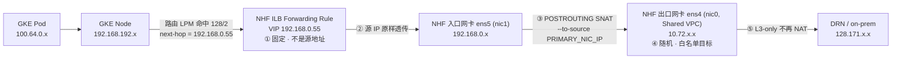

# NHF 出口 IP 固定化:预留静态 IP 并绑定到 MIG 实例

> **一句话结论**:能做,而且**比"新建专用小网段"更好** —— 因为你不能在 Shared VPC 里另开子网段,但**可以在现有子网里预留静态内网 IP**。做法是:**预留 N 个静态 IP,再用 per-instance config 把每个 IP 钉到对应 MIG 实例上**。
> 1. **白名单 = 一份固定的 IP 清单**(例如 4 个),精确到单个 IP,不是网段 —— 这正是你要的效果。
> 2. **不需要改任何路由**:预留的 IP 仍在 `10.72.0.0/18` 内,Cloud Router 已经在广告这个网段,**回程路由天然可用**。这是相对"换子网"方案的最大优势。
> 3. **不需要改任何脚本**:`abj-nat.sh` 的 `PRIMARY_NIC_IP` 从 metadata 取 `network-interfaces/0/ip`,实例拿到静态 IP 后它自动就是那个静态 IP。
> 4. **代价**:stateful 配置与 autoscaler 互斥(GCP 官方限制)。你已明确实例数 ≤ 4 → 改成固定 size、删掉 autoscaler 即可。
> 5. **ILB 的 VIP 与此无关**:它本来就固定,且从不作为源地址出现(见 §3)。但 FR 默认 IP 是 ephemeral、不可原地改,建议顺手预留加固(§3.2)。
> 6. **最关键的一条运维纪律**:MIG 的实例数**永远不得超过已绑定 IP 的数量** —— 多出来的实例会拿到随机临时 IP,它的出网会被对端白名单拒绝。

---

## 1. 问题与前提

### 1.1 你的需求(复述)

- NHF = 跑在 GCP Shared VPC 的一个 **MIG**,双网卡 + iptables 做 L3 NAT 转发。
- GKE 通过静态路由(`128.0.0.0/2`、`10.0.0.0/8` → next-hop = NHF ILB Forwarding Rule)把流量交给 NHF,NHF SNAT 后从 Shared VPC 出口访问公司内部 DRN 网络。
- **你补充的关键约束**:
  - `10.72.x.x` 取自**公司内部的 Shared VPC 网络**,属于既有共享网段;
  - **我们不能另外划出一个专用的小网段**(子网/路由由公司网络侧统一管控);
  - **但我们可以在 Shared VPC 的现有子网里申请并预留静态 IP** —— 提前创建、预留出来,没有问题;
  - **NHF 实例数量明确不会超过 4 个**,所以可以先申请 4 个 IP;
  - **核心诉求**:DRN 侧真正识别到的应当就是**这批我们自己申请的静态 IP**,把这几个 IP 提供给对端,才能构成一份**精确的白名单**。
- 动机:GKE Pod 出网到外部网络时,对端看到的源 IP 范围太大(`10.72.0.0/18`,还混着无关资产),做目的地白名单不好处理。

### 1.2 既有资料定位

| 文档 | 覆盖范围 | 与本文关系 |
| --- | --- | --- |
| `nhf-egress-ip.md`(同目录) | **出局 IP 是什么**、白名单填什么、回程路由 | **本文的前置结论**,不重复 |
| `~/git/gcp/linux/networking/nhf.md` | NHF 权威实现:路由表、防火墙三段、`/opt/abj-nat.sh` | **本文的脚本依据** |
| `nhf-flow-enhance.html` / `nhf-flow.html` | NHF 出网链路全景可视化 | 链路图来源 |
| `gcp/gce/stateful-mig-and-autoscaling.md` | **stateful MIG 与 autoscaling 的概念、互斥原因、命令速查** | 本文 §5/§6 的平台能力依据 |
| `snat-Masquerade.md` | Pod / Node / Service 三类 IP 的出站特性与围栏 | 补充背景 |
| `smtp-egress-nhf-squid-analysis.md` | GKE 公网发邮件(Squid 边界) | 场景不同,结论相反 |

---

## 2. NHF 链路回顾(精简版)



决定出局 IP 的只有这一条规则(`nh.md` §4.4 / `/opt/abj-nat.sh`):

```bash
PRIMARY_NIC_IP=$(curl -H "Metadata-Flavor: Google" \
                    http://metadata.google.internal/computeMetadata/v1/instance/network-interfaces/0/ip)

iptables -t nat -A POSTROUTING -d 128.0.0.0/2 -o $primary_nic -j SNAT --to-source ${PRIMARY_NIC_IP}
iptables -t nat -A POSTROUTING -d 10.0.0.0/8  -o $primary_nic -j SNAT --to-source ${PRIMARY_NIC_IP}
```

**关键推论**:`PRIMARY_NIC_IP` 来自 metadata,**是实例 nic0 的当前地址**。所以 —— **只要让 nic0 拿到固定地址,SNAT 的源地址自动固定,脚本一个字都不用改。**

---

## 3. 三个 IP,三种角色(地基,必须先分清)

| # | 地址 | 谁分配 | 会变吗 | 是白名单要填的吗 |
| --- | --- | --- | --- | --- |
| ① | ILB Forwarding Rule VIP `192.168.0.55` | GCP(FR 资源持有) | **不随实例变**;仅 FR 删除重建可能变(默认 ephemeral) | ❌ **不是** |
| ② | 到达 NHF 入口时的源 IP | 节点 masquerade 决定 | 与本议题无关 | ❌ 不是 |
| ③ | SNAT 后 `10.72.x.x` | GCP 从 Shared VPC 子网分配 | **会变**(实例重建即变) | ✅ **就是它** |

### 3.1 为什么 ILB VIP 固定了也没用

internal passthrough NLB **不终结连接、不代理**,原始包直接转给后端,**客户端源地址被保留**:

> "Unlike a proxy load balancer, an internal passthrough Network Load Balancer doesn't terminate connections from clients and then open new connections to backends. Instead, an internal passthrough Network Load Balancer routes connections directly from clients to eligible backends, without a proxy between the clients and backends."[1]

→ ILB 的 VIP 在整条链路上**从不作为源地址出现**。DRN 看到的源地址 100% 由 §2 的 SNAT 规则决定。**固定 ILB VIP 对白名单毫无贡献。**

### 3.2 ILB VIP 的真实风险(与白名单无关,但该管)

`nhf.md` §4.2 的路由表把 next-hop 写死为 `192.168.0.55`,而 internal forwarding rule 的 IP **不指定时由 GCP 分配 ephemeral 地址**,且**不可原地修改**(只能删了重建)[2][3]。

→ **FR 被删除重建的那一天,`192.168.0.55` 可能不再存在,路由 next-hop 悬空,`128/2` 与 `10/8` 的出网全断。**

**处置(与白名单无关的独立加固项,建议顺手做):** 预留一个静态内网 IP 并挂给 FR,重建时复用同一地址。

---

## 4. 关键约束:为什么"新建专用子网"这条路走不通

在补充信息之前,本文推荐的是「给 ens4 单开一个 `/29` 专用子网」。**你的补充信息否掉了这条路**:

| 换专用子网需要 | 你的现实 |
| --- | --- |
| 在 Shared VPC host project 新建子网 | ❌ 子网由公司网络侧统一管控,未必批准 |
| Cloud Router 广告新网段(可能需改 custom advertisement) | ❌ 变更生产路由,审批成本高 |
| 办公网侧放行新网段 + 确认回程可达 | ❌ 需要企业网络侧配合,周期长 |

**而"在现有子网内预留静态 IP"完全绕开了这三条** —— 因为预留地址仍然落在 `10.72.0.0/18` 内:

- Cloud Router 已经在广告 `10.72.0.0/18` → **回程路由不需要任何改动**;
- 防火墙规则按目的网段匹配(`128/2`、`10/8`),不按源 IP → **不需要改动**;
- `abj-nat.sh` 读 metadata → **不需要改动**;
- 子网本身**不需要新建**。

> **结论:预留静态 IP 的方案,变更面比换子网小一个数量级。**

---

## 5. 能力边界:预留 + 绑定

| 机制 | 能固定什么 | 关键限制 |
| --- | --- | --- |
| **预留静态内网 IP**(`compute addresses create`) | 把地址从动态分配池取出,锁定归属 | 只是"占住",不会自动到实例上 |
| **per-instance config**(`instance-configs create --stateful-internal-ip=address=`) | **把指定的静态 IP 钉到指定的 MIG 实例** | 按**实例名**绑定;实例重建时按名重放 |
| **statefulPolicy(组级)**(`--stateful-internal-ip=interface-name=nic0`) | 组内**所有**实例的 nic0 变 stateful;现有临时地址**原地提升为静态** | 自动分配,不指定具体地址 |
| **autoscaler** | — | ❌ **与 stateful 配置互斥** |

> 官方原文(stateful MIG 限制):
> "A MIG with stateful configuration — a stateful MIG — has the following limitations: **You cannot use autoscaling if your MIG has stateful configuration.**"[4]

**关于"现有临时地址原地提升为静态"**:

> "For existing instances, the MIG promotes in-use ephemeral internal or external IP addresses to static addresses by **reserving the corresponding static IP addresses**."[4]

→ **这是零中断迁移的关键**:组级 statefulPolicy 一开,当前实例正在用的 `10.72.24.254` 这类地址**地址不变**,只是从"临时"变成"静态预留"。

---

## 6. 推荐方案:预留 N 个静态 IP + 绑定到实例

### 6.1 该申请几个 IP?

**建议:稳态实例数上限 + 1 个备用 = 5 个**(你的稳态上限是 4)。

| 用途 | 数量 | 说明 |
| --- | --- | --- |
| 在用实例 | 4 | 每个实例绑定一个,构成白名单主体 |
| 备用 | 1 | 实例被**永久删除**或需要人工换机时,把备用地址绑定到新实例,白名单清单不必变更 |

**为什么必须留备用**:per-instance config 按**实例名**绑定。实例一旦被永久删除,绑定关系消失;此时新实例若没有绑定,会拿到随机临时 IP → 出网被对端拒绝。备用地址就是这种时刻的接力棒。

**白名单口径建议**:**把 5 个(含备用)全部提供给对端**。多授权 1 个不使用的地址,代价远小于因地址缺口导致出网中断。

> ⚠️ 另一个易被忽略的约束:**MIG 的实例数永远不得超过已绑定地址的数量。** 多出的实例拿不到绑定地址 → 随机 IP → 出网被拒。详见 §6.4。

### 6.2 迁移路径(分三步,可零中断)

#### 第 0 步:取基线

```bash
HOST_PROJECT=<SHARED_VPC_HOST_PROJECT>
SERVICE_PROJECT=<NHF_MIG 所在项目>
REGION=europe-west2

# 当前每个实例的 nic0(ens4)= 出局源地址;nic1(ens5)= ILB 后端
gcloud compute instances list --project=$SERVICE_PROJECT \
  --filter="name~<NHF_MIG>" \
  --format="table(name,zone,networkInterfaces[0].networkIP,networkInterfaces[1].networkIP)"

# 出口网卡所在子网(确认是哪个 shared subnet)
gcloud compute networks subnets list --project=$HOST_PROJECT \
  --filter="network:<SHARED_VPC>" \
  --format="table(name,region,ipCidrRange,purpose)"

# 确认 autoscaler 是否存在(stateful 与它互斥,必须先看清楚)
gcloud compute instance-groups managed describe <NHF_MIG> \
  --project=$SERVICE_PROJECT --region=$REGION \
  --format="value(autoscaler)"
```

#### 第 1 步:把"当前正在用的地址"固化为静态(零中断)

组级 statefulPolicy 会把在用临时地址原地提升为静态 —— **地址不变,业务无感**:

```bash
gcloud compute instance-groups managed update <NHF_MIG> \
  --project=$SERVICE_PROJECT --region=$REGION \
  --stateful-internal-ip=interface-name=nic0,auto-delete=never
```

> `auto-delete=never`:实例被永久删除时**保留**预留记录。这正是我们要的 —— 白名单清单不能因为一次删机而失效。

> ⚠️ **执行前必须先处理 autoscaler**:若上一步查出 MIG 配了 autoscaler,官方明确不允许 stateful + autoscaling 共存。处置:
> ```bash
> gcloud compute instance-groups managed delete-autoscaler <NHF_MIG> \
>   --project=$SERVICE_PROJECT --region=$REGION
> # 然后用固定 size 管理规模
> gcloud compute instance-groups managed resize <NHF_MIG> \
>   --project=$SERVICE_PROJECT --region=$REGION --size=4
> ```
> 若你确实需要弹性伸缩,只能放弃"地址固定"这一诉求(地址会随新实例漂移)——**二选一,不能都要**。

**这一步做完,白名单就可以立即提交了** —— 当前实例的 4 个地址已经是静态预留的,不会因 autoheal / 滚动更新而变。

#### 第 2 步:显式绑定,让地址在重建后也钉得住

第 1 步靠的是"MIG 记住这个实例原来的地址"。但**按名字**的绑定更可控、更可审计:

```bash
# 逐实例绑定(地址即第 1 步固化的那批)
gcloud compute instance-groups managed instance-configs create <NHF_MIG> \
  --project=$SERVICE_PROJECT --region=$REGION \
  --instance=<INSTANCE_NAME> \
  --stateful-internal-ip=address=10.72.x.y,interface-name=nic0,auto-delete=never
```

**这一步的机制**:per-instance config 以**实例名**为键存储;实例被 autoheal / 更新 / 重建后,MIG 按名重放该配置,把同一个地址重新绑上去。[5]

> 官方示例形态:"To create a per-instance config with a stateful internal IP 192.168.0.10 … on instance my-instance, run: `gcloud compute instance-groups managed instance-configs create my-group --instance=my-instance --stateful-internal-ip=address=192.168.0.10`"[5]

#### 第 3 步(可选):补足备用地址

```bash
# 在现有 shared subnet 内预留一个备用静态 IP
gcloud compute addresses create nhf-egress-ip-spare \
  --project=$HOST_PROJECT --region=$REGION \
  --subnet=<SHARED_SUBNET> \
  --addresses=10.72.x.z
```

需要人工换机时,把备用地址绑到新实例名即可,白名单清单不变。

### 6.3 Shared VPC 里的地址预留:在哪个项目操作

这是 Shared VPC 特有的一个坑,官方有明确规定:

> "Service Project Admins can reserve an internal IPv4 or IPv6 address in a subnet of a Shared VPC network. **The IP address configuration object is created in the service project, while its value comes from the range of available IPv4 addresses in the shared subnet.**"[6]

两种做法都成立,**但地址资源的归属项目不同,清理责任也不同**:

| 做法 | 命令 | 地址对象归属 | 适合 |
| --- | --- | --- | --- |
| **在 host project 预留** | `--project=HOST --subnet=<SHARED_SUBNET>` | host project | 网络团队统一管控子网与地址池 |
| **在 service project 预留** | `--project=SERVICE --subnet=projects/HOST/regions/REGION/subnetworks/<SHARED_SUBNET>` | service project | 由 NHF 业务侧自主管理,随业务生命周期 |

> service project 侧操作前,先用 `subnetworks.listUsable` 查可用地址范围(以 service project 身份请求 host project 的共享子网):
> ```
> GET https://compute.googleapis.com/compute/v1/projects/HOST_PROJECT_ID/aggregated/subnetworks/listUsable
> ```

**建议**:既然是 NHF 业务团队自己管理的一组固定出口地址,**在 service project 预留**更合适 —— 业务下线时地址随业务一起清理,不需要去找网络团队。

### 6.4 运维纪律(照做就不会出事)

| 纪律 | 原因 |
| --- | --- |
| **MIG size ≤ 已绑定地址数** | 超出部分拿不到绑定 → 随机临时 IP → 出网被对端拒绝 |
| **扩容前先预留 + 绑定新地址,再更新对端白名单** | 顺序反了会出现一段"新实例出网被拒"的窗口 |
| **滚动更新用 `recreate` 而非 `substitute`** | `recreate` 保留实例名 → per-instance config 按名重放 → **地址不变**;`substitute` 换新名 → 绑定关系丢失 → 地址漂移 |
| **滚动更新避免 `maxSurge=1`** | surge 会临时多出一个**无绑定的实例**(新名字),它的随机 IP 不在白名单里 → 部分连接被拒。宁可 `maxSurge=0, maxUnavailable=1`,用"少一台健康后端"换取"地址不漂移" |
| **regional MIG 必须关闭 proactive redistribution** | 它**默认开启**,会为均衡 AZ 分布而**主动删除实例** → 连带销毁 stateful 绑定 → 白名单出现空洞。详见 §6.5.1 |
| **不要手工删实例**,要用 MIG 自身的缩容流程 | 手工删除会绕过 per-instance config 的保留逻辑 |
| **保留 `auto-delete=never`** | 实例永久删除时预留不释放,白名单清单始终有效 |
| **变更是滚动进行的** | 每次替换会断该实例上的长连接(conntrack 随实例消失),大附件邮件投递要避开窗口 |

### 6.5 滚动更新的正确参数

```bash
gcloud compute instance-groups managed set-instance-template <NHF_MIG> \
  --project=$SERVICE_PROJECT --region=$REGION \
  --template=<NEW_TEMPLATE> \
  --instance-redistribution-type=NONE \
  --update-policy=most-disruptive-allowed-action=REPLACE,\
max-surge=0,max-unavailable=1,\
replacement-method=RECREATE
```

- `replacement-method=RECREATE` → 保留实例名 → 绑定关系与地址都保住;
- `max-surge=0` → 不产生无绑定的临时实例;
- `max-unavailable=1` → 同一时刻少一台健康后端,ILB 会把流量分给其余 3 台。**容量前提:4 台里有 1 台不可用时,剩余 3 台能扛住峰值出网量。**
- `instance-redistribution-type=NONE` → 见 §6.5.1。

### 6.5.1 【必做】regional MIG 关闭 proactive redistribution

NHF 是 **regional MIG**,而 regional MIG **默认开启 proactive redistribution**:

> "Proactive instance redistribution is turned on by default for regional MIGs."[12]
> "Turning off proactive instance redistribution is useful if you need to: […] **Protect VMs with stateful workloads from unwanted automatic deletion due to proactive redistribution.**"[12]

它会为了**让各 AZ 的实例数均匀**而主动删除并重建多出来的实例 —— 对普通 MIG 是好事,对 stateful MIG 则是**删掉的正是你绑定好的那台** → 地址预留被释放 → 白名单出现空洞。

官方对此有明确限制:

> "For stateful regional MIGs, you must disable proactive redistribution (set the redistribution type to NONE) to prevent deletion of instances with stateful workloads."[13]

**处置**:

```bash
gcloud compute instance-groups managed update <NHF_MIG> \
  --project=$SERVICE_PROJECT --region=$REGION \
  --instance-redistribution-type=NONE
```

> 注:官方说明,非 autoscaled 的 regional MIG(或 mode 为 `OFF` / `ONLY_SCALE_OUT` 的 autoscaled MIG)用普通 `regionInstanceGroupManagers.patch` 即可;**mode 为 `ON` 的 autoscaled regional MIG 需要走 beta 端点**。NHF 删掉 autoscaler 后用普通 `update` 即可。

---

## 7. 为什么"单个 IP"在多实例 MIG 上做不到

**核心约束**:SNAT 的源地址必须由**持有 conntrack 表项的那台实例自己**持有。

- SNAT 目标 = 本机 nic0 地址 → 天然随实例漂移(现状)。
- SNAT 目标 = 一个不属于任何实例的预留地址 → **回程无处可去**:GCP 内部没有 NIC 持有它,去往该地址的包不会被投递到任何主机。
- SNAT 目标 = 别的实例持有的地址 → **回包送错主机**:conntrack 表在发包实例上,回包送到另一台查不到会话 → 连接中断。

> 严格原话:NHF 的回程依赖 Linux conntrack 在**同一台实例**上把 dst 还原为原始 Pod IP(`nhf.md` §4.5)。**该设计的正确性前提是"源地址与持有 conntrack 的实例是同一台机器"** —— 一旦 SNAT 源地址跨实例,前提不成立。

**"单个 IP"的唯一实现路径**是把 NAT 状态收敛到一个点:

| 路径 | 做法 | 代价 |
| --- | --- | --- |
| C-1 单实例 + 预留静态 IP | 放弃 MIG,改单 VM;重建后 re-attach 同一 address | 失去多 AZ HA;NHF 挂了全断 |
| C-2 托管 Private NAT | 用 `purpose=PRIVATE_NAT` 子网的 NAT 地址替代自建 iptables | 不支持 auto mode VPC;**仅 TCP/UDP**;要重做回程路由与 GCP 侧收口模型 |

> Private NAT 官方原文:"Private NAT enables private-to-private NAT between VPC networks or between VPC and on-premises or other cloud provider networks."[7]
> "Private NAT doesn't support auto mode Virtual Private Cloud (VPC) networks. […] Private NAT supports only TCP and UDP. ICMP and other protocols aren't supported."[8]

**建议**:除非"必须恰好 1 个 IP"是硬性合规要求(例如对方系统只允许单条白名单条目),否则**用 4~5 个固定 IP 的清单**。这在绝大多数对端系统里完全够用,且保留了全部 HA 特性。

> 💡 如果对方系统确实只吃一条白名单:另一种取巧是**让对端按 4~5 条放行**,或对 4~5 个 IP 做**一条聚合的 CIDR**(如 `10.72.x.240/29`)—— 后者仍比 `10.72.0.0/18` 精确得多,且**不需要新建子网**,只是一个白名单写法。这通常比改造整个架构划算。

---

## 8. 验证方法

### 8.1 改之前 / 改之后的基线对照

```bash
# A) 每个实例的 nic0 当前地址 —— 这就是白名单要填的值
gcloud compute instances list --project=$SERVICE_PROJECT \
  --filter="name~<NHF_MIG>" \
  --format="table(name,zone,networkInterfaces[0].networkIP,networkInterfaces[1].networkIP)"

# B) 组级 statefulPolicy 已生效
gcloud compute instance-groups managed describe <NHF_MIG> \
  --project=$SERVICE_PROJECT --region=$REGION \
  --format="yaml(statefulPolicy)"

# C) 每个实例的 per-instance 绑定
gcloud compute instance-groups managed instance-configs list <NHF_MIG> \
  --project=$SERVICE_PROJECT --region=$REGION \
  --format="table(name,preservedStateFromConfig)"

# D) 预留地址清单(白名单的权威来源)
gcloud compute addresses list --project=$HOST_PROJECT --region=$REGION \
  --filter="name~nhf-egress" \
  --format="table(name,address,status,subnetwork,users)"

# E) autoscaler 确认已删除
gcloud compute instance-groups managed describe <NHF_MIG> \
  --project=$SERVICE_PROJECT --region=$REGION \
  --format="value(autoscaler)"

# F) ILB FR 当前 IP 与归属(加固项)
gcloud compute forwarding-rules describe <NHF_FR> \
  --project=$SERVICE_PROJECT --region=$REGION \
  --format="yaml(network,subnetwork,IPAddress,loadBalancingScheme,IPProtocol)"
```

### 8.2 【决定性】在 NHF 上抓包,直接看到对端看到的源地址

抓到的源地址就是白名单要填的值:

```bash
# 在 NHF 实例上,只抓 ens4(SNAT 之后的出口面)
sudo tcpdump -i ens4 -nn 'dst <DRN_TARGET_IP> and tcp port <PORT>'

# 同时从 Pod 发起一次连接
kubectl exec -it <POD> -n <NS> -- \
  timeout 20 bash -c 'cat < /dev/null > /dev/tcp/<DRN_TARGET_IP>/<PORT>'
```

预期:

```
10.72.x.y.51234 > 128.171.x.x.25: Flags [S], seq 1234, ...
                  ^^^^^^^^^^^ 白名单要填的值
```

> **注意**:不同连接可能落在不同实例上,所以要**多次触发**并抓多个包,确认出现的是**预留的那几个地址**,而不是随机临时 IP。**这一步同时验证了 §6.4 的"实例数 ≤ 绑定地址数"纪律是否被遵守。**

### 8.3 回程可达性

```bash
# NHF 实例上:出向路由与 SNAT 规则是否仍匹配
ip route get <DRN_TARGET_IP>
sudo iptables -t nat -L POSTROUTING -n -v
sudo conntrack -L 2>/dev/null | grep <DRN_TARGET_IP>

# 从 Pod 侧确认 TCP 握手能完成(而非只有 SYN 没回包)
kubectl exec -it <POD> -n <NS> -- \
  timeout 20 bash -c 'cat < /dev/null > /dev/tcp/<DRN_TARGET_IP>/<PORT>' && echo "TCP OK"
```

> 因为预留地址仍在 `10.72.0.0/18` 内,**回程路由不需要任何改动** —— 但仍建议实测一次,确认企业侧对该网段的 BGP 学习与转发无二次 NAT(见 `nhf-egress-ip.md` §4.3)。

---

## 9. 简化说法 vs 严格原话

> 遵循本仓库写作纪律:简化说法与严格原话分栏,主语限定词严格化。

| 简化说法 | 严格原话(可核对) |
| --- | --- |
| "预留静态 IP 后,地址就是固定的" | "Reserving an internal IP address takes that address out of the dynamic allocation pool and prevents it from being used for automatic allocations. […] With the ability to reserve static internal IP addresses, you can always use the same IP address for the same resource even if you have to delete and re-create the resource."[9] |
| "地址会钉在实例上" | "By configuring stateful IP addresses in a managed instance group (MIG), you ensure that IP addresses are preserved when VM instances in the group are autohealed, updated, and recreated."[4] |
| "开 stateful 不会改地址" | "For existing instances, the MIG promotes in-use ephemeral internal or external IP addresses to static addresses by reserving the corresponding static IP addresses."[4] |
| "fixed 和 autoscaling 不能共存" | "You cannot use autoscaling if your MIG has stateful configuration."[4] |
| "不用改路由" | "预留的静态内网 IP 取自既有共享子网的地址范围,因此该地址仍落在 Cloud Router 已广告的 `10.72.0.0/18` 内;回程路由的可达性不因地址预留而改变。"(**架构推导**,见 §4) |
| "不用改脚本" | "`PRIMARY_NIC_IP` 取自 metadata 的 `network-interfaces/0/ip`,即实例 nic0 的当前地址;该地址成为静态预留地址后,SNAT 规则的源地址随之固定,规则本身无需变更。" |
| "单个 IP 做不到" | "NHF 的回程依赖 Linux conntrack 在同一台实例上把 dst 还原为原始 Pod IP;因此 SNAT 的源地址必须由持有该 conntrack 表项的实例自身持有。"(**架构推导**,见 §7) |

---

## 10. 待确认项(需要现场补齐)

| # | 待确认 | 为什么重要 | 怎么查 |
| --- | --- | --- | --- |
| 1 | **NHF MIG 是否配了 autoscaler** | 与 stateful 互斥,决定是否要先删 autoscaler | §6.2 命令 |
| 2 | **MIG 当前 size 与稳态上限** | 决定预留几个 IP(建议 = 上限 + 1) | `describe` 的 `targetSize` |
| 3 | **各实例当前的 nic0 地址** | 第 1 步固化的对象,也是白名单清单初稿 | §6.2 命令 |
| 4 | **静态内部 IP 的配额** | 预留 5 个地址是否超配额(部分项目静态内网 IP 配额默认很低甚至为 0) | `gcloud compute regions describe $REGION --format="value(quotas)"` |
| 5 | **在哪个项目预留地址** | 决定地址资源归属与清理责任 | §6.3 决策 |
| 6 | **实例名是否稳定**(`recreate` 是否为现行更新方式) | 决定 per-instance 绑定在滚动更新后是否还成立 | `describe` 的 `updatePolicy` |
| 7 | **扩容流程与责任人** | 新增实例前必须先绑定地址并更新白名单 | 流程约定 |
| 8 | **对端白名单的条目形式** | 是否支持多条 / 是否支持 CIDR 聚合 | 问 DRN 侧 |
| 9 | **ILB FR 的 IP 当前是静态预留还是 ephemeral** | 决定是否补做 §3.2 的加固 | §8.1 命令 F |

---

## 11. 决策树

```
你能不能在 Shared VPC 里新建一个专用小网段?
│
├─ 能 ────► 换子网 + 白名单填 /29(仍需改 BGP,审批成本高)
│            ★ 若网络侧配合度高,这条也能走,但见下方"推荐"
│
└─ 不能(你的情况)
      │
      └─► 预留 N 个静态 IP + per-instance config 绑定  ★推荐
            ├─ N = 稳态上限 + 1 备用(= 5)
            ├─ 第 1 步:组级 statefulPolicy 固化现有地址(零中断)
            ├─ 第 2 步:per-instance config 显式绑定(抗重建)
            ├─ 删 autoscaler → 固定 size
            └─ 白名单 = 这 N 个 IP 的清单 ──► 提供给 DRN

附带的两个独立加固项(与白名单无关):
  · ILB FR 预留静态 IP,防 FR 重建导致 next-hop 漂移(§3.2)
  · 滚动更新改用 recreate + max-surge=0(§6.5)
```

---

## 12. 权威证据 / 最终定型依据

### 12.1 GCP 官方原文

**① Internal passthrough NLB 不代理、不改写客户端源 IP** —— 决定"ILB VIP 与出口源地址无关":[1]

> Unlike a proxy load balancer, an internal passthrough Network Load Balancer doesn't terminate connections from clients and then open new connections to backends. Instead, an internal passthrough Network Load Balancer routes connections directly from clients to eligible backends, without a proxy between the clients and backends.

**② Forwarding rule 的 IP 地址不能改;不指定则分配 ephemeral 地址** —— 决定 §3.2 的加固项:[2][3]

> Otherwise, you can optionally specify an IP address that references an existing static (reserved) IP address resource. When omitted, Google Cloud assigns an ephemeral IP address.

> After creating a forwarding rule, you can make limited changes to it. For example, after a forwarding rule is defined, you can't change its IP address, port number, or protocol.

**③ Stateful MIG 保地址 / 原地提升 / 禁止 autoscaling** —— 决定 §5、§6.2 的能力与代价:[4]

> By configuring stateful IP addresses in a managed instance group (MIG), you ensure that IP addresses are preserved when VM instances in the group are autohealed, updated, and recreated.

> For existing instances, the MIG promotes in-use ephemeral internal or external IP addresses to static addresses by reserving the corresponding static IP addresses.

> You cannot use autoscaling if your MIG has stateful configuration.

**④ Per-instance config 可绑定指定地址** —— 决定 §6.2 第 2 步的语法:[5]

> To create a per-instance config with a stateful internal IP 192.168.0.10 … on instance my-instance, run: `gcloud compute instance-groups managed instance-configs create my-group --instance=my-instance --stateful-internal-ip=address=192.168.0.10`

**⑤ Shared VPC 中地址归属的官方规定** —— 决定 §6.3:[6]

> Service Project Admins can reserve an internal IPv4 or IPv6 address in a subnet of a Shared VPC network. The IP address configuration object is created in the service project, while its value comes from the range of available IPv4 addresses in the shared subnet.

**⑥ 预留地址的语义** —— 决定"地址锁定归属、删除重建后可复用":[9]

> Reserving an internal IP address takes that address out of the dynamic allocation pool and prevents it from being used for automatic allocations. […] With the ability to reserve static internal IP addresses, you can always use the same IP address for the same resource even if you have to delete and re-create the resource.

**⑦ Private NAT 的能力与限制** —— 决定 §7 的 C-2 评估:[7][8]

> Private NAT enables private-to-private NAT between VPC networks or between VPC and on-premises or other cloud provider networks.

> Private NAT doesn't support auto mode Virtual Private Cloud (VPC) networks. […] Private NAT supports only TCP and UDP. ICMP and other protocols aren't supported.

### 12.2 内部资料

- **`~/git/gcp/linux/networking/nhf.md`** —— NHF 权威实现文档。§4.2 路由表(next-hop `192.168.0.55`)、§4.4 `/opt/abj-nat.sh` 的 SNAT 片段、§4.5 回程依赖 conntrack、§6.2 实机调试输出(`10.72.24.254` / `10.72.0.0/18`),均出自该文档。
- **`linux/network/nhf-egress-ip.md`** —— 出局 IP 定位结论、白名单口径、回程路由要求、现状网段里的其它资产清单。

### 12.3 本文档的核验方式

| 结论 | 核验手段 |
| --- | --- |
| 出局源 IP = 实例 nic0 地址,与 ILB VIP 无关 | 读 `abj-nat.sh`:`--to-source ${PRIMARY_NIC_IP}`,`PRIMARY_NIC_IP` 取自 metadata 的 `network-interfaces/0/ip` |
| ILB 不改写源 IP | 引用 GCP 官方 passthrough NLB 文档原文[1] |
| Forwarding rule IP 默认 ephemeral 且不可改 | 引用 GCP 官方 forwarding rule 文档原文[2][3] |
| stateful MIG 保地址 / 原地提升 / 禁 autoscaling | 引用 GCP 官方 stateful IP 文档原文[4] |
| per-instance config 可绑定指定地址 | 引用 GCP 官方 gcloud 参考文档原文[5] |
| Shared VPC 地址归属规则 | 引用 GCP 官方 Shared VPC 预配文档原文[6] |
| **预留地址不需要改路由 / 不需要改脚本** | **架构推导** —— 基于 `nhf.md` §4.2 路由表(LPM 命中 `128/2`、next-hop 不随源 IP 变化)与 §4.4 的 metadata 取址方式;**尚未实测**,见 §8.2 |
| **单 IP 在多实例 MIG 上不可达** | **架构推导** —— 基于 `nhf.md` §4.5 的 conntrack 回程机制;**尚未实测反例** |
| 静态内网 IP 配额 | **未核实**,见 §10 第 4 项 |

---

## 13. 给白名单申请方的一句话

> NHF 的出网源地址取自 NHF 转发实例的 Shared VPC 主网卡。我们已在 GCP Shared VPC 内**预留了固定的静态内网 IP,并将其绑定到各转发实例**,实例重建、扩缩容与滚动更新后地址均保持不变。**请按以下 IP 清单进行白名单授权(逐条列出,不含网段)**:
>
> ```
> 10.72.x.y     # NHF 转发实例 1(在用)
> 10.72.x.y     # NHF 转发实例 2(在用)
> 10.72.x.y     # NHF 转发实例 3(在用)
> 10.72.x.y     # NHF 转发实例 4(在用)
> 10.72.x.y     # 备用地址(预留,用于实例替换时保持清单不变)
> ```
>
> 这些地址均位于既有共享网段 `10.72.0.0/18` 内,**回程路由无需变更**。请同时确认贵侧到该网段的回程路径可达且不做二次 NAT。若贵侧系统仅支持单条白名单,可将上述地址按 `10.72.x.x/29` 形式聚合 —— 该范围仅含 NHF 自身地址,与共享网段的其余资产无关。

---

## 相关文档

- [`nhf-egress-ip.md`](./nhf-egress-ip.md) —— NHF 出网源 IP 定位:白名单填什么(本文的前置结论)
- [`gcp/gce/stateful-mig-and-autoscaling.md`](../../gcp/gce/stateful-mig-and-autoscaling.md) —— **stateful 与 autoscaling 两个概念的详解**,以及"为什么 stateful 正好能解决静态 IP 问题"的因果链;本文 §5/§6 的取舍依据在此
- [`gcp/gce/mig-static-ip-options.md`](../../gcp/gce/mig-static-ip-options.md) —— **让 MIG/Instance 获得静态 IP 的全路径评估**(双网卡 MIG 按网卡固定、7 条路径对比、UIG 评估);本文 §6.5.1 的 redistribution 要求出自此
- [`nhf-flow-enhance.html`](./nhf-flow-enhance.html) —— NHF 出网机制与流量链路全景(架构图)
- [`nhf-flow.html`](./nhf-flow.html) —— NHF 链路图(基础版)
- [`snat-Masquerade.md`](./snat-Masquerade.md) —— Pod / Node / Service 出站特性与 VPC 路由围栏
- [`smtp-egress-nhf-squid-analysis.md`](./smtp-egress-nhf-squid-analysis.md) —— GKE 公网出网发邮件的可行性(与本文场景相反)
- `~/git/gcp/linux/networking/nhf.md` —— NHF 实现细节(路由表 / 防火墙 / iptables 脚本)

---

## Sources

[1] https://cloud.google.com/load-balancing/docs/internal — Internal passthrough Network Load Balancer overview
    > "Unlike a proxy load balancer, an internal passthrough Network Load Balancer doesn't terminate connections from clients and then open new connections to backends. Instead, an internal passthrough Network Load Balancer routes connections directly from clients to eligible backends, without a proxy between the clients and backends."

[2] https://cloud.google.com/load-balancing/docs/forwarding-rule-concepts — Forwarding rules overview
    > "after a forwarding rule is defined, you can't change its IP address, port number, or protocol."

[3] https://cloud.google.com/compute/docs/reference/rest/v1/forwardingRules — ForwardingRule API
    > "Otherwise, you can optionally specify an IP address that references an existing static (reserved) IP address resource. When omitted, Google Cloud assigns an ephemeral IP address."

[4] https://cloud.google.com/compute/docs/instance-groups/configuring-stateful-ip-addresses-in-migs — Configuring stateful IP addresses in MIGs
    > "By configuring stateful IP addresses in a managed instance group (MIG), you ensure that IP addresses are preserved when VM instances in the group are autohealed, updated, and recreated." / "For existing instances, the MIG promotes in-use ephemeral internal or external IP addresses to static addresses by reserving the corresponding static IP addresses." / "You cannot use autoscaling if your MIG has stateful configuration."

[5] https://cloud.google.com/sdk/gcloud/reference/compute/instance-groups/managed/instance-configs/create — gcloud compute instance-groups managed instance-configs create
    > "To create a per-instance config with a stateful internal IP 192.168.0.10 and a stateful external IP reserved in address my-address, on instance my-instance, run: gcloud compute instance-groups managed instance-configs create my-group --instance=my-instance --stateful-internal-ip=address=192.168.0.10"

[6] https://cloud.google.com/vpc/docs/provisioning-shared-vpc — Provision Shared VPC
    > "Service Project Admins can reserve an internal IPv4 or IPv6 address in a subnet of a Shared VPC network. The IP address configuration object is created in the service project, while its value comes from the range of available IPv4 addresses in the shared subnet."

[7] https://cloud.google.com/nat/docs/private-nat — Private NAT
    > "Private NAT enables private-to-private NAT between VPC networks or between VPC and on-premises or other cloud provider networks."

[8] https://cloud.google.com/nat/docs/private-nat — Private NAT specifications
    > "Private NAT doesn't support auto mode Virtual Private Cloud (VPC) networks." / "Private NAT supports only TCP and UDP. ICMP and other protocols aren't supported."

[9] https://cloud.google.com/vpc/docs/reserve-static-internal-ip-address — Reserve a static internal IP address
    > "Reserving an internal IP address takes that address out of the dynamic allocation pool and prevents it from being used for automatic allocations." / "With the ability to reserve static internal IP addresses, you can always use the same IP address for the same resource even if you have to delete and re-create the resource."

[12] https://cloud.google.com/compute/docs/instance-groups/regional-mig-enable-disable-proactive-redistribution — Disable and re-enable proactive VM redistribution in a regional MIG
    > "Proactive instance redistribution is turned on by default for regional MIGs." / "Turning off proactive instance redistribution is useful if you need to: … Protect VMs with stateful workloads from unwanted automatic deletion due to proactive redistribution."

[13] https://cloud.google.com/compute/docs/instance-groups/configuring-stateful-disks-in-migs — Configuring stateful persistent disks in MIGs (Limitations)
    > "You cannot use autoscaling if your MIG has stateful configuration. If you want to use automated rolling updates, you must set the replacement method to RECREATE. For stateful regional MIGs, you must disable proactive redistribution (set the redistribution type to NONE) to prevent deletion of instances with stateful workloads."
