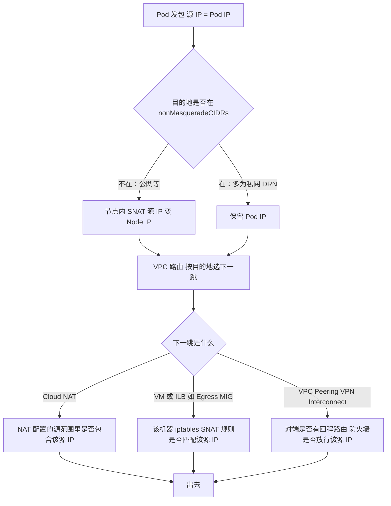
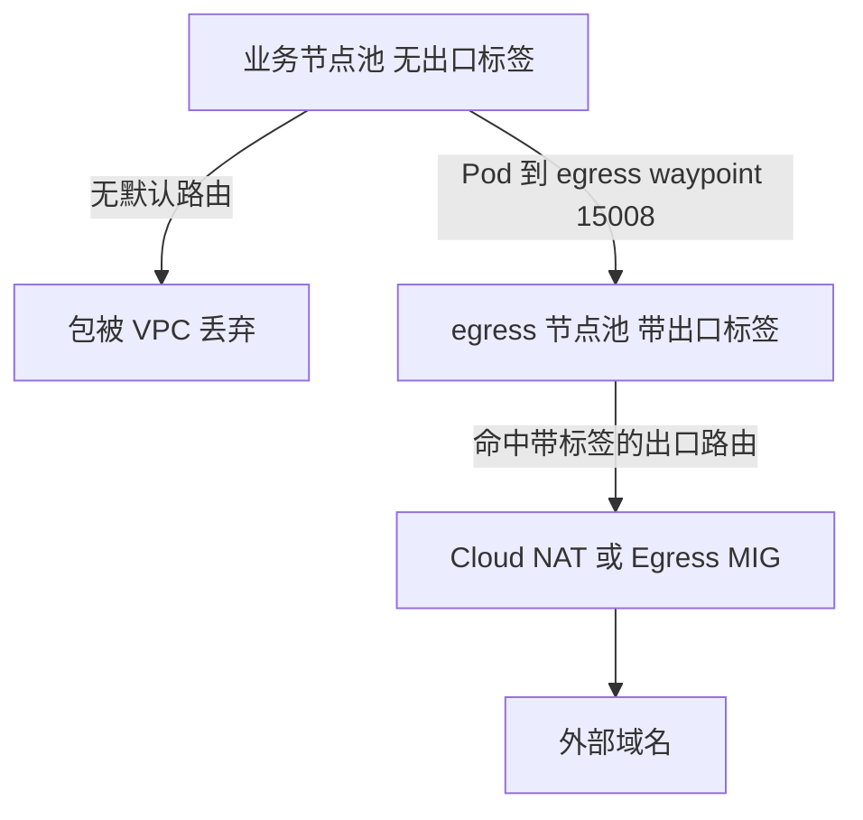

## 1. 问题梳理

你的表达基本清楚，我先把几个术语和假设对齐，避免跑偏：

| 你说的 | 我的理解 | 是否需要确认 |
|--------|----------|--------------|
| Pod IP / Node IP / Server 段 IP | Pod 的 secondary range、节点的 primary range、Service ClusterIP 段 | 基本确定 |
| NAT 3 层路由，允许 Node IP 出去 | 出口有一个 NAT 或路由机制，源地址白名单里只有 Node IP 段 | **需要确认具体是 Cloud NAT、Egress MIG 的 iptables，还是别的** |
| `iptables -t nat --to-source` | 某个 SNAT 规则，源地址匹配范围里没有 Pod 段 | 需要确认这条规则在哪台机器上 |
| DRN 网络 | 一个目的网络，访问范围也由 iptables 控制 | **不确定 DRN 指什么**，我先当作"企业内部的目的网络，不是公网" |
| 工程级路由 | GCP VPC 的 project 级路由 | 确定 |

你的**核心疑问**可以拆成四个子问题：

1. Pod IP 为什么出不去：是 NAT 的源地址范围里缺 Pod 段，还是别的原因？
2. 在 GKE 里，Pod 出站到底经过哪几层地址转换和路由？
3. VPC 路由能不能做到"只允许某些 Pod 出去"？
4. 如果不能，应该用什么机制配合？

## 2. Summary

> **在 GKE 里，Pod IP、Node IP、Service IP 三类地址的出站路径不同。出口 NAT 或路由目前只放行 Node IP 段，Pod 段没有放行。我想理解 Pod 出站为什么会被卡住，以及能不能通过 VPC 项目级路由，来精确控制哪些 Pod 可以出去、能去哪里。**

## 3. 探索

### 3.1 三类 IP 的出站特性

| 地址 | 来源 | 是否会离开节点 | 备注 |
|------|------|----------------|------|
| Pod IP | 子网的 secondary range（VPC-native） | 会 | VPC 能原生路由，是 alias IP |
| Node IP | 子网的 primary range | 会 | 节点网卡本身的地址 |
| Service ClusterIP | 虚拟地址 | **不会** | 在节点上被 DNAT 成后端 Pod IP，对 VPC 不可见 |

所以只有 Pod IP 和 Node IP 会出现在 VPC 里，Service 段不用考虑路由。

### 3.2 校正一个理解：Pod 出站有两道关口

你的直觉是 NAT 里没有 Pod 段，所以出不去。这个方向对，但实际上有两道关口，需要分开看。

**第一道：节点内的 IP 伪装（masquerade）。** 节点上的 ip-masq-agent 或默认 SNAT，会根据 `nonMasqueradeCIDRs` 列表决定要不要把源地址从 Pod IP 改成 Node IP。该列表按目的地址匹配，不匹配的目的地会把源 IP 从 Pod IP 换成节点 IP。 默认的不伪装目的地包含 RFC 1918 私网段等范围，具体以官方列表为准。

**第二道：VPC 路由和 NAT。** 出了节点之后，数据包由 VPC 路由决定下一跳，然后可能被 Cloud NAT 或你自建的 NAT 再转换一次。Cloud NAT 只有在被显式配置了 Pod 所用的 secondary range 时，才会翻译 Pod IP。



**这张图直接对应你的问题。** 你说的"Node IP 能出去、Pod IP 不能"，有三种可能的真实原因：

| 场景 | 现象 | 根因 | 你的理解对不对 |
|------|------|------|----------------|
| A：访问公网，默认 SNAT 生效 | Pod 实际上以 Node IP 出去 | 不存在 Pod 段问题，Pod 也能出去 | 前提不成立 |
| B：访问私网目的地（可能是你的 DRN） | Pod IP 被保留，出站时源是 Pod IP | NAT 源范围或对端回程路由、防火墙里没有 Pod 段 | **基本对，最可能是你的情况** |
| C：关闭了默认 SNAT，或 `nonMasqueradeCIDRs` 设成 `0.0.0.0/0` | 所有出站都保留 Pod IP | 同 B，范围扩大到所有目的地 | 对 |

GKE 如果使用 `--disable-default-snat`，会为所有目的地保留来源 Pod IP；要让这样的流量出公网，需要 Cloud NAT 至少覆盖 Pod 使用的 secondary range，或者配置自定义默认路由，把下一跳指向 VM 或内部直通式负载均衡器，由它们代为转发。

### 3.3 你的出口形态：iptables `--to-source` 在哪里

你提到了 `iptables -t nat --to-source`，这个写法只会出现在**自己维护的 NAT 机器**上，Cloud NAT 没有 iptables 概念，节点上的 ip-masq-agent 用的是 `MASQUERADE`，不是 `--to-source`。

如果你的出口是"内部 LB 加一组双网卡 MIG，在 MIG 上做 SNAT"这种形态（我从之前聊过的架构推测的，请确认），规则大概是这样：

```bash
# 在 Egress MIG 实例上
iptables -t nat -A POSTROUTING -s <NODE_PRIMARY_CIDR> -o <出口网卡> -j SNAT --to-source <出口 IP>
```

这种写法下，**只有 `-s` 匹配到的源地址会被转换。** 如果当前只写了 Node 段，Pod 段的包要么被丢，要么原样出去而对端不认。这和你的描述吻合。

要让它支持 Pod，有两个思路：

| 思路 | 做法 | 优缺点 |
|------|------|--------|
| 1：节点内先伪装 | 保持默认 SNAT，让 Pod 到该目的地也变成 Node IP | 不用改 MIG，但丢失 Pod 级源地址，对端无法区分 Pod |
| 2：MIG 增加 Pod 段 | 在 MIG 规则里加 `-s <POD_SECONDARY_CIDR>`，并保证 VPC 路由把 Pod 流量送到 MIG | 保留 Pod 级可见性，但需要同时改路由、MIG 规则，还有回程 |

### 3.4 项目级路由能不能控制"哪个 Pod 可以出去"

**不能精确到 Pod，只能做粗粒度控制。** 关键在于 VPC 路由匹配什么：

| 机制 | 匹配依据 | 能否区分 Pod | 说明 |
|------|----------|--------------|------|
| VPC 静态路由 | 目的网段，加可选的**实例网络标签或服务账号** | **不能** | 标签是挂在节点（VM）上的，同一节点上的所有 Pod 共享，路由不匹配源 IP |
| 策略路由（Policy-based routes） | 源网段、目的网段、协议 | **可以按 Pod CIDR 区分** | 能把来自 Pod 段的流量指向指定下一跳，适用性和限制请以官方文档为准 |
| VPC 防火墙或分层防火墙策略 | 源范围、目标标签或服务账号、FQDN | 可以按 Pod 段区分，但不能按单个 Pod | 做出站放行和拒绝 |
| Cloud NAT | 子网的 primary 或 secondary 范围，可按目的地定制规则 | 可以按 Pod 段区分 | 决定哪些源地址被翻译上公网 |
| ip-masq-agent / Egress NAT Policy | 目的地，Egress NAT Policy 还可以选 Pod | 部分 | Egress NAT Policy 能按 Pod 标签选择 SNAT 行为，可用范围取决于集群类型和版本 |
| K8s NetworkPolicy | Pod 标签、namespace、IP、FQDN | **可以，最细** | 在集群内，最贴近 Pod |

**所以你的思路是对的，但要理解成"节点池级别的出口控制"，而不是"Pod 级别"。**

### 3.5 可行方案：用节点池加路由做粗粒度围栏

在 deny-all 的前提下，一个很干净的做法是：**只让专用的出口节点池拥有出口路由。**



| 层 | 控制点 | 作用 |
|----|--------|------|
| 业务节点池 | 不打出口标签，VPC 里没有对它生效的默认路由 | 即使 Pod 被攻破，也无法直接出网 |
| egress 节点池 | 打 `egress-allowed` 标签，把 egress waypoint 调度到这里 | 只有这一池拥有出口路由 |
| VPC 路由 | 默认路由只对 `egress-allowed` 标签生效 | 路由层面做围栏 |
| 集群内 | NetworkPolicy 加 egress waypoint 的 AuthZ | Pod 级和域名级精细控制 |

示例命令，执行前请核对网络名、标签和优先级：

```bash
# 只对带 egress-allowed 标签的节点生效的默认出口路由
gcloud compute routes create egress-default-for-tagged-nodes \
  --network=<VPC_NAME> \
  --destination-range=0.0.0.0/0 \
  --next-hop-gateway=default-internet-gateway \
  --tags=egress-allowed \
  --priority=1000

# 如果你的出口是 Egress MIG 前的内部 LB，则改用 ILB 做下一跳
gcloud compute routes create egress-default-via-ilb \
  --network=<VPC_NAME> \
  --destination-range=0.0.0.0/0 \
  --next-hop-ilb=<EGRESS_ILB_FORWARDING_RULE> \
  --next-hop-ilb-region=<REGION> \
  --tags=egress-allowed \
  --priority=1000
```

这个方案有几个前提，必须先核对：

| 前提 | 说明 |
|------|------|
| VPC 里没有"无标签"的默认路由 | 否则所有节点都能走，围栏失效 |
| Google API 的路由单独处理 | Private Google Access 的 VIP 段需要单独的路由，否则业务节点池访问 Google API 也会断 |
| 默认 SNAT 的状态 | 决定 Pod 出站时源是 Node IP 还是 Pod IP，进而决定 NAT 和防火墙要放哪个范围 |
| 节点池调度 | egress waypoint 要用 nodeSelector 加 taint 固定到 egress 节点池 |

## 4. 如何确认你当前的状态

```bash
# 1. 集群是否禁用了默认 SNAT
gcloud container clusters describe <CLUSTER> --region <REGION> \
  --format="value(networkConfig.defaultSnatStatus)"

# 2. 是否部署了 ip-masq-agent，以及它的不伪装范围
kubectl -n kube-system get ds ip-masq-agent
kubectl -n kube-system get cm ip-masq-agent -o yaml

# 3. 在节点上看实际的伪装规则
iptables -t nat -S | grep -i masq

# 4. 看 VPC 的路由，重点找 0.0.0.0/0 和带标签的路由
gcloud compute routes list --filter="network:<VPC_NAME>" \
  --format="table(name,destRange,nextHopGateway,nextHopIlb,tags.list(),priority)"

# 5. 看 Cloud NAT 覆盖了哪些源范围（如果有）
gcloud compute routers nats describe <NAT_NAME> --router=<ROUTER> --region=<REGION>

# 6. 在出口 MIG 实例上看 SNAT 规则（如果是自建出口）
sudo iptables -t nat -S POSTROUTING

# 7. 用 Connectivity Tests 端到端验证，从 Pod IP 到目的地
gcloud network-management connectivity-tests create pod-to-drn \
  --source-ip-address=<POD_IP> --source-network=<VPC_NAME> \
  --destination-ip-address=<DRN_IP> --destination-port=443 --protocol=TCP
```

## 5. 注意事项

| 事项 | 说明 |
|------|------|
| 回程路由 | 保留 Pod IP 出站时，对端网络必须有到 Pod secondary range 的回程路由，Cloud Router 需要通告该范围 |
| 对端防火墙 | DRN 侧的防火墙如果只按 Node 段放行，保留 Pod IP 后会被拒绝 |
| 地址空间重叠 | Pod range 与对端网络重叠时无法路由，这是用 SNAT 到 Node IP 的常见原因 |
| 改默认 SNAT 的影响 | 对已有集群修改可能需要滚动节点才能生效，业务高峰期不要做 |
| 路由是粗围栏 | 路由和 NAT 做外层兜底，Pod 级和域名级管控仍然要靠前面设计的 NetworkPolicy 加 egress waypoint |

## 6. 需要你确认的点

DRN 具体指什么网络，以及你说的"NAT 里只有 Node IP 段"，是指 Cloud NAT 的源范围，还是自建 Egress MIG 上的 iptables `-s` 规则？这两个答案决定了应该改哪一处，我可以按你的实际情况再收窄方案。