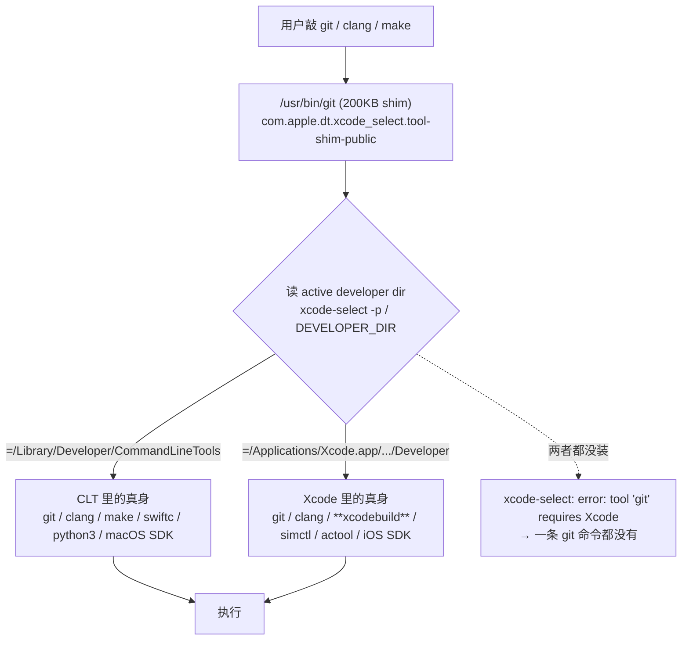

# macOS 上 Xcode 与 Xcode CLT：为什么企业强制要求装，且"没 CLT 连 git 都没有"

> 状态：**结论已定**（本机实测，证据可复现）。本文回答两个问题：
> 1. 为什么 macOS 不装 Xcode CLT 会连 `git` 命令都没有？
> 2. 为什么企业要**同时**装 Xcode 和 Xcode CLT 两个东西，它们能互相替代吗？
>
> 实测机器：`Mac-mini.local`（macOS 27.2.1, arm64, Xcode 27.2 / CLT 27.2.0.0.1792721180）。
> 公司那台 Mac 是另一台机器，**§9 的探针脚本必须原样拷过去重跑**才能拿到公司机结论。
>
> 相邻笔记：[numbered-annotation.md](knowledge/macos/capture/numbered-annotation.md)（其中"Swift + AppKit 零安装可行"之所以成立，正是因为 CLT 提供了 `swiftc`；本文解释这个前提的来源）。

---

## 1. 一句话结论

**macOS 里的 `/usr/bin/git` 不是 Git 本身，而是一个 200KB 的"转发器"（shim）。**
真正的 Git 二进制只存在于**开发者目录**里，而开发者目录有两个来源：**Xcode CLT**（`/Library/Developer/CommandLineTools`）和**完整 Xcode**（`/Applications/Xcode.app/Contents/Developer`）。
两个都不装 → shim 找不到目标 → **系统里一条可用的 git 命令都没有**。

Apple 从 macOS 10.12 (Sierra) 起就不再随系统分发可用的 Git，改为"shim + 开发者目录"模式，
于是 **Git 从"操作系统组件"降级成了"开发者工具"**——这就是为什么"装 CLT"和"装 Git"在 macOS 上是同一件事。

---

## 2. 结论速览

| # | 结论 | 证据强度 |
|---|---|---|
| 1 | `/usr/bin/git` 是 **tool-shim**（`com.apple.dt.xcode_select.tool-shim-public`），不是 Git | ✅ 实测（strings + 体积 + 同构性） |
| 2 | shim 把请求转发到 **active developer directory**（`xcode-select -p` / `DEVELOPER_DIR`）下的同名工具 | ✅ 实测（换 dir → 换目标） |
| 3 | 真 Git 存在于 **CLT** 和 **Xcode** 两处，版本号可能不同（实测 Apple Git-157 vs Apple Git-156） | ✅ 实测 |
| 4 | 只装 CLT，`git` 正常工作；CLT 缺了则 `xcode-select: error: tool 'git' requires Xcode...` | ✅ 实测 |
| 5 | **CLT ≠ Xcode**：CLT 下 `xcodebuild` 直接被拒（"requires Xcode, but ... is a command line tools instance"） | ✅ 实测 |
| 6 | Xcode 独有 ~95 个工具（simctl / actool / ibtool / altool / xctrace / xcresulttool…）和 iOS/watchOS 等 9 个平台 | ✅ 实测（目录差集） |
| 7 | CLT 独有能力：git、clang/LLVM、make、swiftc+SwiftPM、lldb、python3、macOS SDK | ✅ 实测 |
| 8 | 体积：CLT **1.3G**，Xcode.app **4.0G**（合计 ~5.3G） | ✅ 实测 |
| 9 | 不装 CLT 也能有 Git：`brew install git`（预编译 bottle 不需要 CLT） | ⚠️ 官方常识，本机未装 brew git 故未实测 |
| 10 | 两者**互不替代**：Xcode 不提供 CLT 的 pkg receipt，CLT 不提供 xcodebuild | ✅ 部分实测 + 官方文档 |

---

## 3. 实测探针与原始结果（可复制到公司机重跑）

### 3.1 `/usr/bin/git` 是 shim，不是 Git

```bash
$ ls -l /usr/bin/git /usr/bin/clang /usr/bin/make /usr/bin/gcc /usr/bin/ld
-rwxr-xr-x  1 root  wheel  200560  /usr/bin/clang
-rwxr-xr-x  1 root  wheel  200560  /usr/bin/gcc
-rwxr-xr-x  1 root  wheel  200560  /usr/bin/git      # ← 和 clang/gcc 一样大
-rwxr-xr-x  1 root  wheel  200560  /usr/bin/ld
-rwxr-xr-x  1 root  wheel  200560  /usr/bin/make

$ strings /usr/bin/git | grep -i -E 'xcode|shim'
<string>tool-shim-public</string>
<string>com.apple.dt.xcode_select.tool-shim-public</string>
<key>DTXcode</key>
<key>DTXcodeBuild</key>
```

> 关键点：**同尺寸 200,560 字节的一整批工具**（ar/as/asa/cc/c++/clang/clangd/codesign_allocate/gcc/gcov/git/git-shell/ld/lldb/make/nm/otool/pip3/python3/swift/swiftc/strip… 共 90 个）全是**同一个 shim 二进制**的副本。
> 真正的 Git 长这样：`/Library/Developer/CommandLineTools/usr/bin/git` = **3,838,240 字节**。

### 3.2 shim 转发到哪里：跟着"活动开发者目录"走

```bash
$ xcode-select -p
/Applications/Xcode-beta.app/Contents/Developer

$ ls -l /var/db/xcode_select_link
lrwxr-xr-x@ 1 root  wheel 47 /var/db/xcode_select_link -> /Applications/Xcode-beta.app/Contents/Developer

$ git --version                              # 当前指向 Xcode-beta
git version 2.54.0 (Apple Git-156)

$ DEVELOPER_DIR=/Library/Developer/CommandLineTools /usr/bin/git --version   # 指向 CLT
git version 2.54.0 (Apple Git-157)           # ← 版本号不一样！

$ DEVELOPER_DIR=/Applications/Xcode.app/Contents/Developer /usr/bin/git --version
git version 2.54.0 (Apple Git-157)

$ xcrun --find git
/Applications/Xcode-beta.app/Contents/Developer/usr/bin/git
```

**坑点**：这台机器上 `git` 的实际版本随 `xcode-select` 指向变化（Apple Git-156 / -157）。
CI 里"同一台机器两次构建 git 行为不同"就是这么来的。

### 3.3 没有开发者目录时，shim 报什么

```bash
$ mkdir -p /tmp/fakedev/Developer/usr/bin
$ DEVELOPER_DIR=/tmp/fakedev/Developer /usr/bin/git --version
xcrun: error: invalid DEVELOPER_DIR path (/tmp/fakedev/Developer), missing xcrun at: /tmp/fakedev/Developer/usr/bin/xcrun
```

在公司机上（CLT 与 Xcode 都没装）真实会看到的是这一类文案（版本间措辞略有差异）：

```
xcode-select: error: tool 'git' requires Xcode, but active developer directory
'/Library/Developer/CommandLineTools' is a command line tools instance
```

### 3.4 只装 CLT 时，git / clang / make 全部可用

```bash
$ DEVELOPER_DIR=/Library/Developer/CommandLineTools /usr/bin/git --version
git version 2.54.0 (Apple Git-157)

$ /Library/Developer/CommandLineTools/usr/bin/clang --version
Apple clang version 21.0.0 (clang-2100.4.1.1)
Target: arm64-apple-darwin27.2.0

$ /Library/Developer/CommandLineTools/usr/bin/make -v
GNU Make 3.81

$ /Library/Developer/CommandLineTools/usr/bin/python3 -V
Python 3.9.6
```

### 3.5 CLT ≠ Xcode：`xcodebuild` 在 CLT 下被明确拒绝

```bash
$ DEVELOPER_DIR=/Library/Developer/CommandLineTools xcodebuild -version
xcode-select: error: tool 'xcodebuild' requires Xcode, but active developer directory
'/Library/Developer/CommandLineTools' is a command line tools instance

$ DEVELOPER_DIR=/Applications/Xcode.app/Contents/Developer xcodebuild -version
Xcode 27.2
Build version 27B52
```

> 这句话是 Apple 官方设计的核心：CLT 是一个**降级版开发者目录**（"command line tools instance"），
> 系统据此明确区分"要 CLT 的工具"和"要完整 Xcode 的工具"。

### 3.6 两个开发者目录的能力差集（实测目录比对）

**CLT 有、Xcode 没有的**（= CLT 的独门能力）：

```
git, git-shell, git-receive-pack, git-upload-pack, git-upload-archive,
clang, clang++, clangd, clang-format, gcc, g++, llvm-gcc, llvm-g++,
ld, ar, as, nm, objdump, otool, lipo, libtool, install_name_tool, strip,
make, gnumake, bison, flex, lex, yacc, m4, gperf, ctags, indent,
lldb, lldb-dap, sourcekit-lsp,
swift, swiftc, swift-build, swift-package, swift-test, swift-format, swift-run,
python3 (3.9.6), pip3, xcrun
+ SDK: MacOSX.sdk / MacOSX27.2.sdk / MacOSX27.sdk / MacOSX26.5.sdk / MacOSX26.sdk
```

**Xcode 有、CLT 没有的**（= 必须装完整 Xcode 的理由）：

```
xcodebuild, xcodeproj, xcresulttool, xctest, xctrace, xccov, xcdevice, xcdiagnose,
xcsigningtool, xcstringstool, xcprojformatter,
simctl, devicectl, xed,
actool, ibtool, ictool, momc, sdef, scntool, TextureConverter,
altool, iTMSTransporter, ipatool, ipatool2, xarsigner,
crashlog, atos, leaks, malloc_history, vmmap, heap, logdump, sdp,
instrumentbuilder, mcp-server, mcpbridge, lldb-mcp, agent, ...
```

**平台差集**（Xcode 独有）：

```
iPhoneOS.platform  iPhoneSimulator.platform  MacOSX.platform
WatchOS.platform   WatchSimulator.platform    AppleTVOS.platform
AppleTVSimulator.platform  DriverKit.platform  XROS.platform  XRSimulator.platform
```

### 3.7 体积与安装包

```bash
$ du -sh /Library/Developer/CommandLineTools /Applications/Xcode.app
1.3G    /Library/Developer/CommandLineTools
4.0G    /Applications/Xcode.app

$ pkgutil --pkgs | grep -E 'CLTools|Xcode'
com.apple.pkg.CLTools_Executables          # CLT 是独立安装包（9 个 CLTools_* receipt）
com.apple.pkg.CLTools_macOS_SDK
com.apple.pkg.CLTools_SDK_macOS14 / 13 / 12 / LMOS / NMOS / 110
com.apple.pkg.CLTools_SwiftBackDeploy
com.apple.pkg.XcodeSystemResources          # Xcode 是另一套
```

---

## 4. 机制解释：为什么会变成这样



设计意图（Apple 的历史选择）：

1. **系统只放一个"占位转发器"**，不把几十个工具的真实二进制塞进系统卷（体积/安全/签名/更新）。
2. **所有开发者工具统一到一个"开发者目录"**，由 `xcode-select` 一键切换版本。
3. **Git 被归类为开发者工具**：Apple 维护自己的打包版（对外显示 `Apple Git-<n>`），与 clang/SDK 一起版本化分发；
   Apple 希望"编译工具链、SDK、Git"处于同一套受支持版本，所以把 Git 塞进 CLT 而不是留在系统里。
4. **CLT 与 Xcode 是两个独立的安装产物**：CLT 是 `/Library/Developer/CommandLineTools` 下的 pkg 安装包，
   Xcode 是 `/Applications/Xcode.app`。装了 Xcode **不会**自动补出 CLT 的 pkg receipt，
   装了 CLT **也不会**给你 `xcodebuild`/模拟器/设备支持。**这就是企业要"两个都装"的结构性原因。**

> 历史背景（本机未实测，来自 Apple 官方发布说明与社区共识）：
> macOS 10.12 之前，`/usr/bin/git` 是指向 `/usr/local/git` 的包装脚本，需要用户另装 Git；
> 10.12 起 Apple 停止随系统分发可用 Git，统一改为 shim 模式，于是"没有开发者工具就没有 git"成为常态。

---

## 5. 企业为什么两个都要装（角色分工）

### 5.1 CLT 的角色：脚本 / CI / 工具链底座

| 需求 | CLT 提供 |
|---|---|
| 版本管理、CI 脚本拉代码 | `git`、`git-lfs` 配套的 git 基础 |
| 编译 / 构建 / Makefile | `clang`、`gcc`、`ld`、`make`、`ar`、`libtool` |
| 写小工具（上一轮笔记的 AppKit 标注器） | `swiftc` + SwiftPM + macOS SDK |
| 调试 / 剖析 | `lldb`、`lldb-dap`、`leaks`、`vmmap` |
| 链接与签名底层 | `codesign_allocate`、`install_name_tool`、`otool`、`lipo` |
| 解释器兜底 | `python3` (3.9.6)、`pip3` |
| Homebrew / pip 源码包编译 | 前置条件（brew 在 Apple Silicon 上安装脚本就建议先装 CLT） |
| 自动化工具链调用 | `xcrun`、`xcode-select` |

**没有 CLT 的直接后果**：`git`/`make`/`clang`/`swiftc` 全部消失 → 任何 CI 脚本、
任何"用 Swift/AppKit 写原生小工具"的方案（见 [numbered-annotation.md](knowledge/macos/capture/numbered-annotation.md)）都无法落地。

### 5.2 Xcode 的角色：App 构建 / 签名 / 模拟器 / 上架

| 需求 | 只有 Xcode 能做 |
|---|---|
| iOS/macOS App 编译打包 | `xcodebuild`（CLT 下直接被拒）、`xcodeproj` |
| 图形界面资源编译 | `actool`（AppIcon/Asset Catalog）、`ibtool`（Interface Builder）、`momc`、`ictool` |
| 模拟器 | `simctl` + iOS Simulator runtime |
| 真机部署与调试 | `devicectl`、`xcdevice`、设备支持包 |
| 性能剖析 / 泄漏 / 崩溃 | `xctrace`、`xctest`、`leaks`、`malloc_history`、`crashlog`、`atos` 符号化 |
| 上架 / 分发 | `altool`、`iTMSTransporter`、`ipatool`、`xarsigner` |
| 企业内部分发 | 签名与描述文件工具链（`xcsigningtool`、codesign 全套 + 证书） |

### 5.3 为什么不能"只装一个"

| 只装 | 后果 |
|---|---|
| 只装 CLT | 有 git/编译/脚本能力，但**没有任何 App 构建与签名能力**；且 CLT 与 macOS 大版本强绑定，升 macOS 后必须同步升 CLT |
| 只装 Xcode | 有 App 构建能力，`/usr/bin/git` 也能用（shim 转发到 Xcode），但**缺 CLT 的独立 pkg receipt**：部分脚本/Homebrew/校验流程按 `/Library/Developer/CommandLineTools` 判定；且 Xcode 版本更新时命令行工具跟着一起变，容易踩版本错配 |
| 两个都装 | 目录职责清晰：`xcode-select -s /Library/Developer/CommandLineTools` 给脚本用；`-s /Applications/Xcode.app` 给 App 构建用 |

**企业基线通常这么定**（可作为本次探索的落地结论）：

- **所有开发/运维 Mac 装 CLT**（必需，脚本与 CI 依赖它）。
- **需要开发/打包/签名的 Mac 装完整 Xcode**（按角色下发）。
- 固定 `sudo xcode-select -s /Applications/Xcode.app`，避免多 Xcode 并存导致 git/clang 版本漂移。

---

## 6. 注意事项与踩坑清单

1. **多 Xcode 并存会漂移**：本机同时有 `Xcode.app` 和 `Xcode-beta.app`，`xcode-select -p` 指向 beta，
   `git` 版本就跟着变（Apple Git-156 ↔ -157）。CI/构建机必须固定 developer dir。
2. **developer dir 指向已删除的 Xcode**：所有 shim 工具全线报 `invalid DEVELOPER_DIR path ... missing xcrun`，
   表现为"git 突然没了"，实际是 `xcode-select -p` 指向了不存在的目录。
3. **CLT 版本必须匹配 macOS 大版本**（macOS 27 → CLT 27.x）。旧 CLT 装不上/装上后报
   "the SDK 'MacOSXxx.sdk' cannot be located" 之类的错误。Xcode 同样要求 macOS 版本足够新。
4. **许可**：
   - CLT：需接受 Apple 软件许可（`sudo xcodebuild -license accept`，或安装时点同意），**不需要 Apple ID**。
   - Xcode：需要 Apple ID 登录（企业分发通常用企业账号/MDM 管理），许可需接受；过期后 `xcodebuild` 会被拦。
5. **磁盘**：CLT 1.3G + Xcode 4.0G ≈ **5.3G**，笔记本 256G 起步机型要纳入容量规划。
6. **CI 镜像 vs 笔记本**：CI 只需要 CLT（外加 Xcode 若要出包）；笔记本按角色装。
7. **"不装 CLT 也有 git" 的路**：`brew install git` 用预编译 bottle，不需要 CLT；
   但企业基线一般仍要求 CLT，且 brew 自身的安装脚本在 Apple Silicon 上就要求先有 CLT。**不要为了绕过基线走这条路。**
8. **Shim 会"遮蔽"同名工具**：PATH 里 `/usr/local/bin`、`/opt/homebrew/bin` 优先于 `/usr/bin`，
   所以自装 git 会先于 Apple git 命中；但 `xcrun --find git` 仍指向开发者目录，两套 git 容易版本打架。

---

## 7. 在公司机上的正确安装方式（参考）

| 目标 | 方式 |
|---|---|
| 交互式装 CLT | `xcode-select --install` → 弹窗点"安装"（需要用户点确认，适合个人机） |
| 静默装 CLT | `softwareupdate -l | grep -i CLTools` → `softwareupdate -i <label>`；或从 developer.apple.com 下载 `Command_Line_Tools_for_Xcode_<ver>.xip` 后 `xcode-select --install` |
| 装 Xcode | App Store / developer.apple.com 下载 `Xcode_<ver>.xip` → 解包后 `xcode-select -s /Applications/Xcode.app` |
| 企业批量 | 走 MDM：预置安装包 + `xcode-select -s` 固化 developer dir + 许可预接受（`xcodebuild -license accept`） |

---

## 8. 给"要不要自己装"的建议

- 你**只是想在公司 Mac 上跑脚本 / 用 git / 写个原生小工具** → CLT 就够了（1.3G）。
- 你**要出 iOS 包 / 签企业证书 / 用模拟器** → 必须完整 Xcode（4.0G）。
- 两者都装时：**用 `xcode-select -p` 确认当前指向**，并把这条写进入职 checklist 第一条。

---

## 9. 探针脚本（拷到公司机跑，10 秒出结论）

```bash
#!/bin/bash
# xcode-clt-probe.sh —— 判断当前机器的开发者工具状态
echo "== macOS =="; sw_vers
echo "== active developer dir =="; xcode-select -p 2>&1; ls -l /var/db/xcode_select_link 2>&1
echo "== CLT installed? =="; pkgutil --pkg-info=com.apple.pkg.CLTools_Executables 2>&1 | head -3
echo "== Xcode installed? =="; ls -d /Applications/Xcode*.app 2>&1
echo "== git via shim =="; git --version 2>&1 | head -2
echo "== is /usr/bin/git a shim? =="; ls -l /usr/bin/git; strings /usr/bin/git 2>/dev/null | grep -m1 tool-shim
echo "== real git locations =="
for p in /Library/Developer/CommandLineTools/usr/bin/git /Applications/Xcode.app/Contents/Developer/usr/bin/git; do
  [ -x "$p" ] && echo "$p -> $($p --version 2>&1)"
done
echo "== toolchain =="; clang --version 2>&1 | head -1; make -v 2>&1 | head -1; swiftc --version 2>&1 | head -1
echo "== xcodebuild usable? =="; xcodebuild -version 2>&1 | head -2
echo "== disk =="; du -sh /Library/Developer/CommandLineTools /Applications/Xcode.app 2>/dev/null
echo "== license =="; xcodebuild -license check 2>&1 | head -2
```

判定规则：

- `git via shim` 报 `xcode-select: error` → **CLT 和 Xcode 都没装**（或 developer dir 指向了已删除的目录）。
- `git via shim` 有版本号但 `xcodebuild` 报 "is a command line tools instance" → **只有 CLT**，需要出包就要补 Xcode。
- `xcodebuild -version` 正常输出 → **Xcode 已装且可用**。
- `CLT installed?` 段为空但 git 可用 → 只有 Xcode，确认 CLT 是否为硬性要求（脚本/Homebrew 侧）。

---

## 附录：命令速查

```bash
# 当前开发者目录
xcode-select -p
ls -l /var/db/xcode_select_link

# 切换（脚本用 CLT，出包用 Xcode）
sudo xcode-select -s /Library/Developer/CommandLineTools
sudo xcode-select -s /Applications/Xcode.app

# 找出某个工具的真实位置
xcrun --find git
xcrun --find clang

# 列出 shim（/usr/bin 里 200,560 字节那一批）
ls -l /usr/bin/* | awk '$5==200560 {print $NF}'

# 装 / 查 CLT
xcode-select --install
pkgutil --pkg-info=com.apple.pkg.CLTools_Executables
pkgutil --pkgs | grep CLTools

# 许可
sudo xcodebuild -license accept
xcodebuild -license check
```
