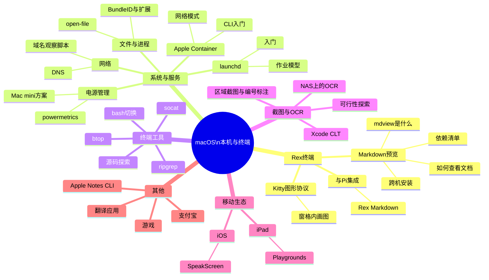

# macOS 知识点分析

Analyze the `macos/` knowledge base. Categorize the macOS tooling / terminal / capture / iOS documents by technical domain, summarize the key knowledge points, and present everything as a Markdown document with a Mermaid mindmap.

本文档覆盖 `macos/` 下的 **39 篇文档 / 10 个子目录**——这是全库最"个人化"的一层：
本机怎么配、终端怎么看文档、截图怎么标注、iOS 上怎么用。

> **一句话结论**
> ★ 这个目录最独特的是 `terminal/Rex/`——**一套在终端里渲染 Markdown
> 和 Kitty 图形协议的方案**，正好和本知识库的"Markdown 优先"风格配套。
> 其余是 launchd、Apple Container、截图标注、OCR、电源管理等实操。

---

## 文档体系分析

1. **`terminal/Rex/`** — Markdown 终端预览、Kitty 图形协议、依赖与跨机安装
2. **`docs/`** — launchd、Apple Container、btop、socat、rg、电源、域名观察、open-file
3. **`capture/`** — 区域截图 + 自动编号标注、Xcode CLT
4. **`ios/`** — OCR（NAS）、Speak Screen
5. **`native-tools/`** — 个人便携 CLI 工具集
6. **其他** — `apple/`（Apple Notes CLI）、`iPad/`、`game/`、`trans/`、`zhifubao/`

---

## 知识点 MindMap



---

## 主要知识领域详解

### 1. Rex 终端（`terminal/Rex/`）—— 本目录的特色
- `Rex-Markdown-for-pi.md`：**Rex Markdown for Pi**——
  在 Pi 这类终端 Agent 里直接预览 Markdown；
- `mdview.md`：**mdview 是什么（技术说明）**；
- `mdview-setup-and-dependencies.md`：**依赖清单与跨机安装指南**；
- `How-to-view-markdown.md`：**如何在终端里直接 Review Markdown**；
- `Rex-Kitty-Graphics.md`：**Rex × Kitty 图形协议——在窗格里画图**。

> 这一组与本知识库的整体风格（Markdown + Mermaid 图）直接配套：
> 在终端里能直接看到渲染结果，意味着"读文档"不再需要切窗口。

### 2. 系统与服务（`docs/`）
- `launchd-101.md`：**macOS launchd 入门**（systemd 的对应物）；
- `apple-container-101.md` / `macos-container.md`：**Apple `container` CLI**——
  macOS 原生容器（注意 `--network=host` 的坑）；
- `open-file.md`：Bundle ID / Extension / Role 的对应关系；
- `my-macos-power-requirement.md` + `explorer-macos-power.md`：
  **Mac mini 后台任务电源管理方案**；
- `powermetrics.md`：性能与功耗采样；
- `app-network-observer.md`：**macOS APP 网络域名观察脚本**；
- `socat.md`、`rg.md`（ripgrep 手册）、`btop.md`、`swith-bash.md`（切 bash）、
  `explorer-source-command.md`、`dns.md`、`install-fonts.md`、`macOS-monitor-connect.md`。

### 3. 截图与 OCR（`capture/`、`ios/ocr/`）
- `numbered-annotation.md`：**macOS 区域截图 + 自动编号标注：可行性探索**；
- `smartshot.md`：截图工具；
- `xcode-clt-why.md`：**为什么企业强制装 Xcode CLT**，
  以及「没 CLT 连 git 都没有」的连锁效应；
- `ios/ocr/nas-ocr.md`：在 NAS 上跑 OCR。

### 4. 移动与其他
`ios/`（Speak Screen 开启方法）、`iPad/`（Playgrounds）、
`native-tools/`（**个人便携 CLI 工具集**）、`apple/`（Apple Notes CLI）、
`trans/`、`zhifubao/`、`game/`。

---

## 三条阅读路线

```
路线 A · 终端里读 Markdown（1 小时）
  terminal/Rex/Rex-Markdown-for-pi.md → terminal/Rex/mdview.md
  → terminal/Rex/mdview-setup-and-dependencies.md
  → terminal/Rex/How-to-view-markdown.md

路线 B · 把 macOS 当开发机（2 小时）
  docs/launchd-101.md → docs/apple-container-101.md
  → docs/rg.md → docs/btop.md → capture/xcode-clt-why.md

路线 C · 做截图标注流水线（半天）
  capture/numbered-annotation.md → capture/smartshot.md
  → ios/ocr/nas-ocr.md
```

---

## 结论

1. **`terminal/Rex/` 是这个仓库的"阅读器"**：全库 9000 篇 Markdown，
   能直接在终端渲染出图，才谈得上被高频使用。
2. **macOS 在这个知识库里的角色是"开发终端"**：
   launchd、容器、ripgrep、电源管理——都是为在 Mac 上做云平台工作服务的。
3. **`.gitignore` 与脱敏规则在这里也有呼应**：`xcode-clt-why.md` 这类文档
   解释了"环境缺工具会导致连锁故障"，是环境基线管理的缩影。

---

## 关联文档

- [../knowledge-mindmap.md](../knowledge-mindmap.md) ·
  [../linux/linux-mindmap.md](../linux/linux-mindmap.md)
- [README.md](./README.md) ·
  [terminal/Rex/Rex-Markdown-for-pi.md](./terminal/Rex/Rex-Markdown-for-pi.md) ·
  [terminal/Rex/mdview-setup-and-dependencies.md](./terminal/Rex/mdview-setup-and-dependencies.md) ·
  [docs/launchd-101.md](./docs/launchd-101.md) ·
  [capture/numbered-annotation.md](./capture/numbered-annotation.md)
