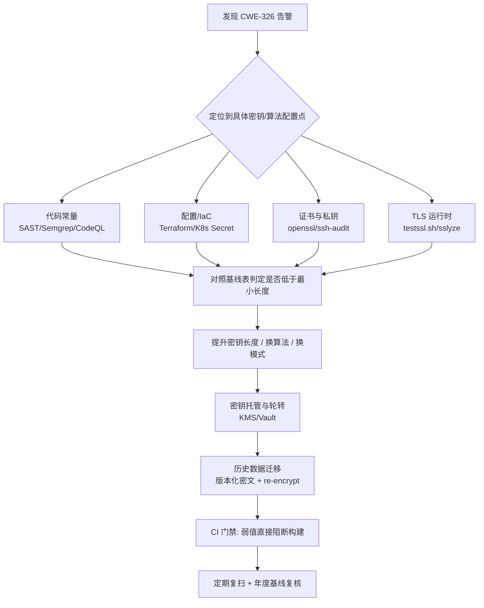

# CWE-326: Inadequate Encryption Strength（加密强度不足）

> 归属目录：`safe/cwe/` · 姊妹文档：[cwe-319.md](./cwe-319.md)（明文传输）、[cwe-287.md](./cwe-287.md)、[cwe-650.md](./cwe-650.md)
> 权威来源：[MITRE CWE-326](https://cwe.mitre.org/data/definitions/326.html)

---

## 1. Summary

- **一句话定义**：产品使用了"理论上成立、但强度不足以满足所需保护级别"的加密方案（典型：密钥太短、算法太旧、模式不安全）。
- **与 CWE-327 的区别**：CWE-327 = 算法本身被破（DES/RC4/MD5）；CWE-326 = 算法没破，但**参数/强度不够**（1024-bit RSA、AES-64、ECB、弱 KDF）。工程上两者常一起报，修复时按"换成现代算法 + 达标密钥长度"一次性收敛。
- **常见后果**：攻击者用当前算力即可暴力破解 → 解密数据、绕过保护机制、读取应用数据。
- **平台视角**：密钥长度 / 算法强度是**配置与代码常量**，不是运行时行为，所以 SAST + 配置扫描 + IaC 检查是主力手段，DAST 只能覆盖 TLS 协商与握手部分。

## 2. MITRE 原文（关键字段）

| 字段 | 内容 |
|---|---|
| Weakness ID | 326 |
| Name | Inadequate Encryption Strength |
| Abstraction | Class |
| Description | The product stores or transmits sensitive data using an encryption scheme that is theoretically sound, but is not strong enough for the level of protection required. |
| Common Consequences | Scope: Access Control, Confidentiality — An attacker may be able to decrypt the data using brute force attacks. The attacker may have a reasonable chance of succeeding using current attack methods and resources. |
| Potential Mitigations | Architecture and Design: Use an encryption scheme that is currently considered to be strong by experts in the field. |
| Relationships | ChildOf CWE-693 (Protection Mechanism Failure)；ParentOf CWE-325 (Missing Cryptographic Step)、CWE-326 的子项 CWE-326/CWE-327 系列变体；PeerOf CWE-327 |
| Vulnerability Mapping | CAPEC（"Cryptanalysis of Repeated Encryption" 等）；CWE-326 常被映射为 NVD 中大量 CVE 的根因 |
| Previous Name | Weak Encryption（2009-07-27 改名） |

## 3. 为什么会发生（根因模型）

1. **历史遗留**：写代码时标准够用，几年前算力暴涨后密钥长度没跟上（1024-bit RSA 今天已可被学术集群分解）。
2. **兼容性妥协**：为了和遗留系统互通而沿用旧算法 / 旧曲线 / 短密钥。
3. **性能或实现偷懒**：用 ECB 模式"跑得快"，或用 MD5/SHA-1 派生密钥。
4. **标准漂移**：密钥长度是硬编码字面量（`1024`、`56`），没人复核。
5. **历史数据未迁移**：只改了新数据，老数据仍是弱加密 → "harvest now, decrypt later"（先囤密文，等算力够了再解）。

## 4. 平台中常见出现位置

| 层 | 典型位置 | 风险 |
|---|---|---|
| 应用代码 | 自研加解密工具类、JWT 签名密钥、密码加密/字段加密 | 高 |
| 密钥/证书 | 私钥 RSA < 2048、证书签名算法 SHA-1、自签 EKU 弱 | 高 |
| 传输层 | TLS 只允许 TLS1.0/1.1、套件含 3DES/RC4/CBC、DH 参数 < 2048 | 中高 |
| 内部通信 | 服务间 mTLS 未启用、Istio/Service Mesh 强制明文 | 中 |
| 存储层 | 备份加密密钥短、对象存储 SSE 用了低强度、DB TDE 密钥过短 | 中 |
| 配置/IaC | Terraform/K8s Secret 里的算法与位数声明、Vault 策略 | 高（易批量发现） |
| 依赖库 | 老版本 OpenSSL/JDK/mcrypt 等引入弱算法默认值 | 中 |
| 口令存储 | MD5/SHA-1/无盐哈希、可逆加密存密码 | 极高（常伴随 CWE-916/522） |
| 工具链 | SSH host key 是 DSA-1024、RSA-1024 签名 | 中 |

> 注意：口令哈希（bcrypt/Argon2/scrypt）不走"加密强度"模型，弱口令哈希应报 **CWE-916**（Use of Password Hash With Insufficient Computational Effort），不要混淆。

## 5. 如何发现与定位

### 5.1 SAST / 代码扫描（主力）

| 工具 | 用法 |
|---|---|
| Semgrep | 规则集 `p/crypto` / `p/security-audit`：命中 `RSA.generate(1024)`、`KeyPairGenerator.getInstance("DSA").initialize(1024)`、`AES.new(key, ECB)`、`DES.new` |
| CodeQL | query `rbcs` / `crypto` 系列，找 key size 常量 |
| Checkmarx / Veracode | 规则 "Inadequate Encryption Strength"（VNX-326 / VNX-CRYPTO-004 等） |
| Trivy / Grype | 扫 CVE 与依赖中的弱算法默认值 |

快速自查（示例，按语言替换）：

```bash
# RSA / DSA / DH 短密钥
grep -rnE "(RSA|DSA|DH|generateKeyPair|initialize)\(?(.{0,20})?(512|768|1024)\b" --include='*.java' --include='*.go' --include='*.py' .
grep -rnE "RSA\.generate\(\s*?(512|1024)\b" --include='*.py' .
grep -rnE "modulusLength\s*:\s*(512|1024)\b" --include='*.js' --include='*.ts' .

# 弱算法 / 弱模式 / 弱哈希
grep -rnE "\b(DES|3DES|RC4|RC2|Blowfish|MD5|MD4|SHA1)\b" --include='*.java' --include='*.py' --include='*.go' .
grep -rnE "MODE_ECB|/ECB/|\bECB\b" .        # ECB 模式
grep -rnE "md5\(|sha1\(|MessageDigest\.getInstance\(\"MD5\"" .
```

### 5.2 密钥与证书扫描

```bash
# 私钥强度
openssl rsa -in key.pem -text -noout | grep -E "Private-Key"
openssl pkey -in key.pem -pubout -text -noout | grep -E "Public-Key|ASN1 OID"

# 证书签名算法 / 有效期
openssl x509 -in cert.pem -noout -text | grep -E "Signature Algorithm|Public-Key|Not After"

# 批量扫描：ssh-audit / testssl.sh / sslyze
ssh-audit -v host                 # 关注 key-exchange 与 host-key 算法
testssl.sh --vulnerable --cipher-per-proto host
sslyze --regular host
```

### 5.3 运行时与配置验证

```bash
# 运行时实际协商到的协议/套件（证明"当前强度"，而非配置意图）
openssl s_client -connect host:443 -tls1_1 </dev/null    # 应失败
openssl s_client -connect host:443 -cipher 'AES128-SHA' </dev/null   # 弱套件应不可用

# TLS 最低版本 / 套件策略（GCP）
gcloud compute ssl-policies describe <policy>
gcloud compute ssl-policies list

# K8s / Istio 强制 mTLS
kubectl get peerauthentication,authorizationpolicy -A
```

### 5.4 检测边界（必须写进报告）

- **静态分析只抓字面量**：密钥长度来自配置、Vault、KMS、运行时下发时，SAST 看不见 → 标为 "not assessed"，交给配置审计。
- **库默认值**：调用 `AES.new()` 不写 key 长度时，是否违规取决于调用方传入的 key → 需要数据流分析或人工确认。
- **TLS 真实强度**：必须用主动扫描（testssl.sh/sslyze）或真实握手确认，静态配置不代表生效。
- **历史数据**：修完代码不代表历史密文安全 → 必须做数据迁移评估。

## 6. 修复方案

### 6.1 密钥长度与算法基线（对齐 NIST SP 800-57 / OWASP / NIST SP 800-131A）

| 用途 | ❌ 不可接受 | ✅ 最低要求 | ✅ 推荐 |
|---|---|---|---|
| 对称加密 (AES / ChaCha20) | DES/3DES/RC4、AES-40/64/112 | AES-128 | AES-256-GCM / ChaCha20-Poly1305 |
| RSA | 512/1024 | 2048 | 3072（长期数据）/ PQC 迁移路线（FIPS 203/204/205） |
| DSA / DH | 512/1024 | 2048 | 3072 或 ECDH |
| 椭圆曲线 | P-192 及以下 | P-256 (secp256r1) | P-384 / Curve25519 / Ed25519 |
| 签名哈希 | MD5 / SHA-1 | SHA-256 | SHA-256 / SHA-3 |
| 密码哈希 | MD5 / SHA-1 / 无盐 | bcrypt cost ≥ 10 | Argon2id / scrypt |
| TLS | 1.0/1.1、3DES/RC4/CBC 套件 | TLS 1.2 | TLS 1.3，仅 AEAD 套件 |
| PBKDF2 迭代 | < 600,000 (SHA-256) | 600,000 | OWASP 2025 推荐值，随算力年度复核 |

### 6.2 修复动作清单（按优先级）

| 优先级 | 动作 | 落地方式 | 验证 |
|---|---|---|---|
| P0 | 密钥生成长度提到达标 | 代码常量改配置化：`KEY_SIZE=${KEY_SIZE:-3072}` | SAST 规则 + 单测断言 |
| P0 | 弃用 DES/3DES/RC4，换 AES-256-GCM | 换库调用，密文格式带版本号 `v2` | 密文兼容性测试 + 扫描器复扫 |
| P0 | ECB → GCM/CBC/CTR（**必须**带 IV/nonce 且 AEAD） | `AES/GCM/NoPadding`，每条消息唯一 nonce | 单测：相同明文两次密文不同 |
| P0 | TLS 策略收紧 | GCP SSL policy / LB 前端 / Ingress | `testssl.sh` 无弱套件 |
| P1 | 密钥集中托管 + 轮转 | KMS / Vault / Secret Manager，DEK-KEK 分离 | 轮转演练记录 |
| P1 | 密钥长度写进 IaC 与流水线策略 | Terraform policy / CI 检查 | CI 阻断弱值 |
| P1 | 口令哈希迁移 | Argon2id + rehash-on-login | 存量哈希迁移率指标 |
| P2 | 历史数据重新加密（弱方案 → 强方案） | 批量 re-encrypt 脚本 + 双读兼容期 | 密文版本分布统计 |
| P2 | 年度基线复核 | 密钥长度基线文档 + 到期提醒 | 审计记录 |

### 6.3 代码修复示例

**Java（RSA 短密钥 + ECB）**

```java
// ❌ 弱：1024-bit RSA
KeyPairGenerator kpg = KeyPairGenerator.getInstance("RSA");
kpg.initialize(1024);

// ✅ 强：3072-bit，参数外置
KeyPairGenerator kpg = KeyPairGenerator.getInstance("RSA");
kpg.initialize(Integer.parseInt(env.getOrDefault("RSA_KEY_SIZE", "3072")));

// ❌ 弱：ECB + 固定 IV
Cipher c = Cipher.getInstance("AES/ECB/PKCS5Padding");

// ✅ 强：GCM，随机 12-byte nonce 随密文存储
Cipher c = Cipher.getInstance("AES/GCM/NoPadding");
SecretKeySpec key = new SecretKeySpec(dek, "AES");
byte[] iv = new byte[12];
SecureRandom.getInstanceStrong().nextBytes(iv);
c.init(Cipher.ENCRYPT_MODE, key, new GCMParameterSpec(128, iv));
byte[] ct = c.doFinal(plaintext);
// 存储格式：version(1) | iv(12) | ciphertext+tag
```

**Go**

```go
// ❌
key, _ := rsa.GenerateKey(rand.Reader, 1024)

// ✅
key, err := rsa.GenerateKey(rand.Reader, 3072)
```

**Python**

```python
# ❌
from Crypto.Cipher import DES
cipher = DES.new(key, DES.MODE_ECB)

# ✅
from cryptography.hazmat.primitives.ciphers.aead import AESGCM
aes = AESGCM.generate_key(bit_length=256)
nonce = os.urandom(12)
ct = aes.encrypt(nonce, plaintext, aad)
```

**TLS 策略（GCP）**

```bash
gcloud compute ssl-policies create secure-tls \
  --min-tls-version TLS_1_2 \
  --members=modern \
  --enable-ssl3=false
gcloud compute ssl-policies update secure-tls \
  --members=modern --clear=member:modern  # 移除旧成员
```

### 6.4 遗留兼容性处理

1. **双格式并存**：密文带版本头（`v1` 弱、`v2` 强），读时按版本解密，写时一律 v2。
2. **渐进迁移**：后台批量 re-encrypt 脚本，跑在迁移窗口内。
3. **密钥版本化**：新密钥版本号写入密文头，便于分批停用旧密钥。
4. **兜底**：无法迁移的字段（如已签发的旧 Token）设过期时间，让其自然失效。

## 7. 与相关 CWE 的关系

| CWE | 名称 | 区别 / 关联 |
|---|---|---|
| CWE-327 | Use of a Broken or Risky Cryptographic Algorithm | 算法本身被破 → 换算法 |
| CWE-326 | Inadequate Encryption Strength | 算法没破但强度/参数不足 → 换参数 + 迁移（**本文**） |
| CWE-319 | Cleartext Transmission of Sensitive Information | 根本没加密 → 传输层 TLS（见 [cwe-319.md](./cwe-319.md)） |
| CWE-311 | Missing Encryption of Sensitive Data | 存储未加密 → 落盘加密 |
| CWE-321 | Use of Hard-coded Cryptographic Key | 密钥硬编码 → KMS |
| CWE-322 | Key Exchange without Entity Authentication | 密钥交换无认证 → 证书校验 |
| CWE-338 | Use of Cryptographically Weak PRNG | 随机数弱 → nonce/IV/密钥生成质量问题 |
| CWE-916 | Use of Password Hash With Insufficient Computational Effort | 口令哈希强度不足（argon2/bcrypt 参数） |
| CWE-757 | Selection of Less-Secure Algorithm During Negotiation | 协商降级到弱算法 |

> OWASP Top 10 2025 **A04 Cryptographic Failures** 覆盖 CWE-326，是该类别下的高频条目之一。

## 8. 检测与修复流程图



## 9. 上手检查清单

- [ ] 全仓搜 `1024/512/768` 关键长度字面量，确认无 RSA/DSA/DH 短密钥
- [ ] 全仓搜 `DES|RC4|MD5|SHA1`，确认为遗留/兼容用途且已排期下线
- [ ] 搜 `ECB`，全部改为 AEAD（GCM）
- [ ] `openssl x509 -text` 检查线上证书签名算法与公钥长度
- [ ] `ssh-audit` 检查 SSH host key 算法与长度
- [ ] `testssl.sh` 确认只允许 TLS 1.2/1.3 + AEAD 套件
- [ ] 检查口令哈希是否 Argon2id/bcrypt，cost ≥ 10
- [ ] 确认密钥不在代码/镜像里，统一走 KMS/Vault，且有轮转机制
- [ ] 评估历史数据是否需要重新加密，并记录迁移进度
- [ ] 在 CI 中加入弱加密阻断规则（SAST + 配置 lint）

## 10. 参考

- MITRE CWE-326: https://cwe.mitre.org/data/definitions/326.html
- NIST SP 800-57 Part 1 Rev.5（密钥长度与周期）: https://csrc.nist.gov/publications/detail/sp/800-57-part-1-rev-5/final
- NIST SP 800-131A Rev.2（算法过渡与禁用）: https://csrc.nist.gov/publications/detail/sp/800-131a-rev-2/final
- OWASP Top 10 2025 — A04 Cryptographic Failures: https://owasp.org/Top10/2025/A04_2025-Cryptographic_Failures/
- OWASP Cryptographic Storage Cheat Sheet: https://cheatsheetseries.owasp.org/cheatsheets/Cryptographic_Storage_Cheat_Sheet.html
- OWASP Password Storage Cheat Sheet: https://cheatsheetseries.owasp.org/cheatsheets/Password_Storage_Cheat_Sheet.html
- BlueKrypt 密钥长度建议对比表: https://www.keylength.com/
- CWE-327（对比）: https://cwe.mitre.org/data/definitions/327.html
