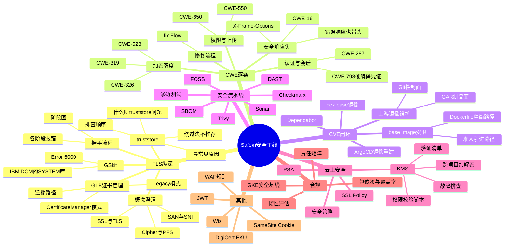

# Safe 安全知识点分析

Analyze the `safe/` knowledge base. Categorize the security documents by technical domain, summarize the key knowledge points, and present everything as a Markdown document with a Mermaid mindmap.

本文档覆盖 `safe/` 下的 **192 篇文档 / 11 个子目录**——这是全库的**安全主线**，
与 `gcp/mtls/`、`gcp/cloud-armor/` 构成"一个平台的安全纵深"。

> **一句话结论**
> ★ 这个目录的主线是 **"从发现漏洞到合规闭环"**：
> `cwe/` 逐条讲清每个 CWE 违规的根因与修复 → `fix-cve/` 给出自动修复路径 →
> `cyberflows/` 画出 CI/CD 里该插哪些扫描器 → `gcp-safe/` 落地到 GCP KMS 与 PSA →
> `Control-and-Compliance/` 收口成基线。TLS 部分则是**协议层的深度**。

---

## 文档体系分析

1. **TLS 纵深** — `ssl/`（握手流程、truststore、SAN/SNI、Cipher、GLB 证书管理）
2. **CWE 逐条击破** — `cwe/`（CWE-16/287/319/326/523/550/650/798 + Nginx 安全头）
3. **CVE 自动修复** — `fix-cve/`（Dependabot、base image 受限、Argo CD 镜像重建、上游镜像维护）
4. **CI/CD 安全流水线** — `cyberflows/`（FOSS、SBOM、Sonar、Trivy、DAST、Checkmarx、渗透测试）
5. **云上安全** — `gcp-safe/`（KMS 跨项目加解密 + 校验脚本、PSA、SSL Policy）
6. **合规与控制** — `Control-and-Compliance/`、`responsibilities/`
7. **其他** — `cert/`（DigiCert EKU）、`cross-site/`（SameSite Cookie）、`docs/`（JWT、WAF、PSA）、
   `how-to-fix-violation/`、`get-token/`、`wiz/`（云安全可视化）

---

## 知识点 MindMap



---

## 主要知识领域详解

### 1. TLS 纵深（`safe/ssl/`）
- `docs/tls-handshake-ascii-flow.md`：**TLS 握手完整流程图，每个阶段可能发生的报错**；
  `docs/tls-handshake-explained.md` 是文字版。
- `docs/request-flow.md`：**从 URL 到像素的 OSI 7 层视角**。
- `certificate-truststore.md`（17 节）：**结论先行** → 什么叫 truststore issue →
  最常见原因 → **GSKit / IBM 生态下为什么更容易遇到** → 如何判断不是 truststore 问题 →
  解决办法 → **不推荐但常见的"临时绕过法"** → **推荐的排查顺序** → 一句话总结。
  还追加了「IBM DCM 的 `*SYSTEM` 里已经有企业 CA，为什么仍然报错」的探索与**原因排序**。
- `gskit.md`：**GSKit Error 6000** 深度剖析与应对。
- `docs/compare-san-sni.md`、`docs/why-san.md`、`docs/root.md`：SAN / SNI / 根证书的关系。
- `docs/cipher-suites-explained.md`：TLS 1.2 / 1.3 的 Cipher Suites，K8s / GKE 实战视角。
- `gcp-glb-ssl-certificate-update.md`：**三种场景**——
  Legacy 模式（< 15 个证书）、**Certificate Manager + Map 模式（推荐）**、从 Legacy 迁移；
  含流程图对比与快速参考表。
- `docs/claude/routeaction/`：把 TLS 终止前移到 GLB 的完整探索（RouteAction 透明代理、URL Map 配额）。

### 2. CWE 逐条击破（`cwe/`）
| 文档 | 主题 |
|---|---|
| `cwe-16.md` / `cwe-16-nginx.md` / `cwe-16-error-page.md` | **安全响应头在错误响应中缺失**——不只是 200，4xx/5xx 也要带 |
| `cwe-287.md` | 认证相关 |
| `cwe-319.md` / `cwe-326.md` / `cwe-523.md` | 明文传输、加密强度不足、容器配额 |
| `cwe-550.md` | 服务器信息暴露（含推荐的 nginx.conf 片段） |
| `cwe-650.md` | 信任边界 |
| `cwe-798.md` | **硬编码凭证** |
| `nginx-header-x-frame-options.md` | **全局 DENY vs API 级 SAMEORIGIN** 的权衡 |
| `how-to-fix.md` | 统一的 fix Flow |
| `pro-security-status.md` | 查询指定 Ubuntu 版本的 CVE 修复状态 |

### 3. CVE 闭环（`fix-cve/`）
- `how-to-autofix-cve.md`：CVE / Violation 自动修复的**可行性探索与方案设计**；
- `how-to-fix-cve-with-base-image-constraints.md`：**Base Image 受限时怎么修 CVE**——
  「准入引进」路径 vs「Dockerfile 精简」路径；
- `how-to-fix-dex-base-image.md`：dex base image 修复 Runbook（alpine 3.21 EOL）；
- `how-to-rebuild-argocd-images.md`：**Argo CD 镜像重建**——「Buildpack 式」路线的可行性；
- `how-to-maintain-upstream-images.md`：**上游镜像持续维护**——从 Git 分支控制面到 GAR 制品面的闭环；
- `how-to-use-dependabot.md`：Dependabot 接入 GCP/GAR 闭环。

### 4. 安全流水线（`cyberflows/`）
`cyberflows-flow.md` 画出完整流程，其下每篇对应一个环节：
**FOSS**（自由与开源软件完全指南）→ **SBOM** → **Sonar** → **Trivy**（介绍与应用场景）→
**DAST**（集成进 CI/CD 的综合指南）→ **Checkmarx** → **渗透测试**
（定义、合规、流程与企业落地）→ **Cage Scan**。
`how-to-fix-violation/` 则给出**检测 → 修复 → CI/CD 集成**三件套。

### 5. 云上安全（`gcp-safe/`）
一个完整的 **GCP KMS 跨项目权限校验工具**：
`verify-kms.md`（设计方案）→ `kms-en-de.md`（跨项目加解密架构）→
`kms-en-and-de.md`（独立 KMS 项目实践）→ `PERMISSIONS-GUIDE.md` → `TROUBLESHOOTING.md` →
`VERIFICATION-CHECKLIST.md` → `BUG-FIX-EXPLANATION.md`（`((COUNTER++))` 在 `set -e` 下的坑）。
另含 `psa.md`、`ssl-policy.md`、`security-policy-overview.md`。

### 6. 合规与控制
`Control-and-Compliance/docs/`：GKE 安全基线（Outstanding findings summary）、
**GCP 韧性评估（resilience）**、风险登记；`responsibilities/`：包依赖与代码覆盖率的责任划分。

### 7. 其他
- `cross-site/`：**SameSite Cookie 深度解析** + 同一域名多路径路由方案 + 跨 Nginx 的 Header 改写；
- `cert/`：**DigiCert EKU 影响评估**与 **Client Authentication EKU Removal 迁移计划**；
- `docs/`：JWT、WAF 规则与排障、PSA、Kali 渗透工具、GKE 审计日志、
  **定期容器镜像扫描方案**、`strings` 原理、egress SFTP 走 SAASP Proxy 可行性；
- `wiz/`：Wiz 在 GCP / GKE 环境中的应用。

---

## 三条阅读路线

```
路线 A · 先把 TLS 搞明白（半天）
  ssl/docs/tls-handshake-explained.md → ssl/docs/why-san.md
  → ssl/certificate-truststore.md → ssl/gskit.md
  → ssl/gcp-glb-ssl-certificate-update.md

路线 B · 处理一条安全违规（2 小时）
  cwe/how-to-fix.md → 对应的 cwe-XXX.md
  → fix-cve/how-to-autofix-cve.md → how-to-fix-violation/README.md

路线 C · 建设安全流水线（2 天）
  cyberflows/cyberflows-flow.md → FOSS → SBOM → Sonar → Trivy → DAST
  → how-to-fix-violation/ci-cd-integration.md
```

---

## 结论

1. **`ssl/` 与 `gcp/mtls/` 是同一件事的两端**：前者讲协议与信任链原理，
   后者讲 GCP 上的操作与自动化；配着读效果最好。
2. **truststore 是最常见的"假命题"**：`certificate-truststore.md` 明确告诉你
   怎么**判断它到底是不是 truststore 问题**，以及有哪些"不推荐但常见"的绕过法。
3. **CVE 修复的关键约束是 base image**：一旦基础镜像被锁死，
   修复路径只剩"准入引进"与"镜像精简"两条——这决定了整个平台的长期成本。
4. **安全不是一个工具，是一条流水线**：FOSS → SBOM → Sonar → Trivy → DAST → 渗透测试，
   每个环节都有对应文档和接入方式。
5. **"错误响应也要带安全头"** 是个非常容易漏的点——只在 200 上配置不算修完。

---

## 关联文档

- [../knowledge-mindmap.md](../knowledge-mindmap.md) ·
  [../gcp/mtls/mtls-mindmap.md](../gcp/mtls/mtls-mindmap.md) ·
  [../gcp/cloud-armor/cloud-armor-mindmap.md](../gcp/cloud-armor/cloud-armor-mindmap.md) ·
  [../gcp/gke/gke-mindmap.md](../gcp/gke/gke-mindmap.md) ·
  [../develop/develop-mindmap.md](../develop/develop-mindmap.md)
- [README.md](./README.md) ·
  [ssl/certificate-truststore.md](./ssl/certificate-truststore.md) ·
  [ssl/docs/tls-handshake-explained.md](./ssl/docs/tls-handshake-explained.md) ·
  [ssl/gcp-glb-ssl-certificate-update.md](./ssl/gcp-glb-ssl-certificate-update.md) ·
  [cwe/how-to-fix.md](./cwe/how-to-fix.md) ·
  [fix-cve/how-to-autofix-cve.md](./fix-cve/how-to-autofix-cve.md) ·
  [cyberflows/cyberflows-flow.md](./cyberflows/cyberflows-flow.md)
