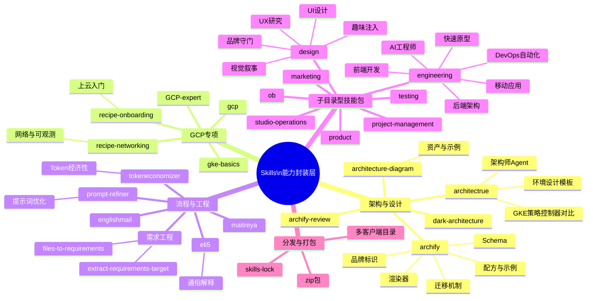

# Skills 知识点分析

Analyze the `skills/` knowledge base. Categorize the agent-skill definitions by capability domain, summarize what each skill does, and present everything as a Markdown document with a Mermaid mindmap.

本文档覆盖 `skills/` 目录。**注意**它有 6643 个 md，但那是虚数——
真正的手写技能只有 **18 个 `SKILL.md`**，其余是分发到 10+ 个 AI 客户端目录的**同源副本**。

> **一句话结论**
> ★ `skills/` 是这个知识库的 **"能力封装层"**：把散落在笔记里的方法论
> （架构评审、图示生成、需求提取、提示词优化、GCP 排障…）
> 打包成 **AI Agent 可调用的 Skill**，并通过 `skills-lock.json` + 多个 `.` 前缀目录分发到
> Claude Code、Codex、Qwen、Kimi、Hermes 等客户端。

---

## 文档体系分析

### 真正的技能源（`skills/<name>/`）
按能力域分五类：

1. **架构与设计** — `archify/`、`archify-review/`、`architectrue/`、`architecture-diagram/`、`dark-architecture/`
2. **GCP 专项** — `GCP-expert/`、`gcp/`、`gke-basics/`、
   `google-cloud-recipe-networking-observability/`、`google-cloud-recipe-onboarding/`
3. **流程与工程** — `eli5/`、`prompt-refiner/`、`tokeneconomizer/`、`files-to-requirements/`、
   `extract-requirements-target/`、`englishmail/`、`maitreya/`
4. **子目录型技能包** — `design/`、`engineering/`、`marketing/`、`product/`、
   `project-management/`、`studio-operations/`、`testing/`、`ob/`
5. **分发与打包** — `skills-lock.json`、`skills-main.zip`、`archify.zip`、`diagram-design.zip`、
   10+ 个 `.` 前缀分发目录

---

## 知识点 MindMap



---

## 主要知识领域详解

### 1. 架构与设计类（最有含量的一组）
| 技能 | 说明 |
|---|---|
| `archify/` | 一个**完整的图示生成器**：`assets/`（资产）、`bin/`（可执行）、`brand-marks/`（品牌标识）、`delta/`、`examples/`、`migrations/`、`recipes/`（配方）、`renderers/`（渲染器）、`schemas/`（结构定义） |
| `archify-review/` | 架构图产出后的**评审**技能 |
| `architectrue/` | **GCP/GKE 架构技术合作伙伴**：`agents/`（架构师 Agent）、`gke-policy-controller-vs-gatekeeper/`、`ple-environment-design/`、`references/`、`templates/` |
| `architecture-diagram/` | 架构图生成：`assets/` + `examples/` |
| `dark-architecture/` | 另一套架构表达风格 |

> `architectrue/` 与 `ai/prompt/architectrue*.md`、`gcp/asm/` 是同一套方法论的三种形态：
> **人读的 Prompt、Agent 读的 Skill、落地读的笔记**。

### 2. GCP 专项类
`GCP-expert/`、`gcp/`、`gke-basics/`（22 篇，最大）、
`google-cloud-recipe-networking-observability/`（8 篇）、`google-cloud-recipe-onboarding/`（2 篇）。
这一组对应的是"**我在 GCP 上干活，需要一个能查、能给判断的专家**"的需求。

### 3. 流程与工程类
- `eli5/`：把复杂概念讲成五岁小孩能懂的话（`references/` + `scripts/`）；
- `prompt-refiner/`：**提示词优化**——这是全库最常被复用的能力；
- `tokeneconomizer/`：**Token 经济性**，与 `ucp/argocd-topics/session-token-usage.md` 呼应；
- `files-to-requirements/`、`extract-requirements-target/`：**需求工程**两段式
  （文件 → 需求 → 目标）；
- `englishmail/`、`maitreya/`：英文邮件与禅意类辅助。

### 4. 子目录型技能包（按角色组织）
每个子目录里是若干"人格化"的 Agent 定义，与 `ai/.claude/agents/` 遥相呼应：

- `design/`：Brand Guardian、UI Designer、UX Researcher、Visual Storyteller、Whimsy Injector；
- `engineering/`：AI Engineer、Backend Architect、DevOps Automator、Frontend Developer、
  Mobile App Builder、Rapid Prototyper；
- `marketing/`、`product/`、`project-management/`、`studio-operations/`、`testing/`、`ob/`。

### 5. 分发与打包（工程细节）
- `skills-lock.json`：**锁定版本**，保证多客户端下技能一致；
- `skills-main.zip`、`archify.zip`、`diagram-design.zip`：分发包；
- `.agents/`、`.claude/`、`.codebuddy/`、`.hermes/`、`.kiro/`、`.minimax/`、
  `.qoder/`、`.qwen/`、`.trae/`、`.vibe/`：**10 个客户端目录的同源分发**。
- 这解释了为什么 md 计数高达 6643——**改一处要同步 10 处**，这是本目录最需要注意的工程事实。

---

## 三条阅读路线

```
路线 A · 先了解有哪些能力（30 分钟）
  ls skills/ → 每个目录读 SKILL.md 的 frontmatter
  → archify/SKILL.md → architectrue/SKILL.md

路线 B · 提升自己的提示词能力（1 小时）
  prompt-refiner/SKILL.md → tokeneconomizer/SKILL.md
  → eli5/SKILL.md → ../ai/prompt/README.md

路线 C · 加一个新客户端的技能分发（半天）
  skills-lock.json → 对应 .xxx/skills/ 目录结构
  → ../develop/shell-review/skill/SKILL.md（现成的范式）
```

---

## 结论

1. **先看 `ls skills/`，不要看 md 计数**：6643 是分发副本造成的，
   真实技能是 18 个。
2. **这个目录是知识库的"出口"**：`develop/shell-review/` 里写的方法论
   被封装成了 `skills/shell-review` 风格的 Skill——**笔记 → Skill** 是一条明确的路径。
3. **`archify/` 是唯一一个"有可执行代码"的技能**：`bin/` + `renderers/` + `schemas/`
   说明它不是提示词集合，而是一个**工具**。
4. **多客户端分发是最大的维护成本**：10 个目录同步，
   建议用 `skills-lock.json` + 脚本生成，而不是手工复制。

---

## 关联文档

- [../knowledge-mindmap.md](../knowledge-mindmap.md) ·
  [../ai/ai-mindmap.md](../ai/ai-mindmap.md) ·
  [../develop/develop-mindmap.md](../develop/develop-mindmap.md) ·
  [../gcp/ucp/argocd-mindmap.md](../gcp/ucp/argocd-mindmap.md)
- [README.md](./README.md) ·
  [skills-lock.json](./skills-lock.json) ·
  [archify/SKILL.md](./archify/SKILL.md) ·
  [architectrue/SKILL.md](./architectrue/SKILL.md) ·
  [gke-basics/SKILL.md](./gke-basics/SKILL.md) ·
  [prompt-refiner/SKILL.md](./prompt-refiner/SKILL.md)
