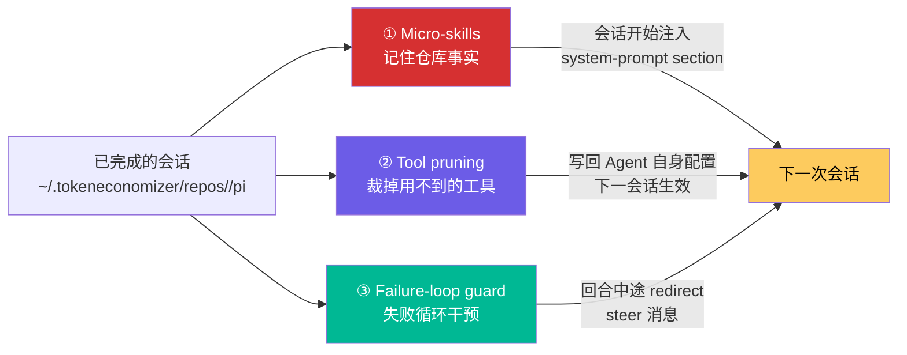

# TokenEconomizer on Pi — 安装、配置与排障手册

> 本文档是 **TokenEconomizer 在本机 Pi 上的落地记录**：包含原理摘要、完整安装过程（逐条命令与真实输出）、
> 配置基线、命令速查与故障排查。所有内容均在本机实测通过。

---

## 1. 一句话概括

TokenEconomizer 是微软 + UC Berkeley 提出的 **Agent 黑盒成本控制插件**：
**不改 Agent 本身**，而是让插件跨会话「记住」这个仓库的脾气，把重复浪费（反复踩坑、从不使用的工具、卡死的失败循环）砍掉。

| 指标（论文 SWE-Bench 实验） | 结果 |
| :--- | :--- |
| 平均成本下降 | **18.4% – 30.9%**（5 组 agent × model 组合） |
| 成本更优的格子 | **30 / 30** 个 仓库 × 组合 |
| Pass@1 提升 | 4 / 5 组合上升（最高 +2.6） |
| Web-Bench 复现 | 成本下降 16% – 21% |
| 全新仓库（安全审计基准） | 成本下降 6% – 20% |

---

## 2. 三大机制



| 机制 | 解决的问题 | 生效时机 | Pi 上的状态 |
| :--- | :--- | :--- | :--- |
| **① Micro-skills（微技能）** | 每次会话都在重新发现同一批事实：`pytest` 命令不存在但 `python -m pytest` 可用、必须先跑的 build 步骤、必需的环境变量、生成文件的位置 | 会话开始时注入到 system prompt | ✅ 支持（**默认关闭**，本次已开启 `envfacts` 模式） |
| **② Tool pruning（工具裁剪）** | 每个 loaded tool 的定义都随每次请求发送，从未使用的工具纯属白付钱 | 会话开始时写入 Agent 自身配置 | ❌ **Pi 不支持**（Pi 只加载 4 个内置工具，无可裁剪空间） |
| **③ Failure-loop guard（循环守卫）** | Agent 在同一个失败上反复打转，白烧 token | 回合进行中，向工具结果注入 redirect | ✅ 支持（**默认开启** `nudge`） |

> 关键设计原则：**可逆优先**。事实会被后续会话证伪而丢弃、被裁掉的工具可以一键归还、守卫只「建议」不「代劳」——
> 停不停这一轮，永远由人决定。

---

## 3. Pi 上的能力矩阵（务必先看）

| 能力 | Claude Code | Codex | **Pi** |
| :--- | :--- | :--- | :--- |
| Micro-skills | ✅ | ✅ | ✅ |
| Tool pruning | 单个工具 | capability 包 | ❌ 不可用 |
| Loop guard | ✅ | ✅ | ✅ |
| 插件自身模型调用 | `claude -p` | `codex exec` | **`pi --print`**（无扩展、无工具） |
| 会话内命令 | `/tokeneconomizer:*` | `$tokeneconomizer:*` | **`/te *`** |
| 终端命令 | `te --host claude` | `te --host codex` | **`te --host pi`** |
| 官方支持版本 | 2.1.300–2.1.310 | 0.153.1–0.164.0 | **1.2.0–1.3.0** |

### ⚠️ 版本说明

本机 Pi 版本为 **1.5.2**，**高于官方测试区间（1.2.0–1.3.0）**。
实测：扩展正常加载、会话正常折叠、成本正常统计、旁路模型调用正常返回，**未发现任何错误**
（`~/.tokeneconomizer/errors.log` 不存在）。但严格说属于「未在官方矩阵内验证」，如后续出现异常，
优先怀疑版本差异，并参考 [排障](#9-故障排查) 一节。

---

## 4. 安装（本次实际执行的过程）

### 4.1 前置条件

| 项 | 要求 | 本机实际 |
| :--- | :--- | :--- |
| Pi | 1.2.0 – 1.3.0（官方） | 1.5.2（实测可用） |
| Python | ≥ 3.10 且在 `PATH` 上 | 3.15.0 ✅ |
| API Key | **不需要**（插件自身调用走你的 Pi 登录态） | — |

### 4.2 安装命令

```bash
# 在任意目录下执行，Pi 会自动 clone 到 ~/.pi/agent/git/ 并写进 settings.json
pi install git:github.com/microsoft/TokenEconomizer
```

实测输出：

```text
Installing git:github.com/microsoft/TokenEconomizer...
Cloning into '/Users/lex/.pi/agent/git/github.com/microsoft/TokenEconomizer'...
up to date in 195ms
Installed git:github.com/microsoft/TokenEconomizer
```

安装完成后 Pi 的 `settings.json` 中会新增 packages 条目：

```json
{
  "packages": [
    "npm:pi-token-usage",
    "git:github.com/microsoft/TokenEconomizer"
  ]
}
```

验证安装结果：

```bash
pi list
```

```text
User packages:
  npm:pi-token-usage
    /Users/lex/.pi/agent/npm/node_modules/pi-token-usage
  git:github.com/microsoft/TokenEconomizer
    /Users/lex/.pi/agent/git/github.com/microsoft/TokenEconomizer
```

> **注意**：插件在会话启动时加载，**安装后必须新开一个 Pi 会话**才生效。

### 4.3 冒烟验证

```bash
cd /tmp/te-pitest && git init -q
pi -p "Reply with exactly: OK"
```

```text
OK
```

再确认插件确实接入了会话（而不是"看起来正常"）：

```bash
~/.tokeneconomizer/bin/te --host pi status
```

```text
TokenEconomizer -- te-pitest (pi)
  repository   /private/tmp/te-pitest, identified by its path (a git repository with no remote)
  state        /Users/lex/.tokeneconomizer/repos/te-pitest-3736b50a45/pi
  config       microskills=off toolprune=auto loopguard=nudge repomap=off mode=auto shadow=False
  sessions     1 folded, 31.7k effective tokens, plugin overhead 0 (0.0%)
  microskills  0 fact(s) injected at session start (0 sessions learned from)
  toolprune    not available on this host
  loopguard    envelope not learned yet (0 ended-green turns); 0 redirect(s), 0 still-stuck notice(s) over 1 turns
```

**判定标准**：`sessions 1 folded` + 有 token 统计 = 插件的 session_start / tool_result / agent_end / session_shutdown
四个钩子全部打通。

> 首次会话后才会生成 `~/.tokeneconomizer/bin/te` 这个终端启动器；在那之前可用仓库内的
> `plugin/scripts/te` 代替。

---

## 5. 本次采用的配置基线

```bash
# 全局开启 micro-skills 的「零模型调用」模式：只从重复失败里总结事实，不产生任何额外模型开销
~/.tokeneconomizer/bin/te --host pi config set microskills=envfacts --global
```

写入 `/Users/lex/.tokeneconomizer/config.json`：

```json
{"microskills": "envfacts"}
```

### 为什么这样配

| 机制 | 取值 | 理由 |
| :--- | :--- | :--- |
| `microskills` | `envfacts` | **不产生模型调用**，只从「同一失败反复出现」中提炼事实（例如 `pytest` 失败 → `python -m pytest` 可用）。零成本零风险先跑起来；等积累 10+ 个会话后再考虑切到 `on`（含模型提议器） |
| `toolprune` | `auto`（默认） | Pi 上本就不生效，保持默认即可 |
| `loopguard` | `nudge`（默认） | 只在回合「有卡死迹象」时才调 judge 模型，成本可控；守卫**不会**自己终止回合 |
| `repomap` | `off`（默认） | 需要 `pip install aider-chat`，属于可选的第四机制，暂不引入 |

### 想要更强的 micro-skills

```bash
# 开启完整模式：每 3 个会话由模型提议一批新事实（有模型开销）
~/.tokeneconomizer/bin/te --host pi config set microskills=on --global

# 或指定用哪个模型跑插件自己的调用（Pi 上默认用你的默认模型）
~/.tokeneconomizer/bin/te --host pi config set paid_model=minimax-cn/MiniMax-M3.1-Flash --global
```

---

## 6. 日常命令

### 在 Pi 会话内（每个命令消耗 1 个模型回合）

```text
/te status          # 这个仓库里学到了什么、做了什么、会话花了多少钱
/te microskills     # 已注入的事实 + 仍在形成中的事实
/te config          # 当前生效的全部设置
/te repos           # 插件为哪些仓库保存了状态
```

### 在终端里（**免费**，不消耗模型回合）

```bash
cd /Users/lex/git/go
~/.tokeneconomizer/bin/te --host pi status
~/.tokeneconomizer/bin/te --host pi microskills
~/.tokeneconomizer/bin/te --host pi config
~/.tokeneconomizer/bin/te --host pi doctor      # 环境自检：Python、状态目录、Agent 探测
```

> `--host` 可省略，默认取该仓库里**最近活跃的 Agent**；多 Agent 混用时建议显式指定。

---

## 7. 插件的模型调用与成本

插件自身**不持有任何 API Key**，所有模型调用都通过你自己的 Pi 登录态完成。

| 调用 | 触发时机 | 读取内容 | Prompt 规模 |
| :--- | :--- | :--- | :--- |
| **Judge（判定卡死）** | 回合出现循环迹象时，最多每 5 次工具调用问一次 | 该回合最近 24 个动作 + 仓库常规回合长度 | ≤ ~1,500 tokens |
| **Redirect writer（写纠偏）** | Judge 判定卡死后立即执行 | Judge 的摘要 | ≤ ~1,500 tokens，输出 2–4 句 |
| **Fact proposer（提议事实）** | 仅 `microskills=on`/`distiller` 时，每 3 个会话一次 | 最近 8 个会话的摘要 + 已学事实 | 几千 tokens |

Pi 上的实际调用形态（实测）：

```bash
pi --print --mode json --no-session --no-tools --no-extensions "<prompt>"
```

`--no-extensions` 意味着插件不会递归触发自己；`--no-tools` 保证 Agent 无法在旁路调用里改动仓库。

> **本机实测**：`minimax-cn/MiniMax-M3.1-Flash` 在上述命令下可正常返回并被正确计价
> （input 1,178 / output 9 tokens）。因此**不需要**配置 `pi_extensions`——
> 该项仅在模型 provider 由某个扩展注册时才需要。

这些开销会被计入 `status` 的 `plugin overhead` 字段与 `ledger.jsonl`。

---

## 8. 文件与目录

| 路径 | 内容 |
| :--- | :--- |
| `~/.pi/agent/git/github.com/microsoft/TokenEconomizer/` | 插件源码（Pi 从这里加载扩展） |
| `~/.tokeneconomizer/` | **全部学习到的状态**，仅本机可见 |
| `~/.tokeneconomizer/bin/te` | 终端启动器（首次会话后生成） |
| `~/.tokeneconomizer/repos/<repo-key>/pi/` | 单仓库的会话账本、事件流、折叠日志 |
| `~/.tokeneconomizer/config.json` | 全局设置 |
| `~/.tokeneconomizer/errors.log` | 出错时的诊断日志（本次为空） |
| `~/.tokeneconomizer/index.json` | 仓库标识索引（remote / 路径 → repo key） |

仓库标识规则：有 origin remote 用 remote 哈希（例：`go-ff86e1edcf`），否则用路径哈希。

---

## 9. 故障排查

| 症状 | 处理 |
| :--- | :--- |
| 安装后无任何反应 | 插件在会话启动时加载 → **重开会话**；再跑 `te --host pi doctor` |
| `TokenEconomizer needs Python >= 3.10` | 装新版 Python，或 `export TE_PYTHON=/path/to/python3.10+` |
| `errors.log` 报包找不到 | 安装源被移动或删了 → 重新 `pi install git:github.com/microsoft/TokenEconomizer` |
| 回合卡死时看不到提示 | Pi 用**通知（notification）**展示该提示；`pi -p` 无头模式下写到 **stderr** |
| `te` 显示的是别的 Agent 的状态 | 加 `--host pi` |
| 想临时关掉整个插件 | `TE_DISABLE=1 pi` |
| 想只关某一个机制 | `TE_LOOPGUARD=off pi` / `TE_MICROSKILLS=off pi` / `TE_TOOLPRUNE=off pi` |
| 怀疑影响了自己的 Agent 行为 | `te --host pi config set shadow=true` → **只决策不执行**，可安全观察 |
| Pi 版本升级后异常 | 官方支持区间是 1.2.0–1.3.0；先 `te --host pi doctor`，再考虑回退 |

---

## 10. 更新与卸载

```bash
# 更新（注意：普通 `pi update` 不会更新扩展）
pi update --extensions

# 卸载（从 settings 移除）
pi remove git:github.com/microsoft/TokenEconomizer

# 可选：清空所有已学习的状态
rm -rf ~/.tokeneconomizer
```

---

## 11. 延伸阅读

| 文档 | 内容 |
| :--- | :--- |
| [setup-log.md](references/setup-log.md) | **本次安装全过程逐条记录**（命令 + 真实输出 + 时间戳） |
| [config-reference.md](references/config-reference.md) | 全部设置项、命令、环境变量速查表 |
| [mechanisms.md](references/mechanisms.md) | 三大机制的判定规则、阈值与生效细节 |
| [上游 README](https://github.com/microsoft/TokenEconomizer#readme) | 官方完整说明（含 Claude Code / Codex / Copilot 的用法） |
| [插件 README](https://github.com/microsoft/TokenEconomizer/blob/main/plugin/README.md) | 各 Agent 适配细节与排障 |
| [论文 arXiv:2610.22732](https://arxiv.org/abs/2610.22732) | 方法与实验数据 |

---

## 12. 落地结论

- ✅ **装好了**：`pi install` 一条命令即可，Pi 会把它当普通 package 管理。
- ✅ **验证通过**：会话折叠、token 计价、仓库识别、终端启动器生成，全部正常。
- ✅ **零额外密钥**：插件复用你的 Pi 登录态与默认模型（`minimax-cn/MiniMax-M3.1-Flash`）。
- ⚠️ **Pi 上少一项**：工具裁剪（Tool pruning）不适用于 Pi，不要期待它生效。
- ⚠️ **版本超出官方区间**：Pi 1.5.2 vs 官方 1.2.0–1.3.0，实测无碍但属未验证区。
- 📌 **建议节奏**：先用 `envfacts` 零成本积累事实；跑满 10 个会话后再评估是否开 `microskills=on`。
