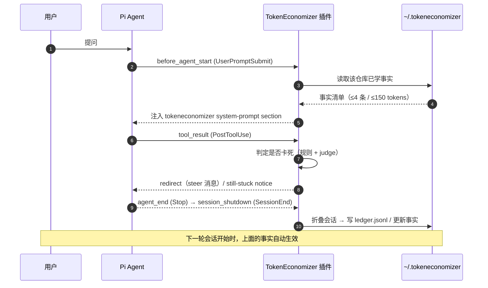
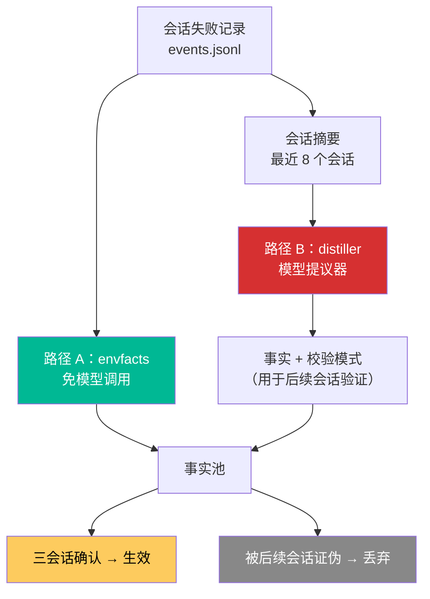
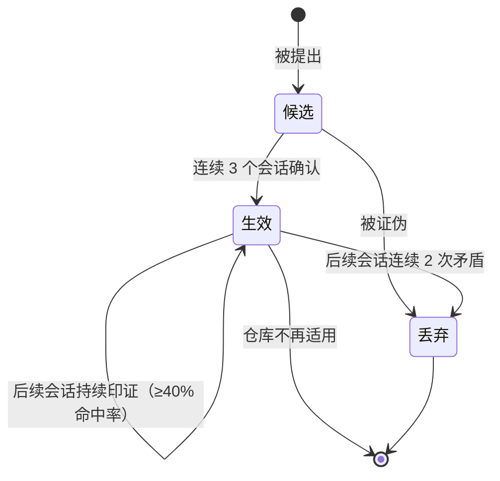
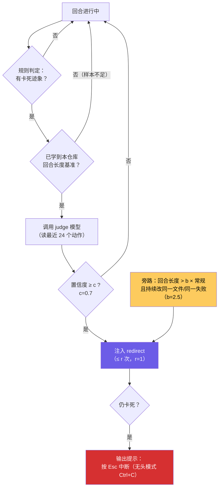

# TokenEconomizer 三大机制详解（Pi 视角）

> 拆解 micro-skills / tool pruning / failure-loop guard 的判定规则、生命周期与在 Pi 上的实际表现。
>
> 相关文档：[SKILL.md](../SKILL.md) · [setup-log.md](setup-log.md) · [config-reference.md](config-reference.md)

---

## 1. 总览：跨会话的闭环



---

## 2. 机制一：Micro-skills（微技能）

### 2.1 它解决什么

同一个仓库里，每个会话都在重新发现同一批事实：

| 反复踩坑的场景 | 学到的事实 |
| :--- | :--- |
| `pytest` 不存在 → 报错 | 「本仓库用 `python -m pytest`」 |
| 必须先跑 `make generate` 才能编译 | 「改动 proto 后需先 `make generate`」 |
| 某命令需要 `DATABASE_URL` | 「运行集成测试前需设置 `DATABASE_URL`」 |
| 生成物落在 `dist/` 且已被 git 忽略 | 「构建产物在 `dist/`，不要手工编辑」 |

### 2.2 两条学习路径



| 路径 | 名称 | 模型调用 | 说明 |
| :--- | :--- | :--- | :--- |
| A | `envfacts` | ❌ 无 | 只从「同一环境失败在多个会话重复出现」中提炼（如命令拼写） |
| B | `distiller` | ✅ 每 N 个会话一次 | 模型读最近 8 个会话摘要（命令形状、编辑的文件、失败命令与错误行），提出候选事实并附**校验模式** |

### 2.3 事实的生命周期



| 阶段 | 判定 |
| :--- | :--- |
| 确认 | 连续 **3 个会话**确认 |
| 维持 | 适用场景中，**至少 40%** 的会话（且不少于 4 个会话）仍在印证或仍触发它要防的失败 |
| 证伪 | 命令拼写类事实被**连续 2 次**反证 → 立即丢弃 |
| 注入 | 会话开始时，system-prompt section 名固定为 `tokeneconomizer` |

### 2.4 Pi 上的实现要点

- **每轮 prompt 都重新注入**。Pi 会 diff system-prompt 的各个 section；如果某一轮不注入，Pi 会把它记成「被删除」，
  导致缓存失效。所以插件在 `before_agent_start` 上**每个 prompt 都写一次**同样的 section。
- **续跑的会话保留原有事实**（逐字保留），保证其 prompt cache 仍然命中。
- **注入上限**：`microskills_max_facts=4`（仅针对 envfacts）、`microskills_max_tokens=150`。
- **查看**：`/te microskills` 或 `te --host pi microskills`。

---

## 3. 机制二：Tool pruning（工具裁剪）

> ⚠️ **Pi 上不可用**。以下为通用原理说明，便于理解它在别的 Agent（如 Claude Code）上的行为，
> 以及为何 Pi 不适用。

### 3.1 通用原理

每个 loaded tool 的 **JSON 定义**都会随**每一次**请求发送——即使这个工具整场会话一次都没被调用。
Agent 加载 20 个工具，就意味着每个请求都要为 20 个工具的定义付费。

裁剪条件（**或**关系满足其一）：

```text
工具在 ≥ p 个 prompt 上完全未被使用
   └─ 且这些 prompt 跨越 ≥ m 个会话          （p=10, m=2）

或

工具在 ≥ s 个会话中完全未被使用              （s=5，与 prompt 数无关）
```

### 3.2 保护性设计

| 设计 | 原因 |
| :--- | :--- |
| 需要 **≥ 2 个会话** 才生效 | 单个会话不能独断 |
| 写入前要求仓库**空闲 q 分钟**（默认 60） | 刚续上的对话若工具集变了，prompt cache 要整体重写；空闲一小时后缓存本就过期 |
| 清单**最长等一天**也会写入 | 避免永远不落地 |
| `toolprune_protect` | 用户可永久保护某些工具（如 `mcp__headroom__*`） |
| 只增改自己的条目 | 用户手写的 deny 规则永不被触碰 |
| 创建的配置文件加入 `.git/info/exclude` | 不污染仓库 git 状态 |

### 3.3 各 Agent 能裁什么

| Agent | 可裁剪粒度 | 写入位置 |
| :--- | :--- | :--- |
| Claude Code | 单个工具 | `.claude/settings.local.json` |
| Codex | capability 包（`collaboration` / `goals` / `image_media`） | `.codex/config.toml` |
| Copilot CLI | 整个 MCP server | `.github/copilot/settings.local.json` |
| **Pi** | **无**（只加载 4 个工具） | — |

---

## 4. 机制三：Failure-loop guard（循环守卫）

### 4.1 两级判定



### 4.2 「有卡死迹象」的构成

| 信号 | 阈值（default 档） |
| :--- | :--- |
| 工具调用次数 | ≥ `min_turns` = 20 |
| 同一文件反复编辑 | ≥ `edit_churn` = 4 次 |
| 编辑文件过于分散 | ≥ `distinct_edit_files` = 3 个 |
| 持续报错 | ≥ `error_outputs` = 6 次失败结果 |
| 失败停滞（重复老失败） | `stagnation` ≥ 0.20 |
| 回合长度超基准 | > `envelope_pct`(90) × `envelope_margin`(1.25) |
| 长度超极限 | > `backstop_mult`(2.5) × 常规长度 **且** 仍在churn → **跳过 judge 直接 redirect** |

### 4.3 回合长度基准（envelope）怎么来

1. 观察本仓库的回合，记录**「正常结束」**的回合：
   - 自行结束；
   - 最后一次编辑之后**没有**失败的检查。
2. 攒够 `envelope_min_samples`（default 5）个这样的回合后，才开始启用守卫。
3. 取这些回合长度的 **90 百分位**，再乘 `envelope_margin`（1.25）作为阈值。

> 这解释了为什么刚装上时 `status` 会显示 `envelope not learned yet`——
> 守卫在攒样本，攒够之前完全不介入。

### 4.4 四个阈值预设

| 阈值 | conservative | default | aggressive |
| :--- | :--- | :--- | :--- |
| `min_turns` | 28 | 20 | 14 |
| `edit_churn` | 5 | 4 | 3 |
| `error_outputs` | 8 | 6 | 4 |
| `stagnation` | 0.30 | 0.20 | 0.12 |
| `envelope_min_samples` | 7 | 5 | 3 |
| `backstop_mult` | 3.5 | 2.5 | 1.8 |
| `judge_confidence` | 0.85 | 0.7 | 0.55 |
| `gate_min_turns` | 24 | 18 | 12 |

### 4.5 Pi 上的表现

| 场景 | 表现 |
| :--- | :--- |
| 交互式 TUI | 以 **notification** 形式弹出 `TokenEconomizer: this turn still looks stuck...`，按 **Esc** 中断 |
| `pi -p` 无头模式 | 提示写到 **stderr**；**Ctrl+C** 结束运行（Pi 启动的命令会继续跑到结束） |
| redirect 下发方式 | 扩展用 `pi.sendMessage({customType:"tokeneconomizer"}, {deliverAs:"steer"})` 以 steering 消息注入工具结果 |
| 终止权 | **插件永不自己停回合**，只提示人 |

---

## 5. 成本核算

| 项目 | 是否计入插件开销 |
| :--- | :--- |
| Agent 正常对话 token | ❌ 计入你的常规用量 |
| Judge 调用 | ✅ 计入 `plugin overhead` |
| Redirect writer 调用 | ✅ 计入 `plugin overhead` |
| Fact proposer 调用 | ✅ 计入 `plugin overhead`（仅 `microskills=on`/`distiller`） |
| 工具裁剪 | ✅ 无模型调用，纯白赚 |

记账位置：

| 文件 | 内容 |
| :--- | :--- |
| `~/.tokeneconomizer/repos/<key>/pi/ledger.jsonl` | 每会话 token 账本，插件开销在 `overhead` 字段 |
| `~/.tokeneconomizer/repos/<key>/pi/events.jsonl` | 原始事件流（折叠的输入） |
| `~/.tokeneconomizer/repos/<key>/pi/folded.json` | 折叠结果 |

> 成本按**缓存价**计算——一次会话里绝大多数 token 是缓存重读，按全价算会高估浪费。

---

## 6. 可逆性设计（为什么敢开）

| 机制 | 如何撤销 |
| :--- | :--- |
| 事实 | 后续会话证伪即自动丢弃；`config set microskills=off` 立即停用 |
| 工具裁剪 | `toolprune restore` 归还；归还后不再被裁；`toolprune=off` 停止新清单 |
| 循环守卫 | `loopguard=off`；单次会话 `TE_LOOPGUARD=off pi` |
| 整体 | `TE_DISABLE=1 pi`；`config set enabled=false --global` |
| 只看不改 | `config set shadow=true`（决策并记录，但一概不执行） |

---

## 7. 四条设计原则

| 原则 | 落地方式 |
| :--- | :--- |
| **只依赖 Agent 已读的东西** | 事实在会话开始注入，工具通过 Agent 自身配置裁剪——不要求 Agent 学会新工具 |
| **按实际计费口径算成本** | 用缓存价计算，并把插件自身的模型调用一并计入 |
| **保护任务成功率** | 事实只从重复证据形成，工具只在确认闲置后裁，守卫对仍在推进的回合不干预 |
| **每个动作都可逆** | 事实可丢弃、工具可归还、守卫只建议不代劳 |

---

## 8. Pi 上的实操建议

| 建议 | 理由 |
| :--- | :--- |
| 起步用 `microskills=envfacts` | 零模型调用即可拿到「命令拼写类」事实，是性价比最高的一档 |
| 跑满 10+ 个会话再开 `microskills=on` | 提议器需要足够的历史才有信息量 |
| 前 5 个回合别指望守卫生效 | envelope 需要 5 个「正常结束回合」才建立 |
| `loopguard_aggr` 先别动 | default 档对大多数仓库足够；卡死误报再考虑调低 `min_turns` |
| 想验证插件行为又怕干扰 → `shadow=true` | 只记录不执行，安全 |
| 定期 `te --host pi status` | 看 `sessions` 里的 token 趋势与 `plugin overhead` 占比 |
