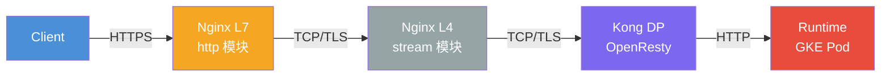

# 多层代理链路 Header 追踪与覆盖排查方法论

> **适用链路**：Client → nginx L7 → nginx L4(stream) → Kong DP → Runtime (GKE Pod)
>
> **核心问题**：请求头（发出方向）或响应头（返回方向）在某一跳被改写、丢弃或复制，
> 导致下游拿到的值与客户端发出的不一致。典型症状是"客户端发了 A，下游看到 B"。
>
> **本文回答三个问题**：
> 1. 每层到底能对 Header 做什么？（谁能改、谁不能改）
> 2. 如何精确知道"哪一跳"改的？（而不是逐个登录试探）
> 3. 如何用可复用的探针（probe）把链路状态一次性打出来？

---

## 目录

- [多层代理链路 Header 追踪与覆盖排查方法论](#多层代理链路-header-追踪与覆盖排查方法论)
  - [目录](#目录)
  - [1. 一句话定位](#1-一句话定位)
  - [2. 术语先行：上游与下游](#2-术语先行上游与下游)
    - [2.1 本链路里每个节点的上下游](#21-本链路里每个节点的上下游)
    - [2.2 指令与方向的对应关系](#22-指令与方向的对应关系)
  - [3. 链路模型：谁有能力改 Header](#3-链路模型谁有能力改-header)
    - [3.1 各层改动 Header 的权限矩阵](#31-各层改动-header-的权限矩阵)
  - [4. 四个观测面：每跳你实际能看到什么](#4-四个观测面每跳你实际能看到什么)
    - [4.1 nginx 变量命名规则（最容易踩坑的地方）](#41-nginx-变量命名规则最容易踩坑的地方)
  - [5. Header 被改写的 6 种机制与优先级](#5-header-被改写的-6-种机制与优先级)
    - [5.1 优先级：谁赢](#51-优先级谁赢)
    - [5.2 一个必须提前知道的 nginx 陷阱：继承是"整体替换"，不是"合并"](#52-一个必须提前知道的-nginx-陷阱继承是整体替换不是合并)
  - [6. 通用排查方法论：五步法](#6-通用排查方法论五步法)
    - [Step 1 — 锁定观察点（先别改代码）](#step-1--锁定观察点先别改代码)
    - [Step 2 — 建立"差异假设"，不要"全链路怀疑"](#step-2--建立差异假设不要全链路怀疑)
    - [Step 3 — 逐跳盖章（探针），一次拿到全链证据](#step-3--逐跳盖章探针一次拿到全链证据)
    - [Step 4 — 读证据链，定位变形点](#step-4--读证据链定位变形点)
    - [Step 5 — 修复并回归](#step-5--修复并回归)
  - [7. 探针规范：为什么不能所有跳都用同一个头名](#7-探针规范为什么不能所有跳都用同一个头名)
    - [7.1 头名必须逐跳唯一](#71-头名必须逐跳唯一)
    - [7.2 值的语义必须严格对应](#72-值的语义必须严格对应)
    - [7.3 加探针的正确姿势（避免踩 5.2 的继承陷阱）](#73-加探针的正确姿势避免踩-52-的继承陷阱)
    - [7.4 可直接粘贴的 L7 探针配置](#74-可直接粘贴的-l7-探针配置)
    - [7.5 Kong 侧的等价探针](#75-kong-侧的等价探针)
  - [8. 各层速查](#8-各层速查)
    - [8.1 脚本用法](#81-脚本用法)
  - [9. 本案例复盘：UA\_DIRECT\_A 与 SRC\_B](#9-本案例复盘ua_direct_a-与-src_b)
    - [9.1 现象记录](#91-现象记录)
    - [9.2 关键推理：被改的到底是哪一个头](#92-关键推理被改的到底是哪一个头)
    - [9.3 候选机制排序](#93-候选机制排序)
    - [9.4 现象判别表](#94-现象判别表)
    - [9.5 取证步骤（按顺序执行）](#95-取证步骤按顺序执行)
  - [10. 生产安全约束](#10-生产安全约束)
  - [11. 参考与相关文档](#11-参考与相关文档)


---
)
## 1. 一句话定位
- [nginx-debug](../../webservice/nginx/docs/nginx-header-debug.md)
> **Header 覆盖排查的本质不是"逐跳登录 curl"，而是"在每一跳留下一份可对比的快照"。**

手工逐跳 curl 之所以累，是因为它只告诉你"这一跳的**出口**"，
而你需要同时知道每一跳的**入口**和**出口**，才能定位"变形发生在哪一跳"。

正确做法是让每一跳自己把"我收到的值"盖个章写进一个新的 Header，
这些章会随请求流向下游，最终在 Runtime 的日志里排成一条完整证据链。

复杂度：**Moderate**（不需要改架构，不需要抓包，只需要加几个 `proxy_set_header`）。

---

## 2. 术语先行：上游与下游

在 nginx / Envoy / Kong 这类网关的语境里，**上下游是按请求的流向定义的**，
而且是**相对于某一个节点**而言的，不是固定属于某台机器：

- **Upstream（上游）**：本节点把请求**转发过去**的目标，也就是 `proxy_pass` 指向的后端。
- **Downstream（下游）**：把请求**发给本节点**的一方，也就是客户端或前一跳。

> ⚠️ **注意**：数据管道等领域常用相反的说法（把数据来源叫"上游"）。
> 讨论 nginx / Kong 的配置和日志时，统一按**请求流向**理解才不会混淆。

### 2.1 本链路里每个节点的上下游

链路：`Client → Nginx L7 → Nginx L4 → KongDP → Runtime`

**注意 L7 的直接上游是 L4，不是 Kong**（很容易在这里搞混）：

| 节点 | 它的 downstream | 它的 upstream |
|---|---|---|
| Nginx L7 | Client | **Nginx L4** |
| Nginx L4 | Nginx L7 | KongDP |
| KongDP | Nginx L4 | Runtime |
| Runtime | KongDP | 无 |

整体上：请求往 Runtime 的方向走 = "往上游"；响应往 Client 的方向走 = "往下游"。

### 2.2 指令与方向的对应关系

| 名称 | 作用对象 | 方向 |
|---|---|---|
| `proxy_set_header` | **请求头** | 本节点 → **upstream**（后一跳） |
| `add_header` | **响应头** | 本节点 → **downstream**（客户端或前一跳） |
| `proxy_hide_header` | **响应头** | 屏蔽 upstream 返回给 downstream 的头 |
| `$http_<name>` | 请求头 | 本节点**收到**的 |
| `$upstream_http_<name>` | 响应头 | **upstream 返回给本节点**的 |
| `$sent_http_<name>` | 响应头 | 本节点**发给 downstream**的 |
| `$upstream_addr` / `$upstream_status` | — | 本节点所连 upstream 的地址与状态码 |

> 把这张表和第 4 节的"四个观测面"对照着看：
> **请求方向**只有"收到"一个视角，而 `add_header` 属于**响应方向**，
> 所以 `add_header` 无论怎么配，都不会影响"发给上游的请求头"。
>
> 这套术语在 nginx / Kong 的官方文档里是同一套口径，
> 跨文档讨论时按**请求流向**理解即可，不要按"数据来源"理解。

---

## 3. 链路模型：谁有能力改 Header



### 3.1 各层改动 Header 的权限矩阵

| 层 | 能改请求头？ | 能改响应头？ | 手段 | 本架构中的实际角色 |
|---|---|---|---|---|
| **Client** | ✅ 唯一源头 | — | SDK / curl | 发送 `user-agent`、`x-caep-src-useragent` |
| **nginx L7 (http)** | ✅ **强** | ✅ **强** | `proxy_set_header`、`proxy_pass_request_headers`、`proxy_hide_header`、`add_header` | **主要嫌疑层** |
| **nginx L4 (stream)** | ❌ **不能** | ❌ **不能** | 仅 TCP 字节转发 | 字节级管道，不解析 HTTP |
| **Kong DP (OpenResty)** | ✅ 强 | ✅ 强 | `request-transformer`、`response-transformer`、`key-auth` 等插件 | **主要嫌疑层** |
| **Runtime (应用)** | ⚠️ 只能改自己看到的 | ✅ | Filter / Interceptor / 读取逻辑 | 消费方，也是"报错现场" |

> **关键结论 1：nginx L4 不参与 Header 改动。**
> `stream` 模块工作在 TCP 字节流层面，不解析 HTTP 报文，因此它对 Header 是**完全透明**的。
> 如果你确认 L4 是 `stream`（不是 `http` 块里反代），那么嫌疑范围直接收敛到 **L7 nginx、Kong、Runtime** 三者。
> 验证方法：看 L4 的配置里是 `stream { ... }` 还是 `http { ... }`；或 `nginx -T | grep -A3 stream`。
> （注意：如果 L4 做的是 **TLS 终结 + TCP 转发**，Header 字节依然原样透传，结论不变。）

> **关键结论 2：nginx 的"请求头"只有一个视角。**
> nginx 没有"我发出去的头"的变量（请求方向只有 `$http_*` = 我**收到**的）。
> 想知道"我发出去了什么"，只能在**下一跳**观测，或者用本文第 7 节的探针间接构造。
> 响应方向则相反，nginx 同时给你两个视角：`$upstream_http_*`（从上游收到）与 `$sent_http_*`（发给客户端）。

---

## 4. 四个观测面：每跳你实际能看到什么

排查 Header 问题，本质上需要回答四个问题。对应到每一跳：

| 观测面 | 含义 | nginx (http) | Kong | 应用层 |
|---|---|---|---|---|
| **IN-REQ** | 我**收到**的请求头 | `$http_<name>` | `kong.request.get_header()` | `request.getHeader()` |
| **OUT-REQ** | 我**发出**的请求头 | ❌ 无变量，用探针构造 | `kong.service.request.get_header()` | — |
| **IN-RES** | 我从上游**收到**的响应头 | `$upstream_http_<name>` | `kong.service.response.get_header()` | — |
| **OUT-RES** | 我**发出**的响应头 | `$sent_http_<name>` | `kong.response.get_header()` | — |

### 4.1 nginx 变量命名规则（最容易踩坑的地方）

请求头/响应头名 → 变量名的转换规则：**转小写 + 短横线换成下划线**。

```text
Header 名:            X-Caep-Src-Useragent
nginx 变量:           $http_x_caep_src_useragent
                                        ↑
                        短横线 - 全部变成下划线 _
```

由此产生三个必须注意的推论：

1. **命名冲突不可区分**：`x-caep-src-useragent` 和 `x_caep_src_useragent`
   在 nginx 变量空间里是**同一个** `$http_x_caep_src_useragent`。
2. **下划线形式的请求头默认会被丢弃**：`underscores_in_headers` 默认 `off`，
   名字里含下划线的请求头会被标记为 invalid，进而受 `ignore_invalid_headers`（默认 `on`）影响被丢弃。
   所以 `X_Caep_Src_Useragent`（下划线）到达 nginx 时可能**根本不存在**，
   而 `X-Caep-Src-Useragent`（短横线）正常。
3. **多个同名头会被合并**：同一 Header 出现多次时，`$http_*` 返回的是
   **用 `, ` 拼接**的结果，不是数组。这会掩盖"重复头"问题（见第 5 节机制 D）。

---

## 5. Header 被改写的 6 种机制与优先级

任何一层能把值改掉，只可能通过下面 6 种机制之一。定位时按此表逐条排除：

| # | 机制 | 现象 | nginx 触发方式 | Kong 触发方式 |
|---|---|---|---|---|
| **A** | **替换** Replace | 值变成了另一个已知值 | `proxy_set_header X "$http_y";` | `request-transformer` → `replace.headers` |
| **B** | **删除** Drop | Header 消失 | `proxy_set_header X "";` / `proxy_pass_request_headers off;` | `request-transformer` → `remove.headers` / `key-auth` 的 `hide_credentials` |
| **C** | **重复** Duplicate | 出现多个同名头 / 值被 `, ` 拼接 | 客户端本身重复发；`proxy_set_header` 不会产生重复 | `request-transformer` → `append.headers` |
| **D** | **大小写折叠** Case-fold | 名字变了，值不变 | nginx 内部存储即小写，但**透传时保留原始大小写** | **OpenResty 全部转小写**（HTTP/2 强制要求） |
| **E** | **截断** Truncate | 值只剩前半截 | `large_client_header_buffers` 超限 → 直接 400/501 | `headers` / `http2_max_header_size` 超限 → 400 |
| **F** | **模板重写** Template | 值由另一个 Header 算出 | `map` + `proxy_set_header` 组合 | `$(headers.user-agent)` 模板语法 |

### 5.1 优先级：谁赢

在**同一层内部**，多个规则同时命中时：

- **nginx L7**：`proxy_set_header` 之间按配置文件中出现顺序，**后写的覆盖先写的**（同层同名）。
  `proxy_set_header` 命中后，**客户端原始的同名 Header 不再透传**（源码在
  `ngx_http_proxy_create_request` 里按 `headers->hash` 跳过同名客户端头）。
- **Kong**：`request-transformer` 内部执行顺序固定为
  **Remove → Rename → Replace → Add → Append**（来自 `kong/plugins/request-transformer/access.lua`）。
  因此 `replace` 与 `add` 的行为差异很关键：
  - `add.headers`：**仅当该 Header 不存在时才添加**（不覆盖已有值）
  - `replace.headers`：**仅当该 Header 已存在时才替换**（不存在则什么都不做）

  > 这条差异直接决定了排查方向：
  > 客户端**已经发了** `x-caep-src-useragent` → 只有 `replace` 能改到它，`add` 改不动。
  > 如果你怀疑是 Kong 插件干的，先确认它用的是 `replace` 而不是 `add`。

- **跨层**：上游覆盖下游。Kong 的 `replace` 发生在 nginx L7 之后，
  所以 **Kong 的结果最终胜出**；L4 因为是字节管道，永远不参与竞争。

### 5.2 一个必须提前知道的 nginx 陷阱：继承是"整体替换"，不是"合并"

> nginx 官方原文：
> *"These directives are inherited from the previous configuration level
> **if and only if there are no `proxy_set_header` directives defined on the current level**."*

推论（**这是生产事故的高发点**）：

- 你在 `location` 里加一条 `proxy_set_header X-Debug-Foo ...;` 用来排查问题，
  如果这个 `location` 原本**没有**任何 `proxy_set_header`，
  那么它会**整体丢弃**从 `server`/`http` 层继承下来的**全部** `proxy_set_header`。
- 被丢弃的包括业务上必需的 `Host $host`、`X-Forwarded-For` 等。
  默认的 `Host $proxy_host` / `Connection close` 会被重新合并进来（源码 `ngx_http_proxy_init_headers`）。
- `add_header` 的继承规则**完全一样**（"if and only if there are no add_header directives defined on the current level"）。
  在 `location` 里加一条 `add_header` 调试用，可能顺带**干掉上层的安全响应头**。

**因此：探针的加法必须"同层复制、原地替换"**，见第 6.3 节。

---

## 6. 通用排查方法论：五步法

### Step 1 — 锁定观察点（先别改代码）

把 5 跳链路列出来，标注每一跳：

- 你**能不能**改它的配置？（L4 stream 改不了）
- 它**有没有**现成的日志能看到入站 Header？
- Runtime 侧有没有一个能打印全部入站 Header 的接口或日志？

Runtime 侧必须先具备"能看到全部 Header"的能力，否则最后一步无法收口。
Java 侧最小实现：

```java
log.info("headers={}", Collections.list(request.getHeaderNames()));
```

> 优先用 `HttpServletRequest.getHeaderNames()` / `getHeaders()`，
> **不要**把 Header 转成普通 `HashMap` 再按 key 取——那样会引入大小写敏感问题，
> 把"大小写"和"值被改"两个现象混在一起（详见 `references/runtime-layer.md`）。

### Step 2 — 建立"差异假设"，不要"全链路怀疑"

用第 5 节的 6 种机制分类，对照现象直接缩小范围。经验判据：

| 现象 | 首要怀疑 |
|---|---|
| 下游值 == 链路上**另一个 Header** 的值 | 机制 A/F：某处显式拷贝/模板 |
| 下游值 == **本跳的默认值** | 机制 A：`proxy_set_header` 写死了值 |
| 下游**完全没有**这个头 | 机制 B：被删了，或名字含下划线被丢弃 |
| 下游值以 `, ` 开头/中间有逗号 | 机制 C：重复头 |
| 只有部分请求有问题 | 与请求路径/`location` 匹配相关 → **重点查继承规则（4.2）** |
| 只有某一个下游服务有问题 | 该下游专属插件/应用逻辑 |

### Step 3 — 逐跳盖章（探针），一次拿到全链证据

在**每一跳你能改的地方**，加一个**该跳专属名字**的 Header，内容是"我收到的值"。
这些 Header 会一路流到 Runtime，最终在 Runtime 日志里形成证据链。

第 7 节给出命名规范与可直接粘贴的配置。

### Step 4 — 读证据链，定位变形点

把 Runtime 日志里的探针按跳数排开，**找第一个值发生变化的位置**：

```text
Client 发出:      x-caep-src-useragent = SRC_B
L7 收到:          X-Dbg-H1-Caep = SRC_B      ← 未变
Kong 收到:        X-Dbg-H2-Caep = SRC_B      ← 未变
Runtime 收到:     x-caep-src-useragent = UA_DIRECT_A   ← 变了
```

- 若 **L7 的探针就已经变了** → 凶手在 L7 及其之前（Client 自己 / L7 配置）
- 若 **L7 未变、Kong 探针已变** → 凶手是 Kong
- 若 **所有探针都未变，只有最终值变了** → 凶手是 Runtime 自身逻辑

> 注意：探针盖的是"**收到**"的值。若某跳在**收到之后、发出之前**做了改写，
> 该跳自己的探针显示的是改写**前**的值，而**下一跳**的探针显示改写**后**的值。
> 所以"变化点"永远出现在**下一跳**，而不是当前跳。这一点是整个方法的关键。

### Step 5 — 修复并回归

修复时遵守两个原则：

1. **改写方要显式、可审计**：不要依赖"某处默认会覆盖"。
2. **不要用删除 Header 的方式绕过问题**：把头删掉会让下游"看起来正常"，
   但真实语义（谁传过来的）丢了，后续排障更困难。

---

## 7. 探针规范：为什么不能所有跳都用同一个头名

### 7.1 头名必须逐跳唯一

你提议的写法：

```nginx
# ❌ 所有跳都用 X-Debug-User-Agent
proxy_set_header X-Debug-User-Agent $http_x_caep_src_useragent;
```

**问题**：每跳都会用同名头**覆盖**上一跳留下的值。
到 Runtime 时只剩最后一跳的章，**前面所有跳的证据全部丢失**，
等于白加。

**正确**：名字里带上跳标识，逐跳唯一：

```text
X-Dbg-H1-UserAgent      ← L7 nginx 盖的章
X-Dbg-H2-UserAgent      ← Kong 盖的章
X-Dbg-H3-UserAgent      ← Runtime 盖的章（如需）
```

这样 Runtime 日志里三个头并存，一眼看出每一跳各自看到什么。

### 7.2 值的语义必须严格对应

你提议的写法还有一个**语义错位**：

```nginx
# ❌ 名字叫 User-Agent，值却取自 x-caep-src-useragent
proxy_set_header X-Debug-User-Agent $http_x_caep_src_useragent;
```

看日志的人会以为这是"UA 的值"，实际是"src-useragent 的值"。
**这类命名与取值不一致，是排障时最容易自己骗自己的地方。**

正确：头名与取值严格一一对应：

```nginx
proxy_set_header X-Dbg-H1-UserAgent       $http_user_agent;             # UA 的值
proxy_set_header X-Dbg-H1-CaepSrcUserAgent $http_x_caep_src_useragent;   # caep-src 的值
```

### 7.3 加探针的正确姿势（避免踩 5.2 的继承陷阱）

**规则一：探针加在和业务 `proxy_set_header` 同一层。**
如果 `location` 里已经有业务 `proxy_set_header`，把探针加在**同一层**，
继承关系不变；**不要**新建一个空的 `location` 只放探针——那会丢掉该 `location` 原有的继承链。

**规则二：同层重复定义时，把原有的 `proxy_set_header` 一起抄下来。**
如果你必须新建 `location`，则必须完整复制该层原有的 `proxy_set_header` 集合。

**规则三：`add_header`（响应方向）同理。**
在 `location` 加 `add_header` 会整体替换上层 `add_header`，
**务必把上层的安全响应头一并复制**（如 `Strict-Transport-Security`、`X-Frame-Options`）。

**规则四：优先用 `proxy_set_header` 而不是 `add_header` 做请求方向探针。**
`add_header` 加的是**响应头**（客户端可见），`proxy_set_header` 加的是**请求头**（上游可见）。
两者观测的是不同方向，不能混用。

**规则五：探针要有开关。**
用 `map` + 内部白名单 IP 控制是否生效，排查完立刻摘掉，避免长期污染日志与带宽。

### 7.4 可直接粘贴的 L7 探针配置

```nginx
http {
    # 只对白名单来源 IP 生效；排查完把白名单清空即可停用
    map "$remote_addr:$http_x_debug_trace" $debug_trace_on {
        default        0;
        "10.0.0.5:1"  1;
    }

    server {
        listen 443 ssl;
        server_name api.example.com;

        location / {
            # ---- 探针：命名带跳号，值与语义严格对应 ----
            proxy_set_header X-Dbg-H1-UserAgent       $http_user_agent;
            proxy_set_header X-Dbg-H1-CaepSrcUserAgent $http_x_caep_src_useragent;
            proxy_set_header X-Dbg-H1-Trace            $debug_trace_on;

            # ---- 业务原有配置保持不变（不要为了加探针重排它们）----
            proxy_set_header Host              $host;
            proxy_set_header X-Forwarded-For   $proxy_add_x_forwarded_for;
            proxy_set_header X-Forwarded-Proto $scheme;

            proxy_pass http://backend_upstream;
        }
    }
}
```

### 7.5 Kong 侧的等价探针

Kong 用 `request-transformer` 的 `add` 盖章（`add` 不会覆盖已有头，最安全）：

```yaml
apiVersion: configuration.konghq.com/v1
kind: KongPlugin
metadata:
  name: debug-header-probe
  annotations:
    konghq.com/plugin: request-transformer
plugin: request-transformer
config:
  add:
    headers:
      - "X-Dbg-H2-UserAgent:$(headers['user-agent'])"
      - "X-Dbg-H2-CaepSrcUserAgent:$(headers['x-caep-src-useragent'])"
```

模板语法（Kong 官方）：

| 类型 | 语法 |
|---|---|
| Header | `$(headers.{HEADER-NAME})` 或 `$(headers["{HEADER-NAME}"])` |
| Query 参数 | `$(query_params.{NAME})` / `$(query_params["{NAME}"])` |
| URI 捕获组 | `$(uri_captures.{GROUP})` / `$(uri_captures["{GROUP}"])` |
| 共享变量 | `$(shared.{VAR})` / `$(shared["{VAR}"])` |

> **注意**：Header 名在模板里**大小写不敏感**（OpenResty 存的就是小写）。
> 但 `X-Forwarded-*` 是例外——**request-transformer 无法改写 `X-Forwarded-*`**，
> 需要用 `post-function` 插件。

---

## 8. 各层速查

| 主题 | 详见 |
|---|---|
| nginx L7：`proxy_set_header` / `add_header` / `map` / 变量命名 / 继承陷阱 / 响应方向观测 | `references/nginx-layer.md` |
| Kong DP：`request-transformer` 六种操作语义 / 插件优先级 / Admin API 排查命令 | `references/kong-layer.md` |
| Runtime：Java/Spring 读取 Header、大小写陷阱、如何打印完整入站 Header | `references/runtime-layer.md` |
| 本案例：UA_DIRECT_A / SRC_B 完整复盘与三种修复方案 | `references/caep-case-study.md` |
| 可执行脚本：逐跳对比 + 自动生成证据链 | `scripts/header-trace.sh`（用法见 8.1） |

### 8.1 脚本用法

`scripts/header-trace.sh` 有三个模式：

```bash
cd sre/header-tracing/scripts

# (1) 生成带跳号的探针配置（nginx + Kong），直接粘贴使用
./header-trace.sh --generate --hops 3

# (2) 逐跳直连对比：把同一个请求分别发给每一跳，看谁改了值
#     需要每一跳都能回显收到的 Header（httpbin 风格 JSON）
./header-trace.sh --probe \
  --url "L7=https://l7.example.com/headers" \
  --url "KONG=https://kong.example.com/headers" \
  --url "RUNTIME=https://api.example.com/debug/headers" \
  --send "user-agent=UA_DIRECT_A" \
  --send "x-caep-src-useragent=SRC_B" \
  --watch "x-caep-src-useragent"

# (3) 印章模式：一次请求还原整条链（需先按 (1) 装好探针）
./header-trace.sh --stamps \
  --url "RUNTIME=https://api.example.com/debug/headers" \
  --send "user-agent=UA_DIRECT_A" \
  --send "x-caep-src-useragent=SRC_B"
```

三种模式的取舍：

| 模式 | 需要什么 | 优点 | 局限 |
|---|---|---|---|
| `--probe` | 每跳都能直连 | **隔离性强**，直接看出哪跳改的 | 每跳都要能直连；TLS 证书要 `--insecure` |
| `--stamps` | 装好探针 | **一次请求**还原全链，最接近真实流量 | 需要先改配置 |
| `--generate` | — | 产出可直接粘贴的配置 | 需手工贴到各层 |

> `--probe` 与 `--stamps` 的语义不同，别混用：
> `--probe` 是**每一跳单独收一次请求**（所以"变了的那个 hop"就是改写者）；
> `--stamps` 是**一次请求穿全链**（所以"变了的那个 hop"是改写者的**下一跳**）。

---

## 9. 本案例复盘：UA_DIRECT_A 与 SRC_B

### 9.1 现象记录

| 位置 | `user-agent` | `x-caep-src-useragent` |
|---|---|---|
| Client 发出 | `UA_DIRECT_A` | `SRC_B` |
| Runtime 收到（异常） | `UA_DIRECT_A` | **`UA_DIRECT_A`** ← 被改 |

### 9.2 关键推理：被改的到底是哪一个头

先看清楚**是什么被改了**，这一点很多人会搞反：

- `user-agent` = `UA_DIRECT_A` → **没有被改**，与 Client 一致。
- `x-caep-src-useragent` = `UA_DIRECT_A` → **被改了**，原值 `SRC_B` 消失，
  且新值**恰好等于同一个请求里另一个 Header（`user-agent`）的值**。

所以这不是"某个默认值覆盖了它"，而是：

> **某一跳显式执行了一次"把 `user-agent` 的值拷贝进 `x-caep-src-useragent`"的动作。**

对应第 5 节的机制 **A（替换）** 或 **F（模板重写）**。
"值恰好等于另一个 Header" 这个特征，几乎把嫌疑范围压到了**少数几行配置**。

### 9.3 候选机制排序

| 层 | 写法 | 机制 |
|---|---|---|
| nginx L7 | `proxy_set_header X-Caep-Src-Useragent $http_user_agent;` | A |
| nginx L7 | `map $http_user_agent $caep_src { ... }` + `proxy_set_header X-Caep-Src-Useragent $caep_src;` | F |
| Kong | `request-transformer` → `replace.headers: ["x-caep-src-useragent:$(headers['user-agent'])"]` | A/F |

> Kong 侧注意：客户端**已经发过** `x-caep-src-useragent`，
> 所以只有 `replace` 能改到，`add` 改不动（见 5.1）。
> 若你在 Kong 里看到的是 `add.headers` 配置，**它不是本次的凶手**。

### 9.4 现象判别表

```bash
# 1) L7 nginx：全量搜索"谁在写这个头"
grep -rn "caep\|src_useragent\|src-useragent" /etc/nginx/
grep -rn "proxy_set_header" /etc/nginx/ | grep -iv "^\s*#"

# 2) nginx 生效配置（include 展开后的真实结果，比翻文件准）
nginx -T 2>/dev/null | grep -n -i "caep\|user_agent"

# 3) Kong 侧：查所有插件与声明式配置
curl -s http://127.0.0.1:8001/plugins | jq '.data[] | select(.name|test("transformer|auth")) | {name, config}'
# KIC 环境
kubectl get kongplugin -A -o yaml | grep -B5 -A10 -i "caep"
```

### 9.5 取证步骤（按顺序执行）

| 方案 | 做法 | 适用 | 代价 |
|---|---|---|---|
| **A. 停止覆盖**（推荐） | 删掉那行拷贝，改成透传 `proxy_set_header X-Caep-Src-Useragent $http_x_caep_src_useragent;` | 语义应是"透传客户端声明" | 无 |
| **B. 改用专用头** | 拷贝到一个**新**头名（如 `X-Caep-Observed-UserAgent`），不占用 `x-caep-src-useragent` | 该头语义是"平台观测到的 UA" | 需下游同步改 |
| **C. 显式优先级** | 用 `map` 定义"客户端有值就用自己的，没有才用 UA" | 两者语义都要保留 | 配置复杂度上升 |

方案 C 的可粘贴写法：

```nginx
map $http_x_caep_src_useragent $caep_src_useragent_final {
    default  $http_x_caep_src_useragent;   # 客户端有声明 → 用客户端的
    ""       $http_user_agent;             # 客户端没声明 → 退化为 UA
}
# ...
proxy_set_header X-Caep-Src-Useragent $caep_src_useragent_final;
```

> 选型建议：**优先 A**。如果 `x-caep-src-useragent` 的语义本就是"客户端自声明的来源 UA"，
> 那么任何用 `user-agent` 覆盖它的写法都是错的，应当直接移除；
> 若确实需要"平台观测到的 UA"，走方案 B 用新头名，**不要复用**客户端可控的头名——
> 否则任何客户端都能通过伪造该头影响下游决策（例如用于审计或风控）。

---

## 10. 生产安全约束

1. **探针头名统一加 `X-Dbg-` 前缀**，避免与业务头冲突；排查完必须删除。
2. **不要把敏感值原样盖章**。若被观测头含 token/凭证，在盖 章前用 `map` 做掩码：
   ```nginx
   map $http_authorization $masked_auth {
       default  "***";
       "~.+"    $http_authorization;
   }
   ```
   更稳妥的做法是盖**长度与哈希指纹**而非原值。
3. **Header 体积预算**。加探针会增大请求头体积，注意上限：
   - nginx：`large_client_header_buffers`（默认 `4 8k`）
   - Kong：`headers` 配置项 / HTTP/2 `http2_max_header_size`
   超过上限的表现是 **400/501**，不是"头被截断"，容易误判（见机制 E）。
4. **探针只对白名单 IP 生效**（见 7.4），避免全量流量日志膨胀与信息泄露。
5. **回归验证**：修复后重跑一次证据链，确认目标 Header 在每一跳的值都等于客户端发出的值。

---

## 11. 参考与相关文档

**本文档集**

- `references/nginx-layer.md` — nginx L7/L4 Header 语义详解
- `references/kong-layer.md` — Kong DP 插件语义与排查命令
- `references/runtime-layer.md` — Runtime 侧读取与验证
- `references/caep-case-study.md` — 本案例完整复盘
- `scripts/header-trace.sh` — 逐跳对比脚本

**仓库内相关文档**

- [`webservice/nginx/docs/nginx-header-debug.md`](../../webservice/nginx/docs/nginx-header-debug.md) — 同一问题的 nginx 视角速查。**本目录已把其中独有的概念与手段回填**：上下游术语（本文第 2 节）、抓包与 debug 日志（`references/nginx-layer.md` 6.1）、回显端点与"别拿 Runtime 日志反推 L7"（同文件 6.1.1 / 6.1.2）、`headers-more`（同文件 6.3）、插件清单（`references/kong-layer.md` 3.5）、执行顺序（`references/caep-case-study.md` 5.7）。该文档保留为 nginx 视角的单页速查。
- [`sre/docs/debug-header.md`](../docs/debug-header.md) — Header 丢失类问题的既有排查记录（`X-AIBANG-client-secret` 案例）
- [`sre/docs/flow-debug.md`](../docs/flow-debug.md) — 502 与分层日志分析
- [`webservice/nginx/docs/nginx-l4-stream-explorer.md`](../../webservice/nginx/docs/nginx-l4-stream-explorer.md) — L4 stream 能力边界
- [`webservice/nginx/docs/L7+L4.md`](../../webservice/nginx/docs/L7+L4.md) — L7/L4 融合改造
- [`webservice/nginx/docs/nginx-debug-log-example.md`](../../webservice/nginx/docs/nginx-debug-log-example.md) — nginx 调试日志示例
- [`flow/docs/L7-L4-request-flow.md`](../../flow/docs/L7-L4-request-flow.md) — 本链路的回包流程

**官方来源**

- nginx `proxy_set_header` / `add_header` — https://nginx.org/en/docs/http/ngx_http_proxy_module.html
- nginx `underscores_in_headers` — https://nginx.org/en/docs/http/ngx_http_core_module.html
- Kong Request Transformer — https://developer.konghq.com/plugins/request-transformer/
