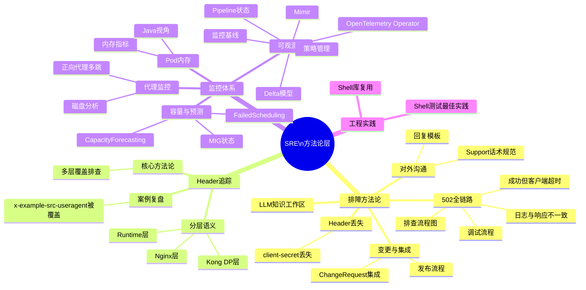

# SRE 知识点分析

Analyze the `sre/` knowledge base. Categorize the troubleshooting / observability / header-tracing documents by technical domain, summarize the key knowledge points, and present everything as a Markdown document with a Mermaid mindmap.

本文档覆盖 `sre/` 下的 **39 篇文档 / 3 个子域**：
排障方法论、Header 追踪、监控体系。

> **一句话结论**
> ★ 这个目录的价值在 **"方法论"而不是"工具"**：
> `header-tracing/` 把多层代理链路的 Header 覆盖问题变成**逐层语义对照**；
> `docs/how-to-debug*.md` 把 502 变成一条**可复用的排查链**；
> `monitor/` 则定义了"该监控什么"而非"怎么配监控"。

---

## 文档体系分析

1. **排障方法论（`docs/`）** — 502 全链路调试、Header 丢失、变更集成、Support 话术
2. **Header 追踪（`header-tracing/`）** — 多层代理链路的 Header 语义对照 + 案例复盘
3. **监控体系（`monitor/`）** — 容量预测、内存、代理、磁盘、OpenTelemetry、Mimir

---

## 知识点 MindMap



---

## 主要知识领域详解

### 1. 排障方法论（`docs/`）
- `how-to-debug.md`：**云服务 API 502 错误调试思路与方法论**；
- `how-to-debug-flow.md`：**GCP 云服务 API 502 全链路调试指南**，
  并给出一张**调试流程图**；
- `flow-debug.md` / `flow-debug-gemini.md`：具体流量的调试记录（两种模型对照）；
- `debug-header.md`：**`X-AIBANG-client-secret` Header 丢失问题**的深度排查；
- `cr-release-integration.md`：Change Request × Release 集成工具调研；
- `reply-template.md`：**API 平台对外 Support 话术规范 v1.0**——
  一份"技术问题如何对外表达"的规范，很少见但很重要；
- `llm-knowledge-workspace-for-sre.md`：**LLM 知识工作区**方案（SRE 场景的知识沉淀）。

### 2. Header 追踪（`header-tracing/`）—— 本目录最独特的一组
- `README.md`：**多层代理链路 Header 追踪与覆盖排查方法论**；
- `references/kong-layer.md`：**Kong DP 层 Header 语义详解**；
- `references/nginx-layer.md`：**Nginx 层 Header 语义详解**；
- `references/runtime-layer.md`：**Runtime 层 Header 接收与验证**；
- `references/example-case-study.md`：**案例复盘**——
  `x-example-src-useragent` 被 `user-agent` 覆盖。

> 价值在于：它不教"怎么加 Header"，
> 而是教"**每一层各自会改写哪些 Header、覆盖顺序是什么**"——
> 这正是多跳链路里丢 Header 的真正原因。

### 3. 监控体系（`monitor/`）
#### 3.1 容量与主动监控
`docs/Capacity-Forecasting.md`：**GKE 容量预测与主动监控**；
`docs/FailedScheduling.md`：调度失败分析；`docs/gce-mig-status.md`：MIG 实例状态。

#### 3.2 Pod 内存
`docs/monitor-memory.md`（GKE Pod 内存监控指南）、
`docs/pod-memory.md`（**以 Java Application 为核心视角**的指标详解）。

#### 3.3 代理与磁盘
`docs/monitor-egress-proxy.md`：**GKE 正向代理（Squid）多跳访问场景的标准化监控设计**；
`docs/monitor-proxy.md`；`gce-disk/`：GCE Squid 代理磁盘监控工具集
（分析方案、监控脚本）。

#### 3.4 可观测栈
`opentelemetry/`：OpenTelemetry Operator（推荐官方 Helm Chart）、K8s 特殊场景；
`docs/Mimir.md`；`docs/monitory-base.md`（监控基线）；
`docs/monitor-base-ai.md`（**理解 Monitoring 里的 Delta**——为什么用 delta 指标）；
`docs/How-to-manage-monitor-policy.md`；`docs/pipeline-status.md`。

### 4. 工程实践
`shell-lib-testing-best-practices.md`：**Shell Lib 复用与 Shell 测试最佳实践**——
把 SRE 脚本工程化（与 `develop/shell-review/` 呼应）。

---

## 三条阅读路线

```
路线 A · 线上 502，按流程排查（2 小时）
  docs/how-to-debug.md → docs/how-to-debug-flow.md
  → docs/flow-debug.md → ../gcp/cross-project/cross-project-sre-summary.md

路线 B · Header 莫名丢了（1 小时）
  header-tracing/README.md → references/kong-layer.md
  → references/nginx-layer.md → references/runtime-layer.md
  → references/example-case-study.md

路线 C · 建一套监控（2 天）
  monitor/docs/monitory-base.md → monitor/docs/Capacity-Forecasting.md
  → monitor/docs/pod-memory.md → monitor/opentelemetry/OpenTelemetry.md
```

---

## 结论

1. **Header 追踪那组是"多层代理"架构的必备配套**：
   链路每多一跳，Header 被覆盖的风险就多一分；
   只有把每层的语义写清楚，才能定位"到底哪一跳改的"。
2. **502 类问题的正确解法是分层定位，不是重试**：
   `how-to-debug-flow.md` 的流程图把"响应慢但日志成功"这类不对称现象拆开讲。
3. **"delta 指标"这一篇值得单独读**： Monitoring 的指标语义不清是误报警的最大来源。
4. **对外话术也属于 SRE 的职责**：`reply-template.md` 把它规范化，
   避免"技术问题被当成不专业"的损耗。

---

## 关联文档

- [../knowledge-mindmap.md](../knowledge-mindmap.md) ·
  [../webservice/webservice-mindmap.md](../webservice/webservice-mindmap.md) ·
  [../gateway/gateway-mindmap.md](../gateway/gateway-mindmap.md) ·
  [../linux/linux-mindmap.md](../linux/linux-mindmap.md) ·
  [../gcp/gcp-mindmap.md](../gcp/gcp-mindmap.md)
- [README.md](./README.md) ·
  [docs/how-to-debug-flow.md](./docs/how-to-debug-flow.md) ·
  [header-tracing/README.md](./header-tracing/README.md) ·
  [header-tracing/references/example-case-study.md](./header-tracing/references/example-case-study.md) ·
  [monitor/docs/Capacity-Forecasting.md](./monitor/docs/Capacity-Forecasting.md) ·
  [monitor/docs/monitor-base-ai.md](./monitor/docs/monitor-base-ai.md)
