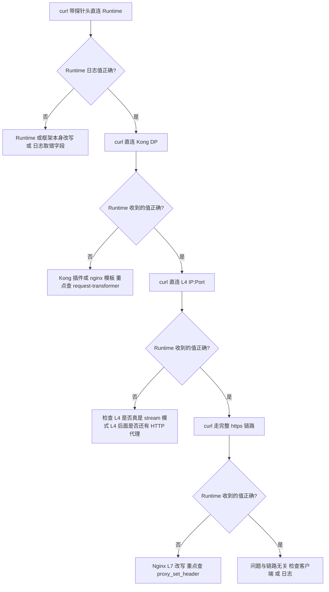

对，在 Nginx 的语境里你的理解是对的。另外，我上一份回答里有一处把方向写反了，先更正。

## 概念

在 Nginx（以及 Envoy、Kong 这类基于它的网关）里，上下游是按**请求的流向**来定义的：

- **Upstream（上游）**：Nginx 把请求转发过去的那个后端，也就是 `proxy_pass` 指向的目标。
- **Downstream（下游）**：把请求发给 Nginx 的一方，也就是客户端或前一跳。

所以 "Nginx L7 → Kong" 里，Kong 是 Nginx L7 的 upstream，不能叫下游。Nginx L7 反过来是 Kong 的 downstream。上下游是相对于某一个节点而言的，不是固定属于某台机器。

## 放到你的链路里

你的完整链路是 `Client → Nginx L7 → Nginx L4 → KongDP → Runtime`，注意 L7 的**直接**上游是 L4，不是 Kong：

| 节点 | 它的 downstream | 它的 upstream |
|---|---|---|
| Nginx L7 | Client | Nginx L4 |
| Nginx L4 | Nginx L7 | KongDP |
| KongDP | Nginx L4 | Runtime |
| Runtime | KongDP | 无 |

整体上，请求往 Runtime 的方向走是"往上游"，响应往 Client 的方向走是"往下游"。

## 对应到变量和指令

| 名称 | 含义 |
|---|---|
| `proxy_set_header` | 改**发给 upstream 的请求头** |
| `add_header` | 改**返回给 downstream 的响应头** |
| `$upstream_http_<name>` | upstream 返回给本节点的响应头 |
| `$sent_http_<name>` | 本节点最终发给 downstream 的响应头 |
| `$upstream_addr`、`$upstream_status` | 本节点所连 upstream 的地址与状态码 |

## 更正上一份回答

我在第 2 节写的两句方向反了：

- `add_header` 我写成"返回给上游客户端"，应该是**返回给下游（客户端或前一跳）**。
- `proxy_set_header` 我写成"发给下游"，应该是**发给上游（后一跳）**。

第 3.6 节里 `$upstream_http_*`（上游返回的）与 `$sent_http_*`（发给下游的）的用法是对的，不受影响。

## 一个注意点

"上下游"在别的领域里也有相反的用法，比如数据管道里经常把数据来源叫上游。讨论 Nginx、Kong 的配置和日志时，统一按"请求流向"来理解就不会混淆。

> **延伸阅读**：本文是 nginx 视角的速查记录。
> 完整方法论（分层参考文档 + 可执行脚本 `header-trace.sh`）见
> [`sre/header-tracing/`](../../../sre/header-tracing/README.md)。

## 1. 问题分析

### 先缩小范围：L4 不可能改请求头

L4 Nginx 如果用的是 `stream {}`，它只转发 TCP 字节，看不到 HTTP，也改不了任何 header。开启 PROXY protocol 时，也只是在连接开头多一行，不会动 HTTP 头。

所以嫌疑只剩三层：

| 层 | 能改请求头的方式 | 能改响应头的方式 |
|---|---|---|
| Nginx L7 | `proxy_set_header`、`more_set_input_headers`、Lua、`proxy_pass_request_headers off` | `add_header`、`proxy_hide_header`、`more_set_headers` |
| Nginx L4 | 不能 | 不能 |
| Kong DP | `request-transformer`、`pre-function`/Lua 插件、自定义 nginx 模板 | `response-transformer`、插件 |
| Runtime | 应用自己的框架或中间件，也可能是日志只打印了某个字段 | 应用代码 |

### 你的现象最可能的原因

日志里 `x-caep-src-useragent: UA_DIRECT_A` 与 `user-agent` 的值相同，最像是某一层执行了类似下面的配置，把 UA 复制过去覆盖了你发的值：

```nginx
proxy_set_header x-caep-src-useragent $http_user_agent;
```

Kong 的 `request-transformer` 里 `replace.headers` 或 `add.headers` 引用 `$(headers['user-agent'])`，效果也一样。

**第一步先全链路 grep**，这是成本最低的定位手段：

```bash
# Nginx L7 / L4 / Kong 所在机器或容器内
nginx -T 2>/dev/null | grep -n -i -E 'caep|user.agent|proxy_set_header|more_set|underscores_in_headers|ignore_invalid_headers|proxy_pass_request_headers'

# Kong：查插件配置
curl -s http://<kong-admin>:8001/plugins | jq '.data[] | select(.name|test("transformer|function")) | {name, route, service, config}'
```

## 2. 你写的那段配置需要先纠正

```nginx
add_header X-Debug-User-Agent $http_user_agent always;          # 响应头，返回给下游（客户端或前一跳）
proxy_set_header X-Debug-User-Agent $http_x_caep_src_useragent; # 请求头，发给上游（后一跳）
```

这里要分清两个方向：

| 指令 | 作用对象 | 发送方向 |
|---|---|---|
| `add_header` | 响应头 | 本节点 → 下游 |
| `proxy_set_header` | 请求头 | 本节点 → 上游 |

另外，我在前面说你的写法容易让人看晕，原因没变。这两行虽然 header 名相同，但一个是响应头，一个是请求头，值也来自不同的变量（一个取 `user-agent`，一个取 `x-caep-src-useragent`）。调试时建议用不同的名字，比如响应头用 `X-Debug-Recv-UA`，请求头用 `X-Debug-Fwd-Src-UA`，看日志和抓包时才不会混淆。

- **`add_header` 只改响应头，`proxy_set_header` 只改发给上游的请求头**，两者互不影响。
- 你的写法把两个不同的值塞进同名 header，会让你自己看晕。Debug header 的名字要和它记录的内容一一对应。
- `proxy_set header` 中间不能有空格，应为 `proxy_set_header`。
- `add_header X ... always` 在 server 或 location 层定义后，会让上层的 `add_header` 全部失效，`proxy_set_header` 同理（见第 4 节）。

## 3. 通用排查方法：每一跳都记录收到什么、发出什么

### 核心思路

1. **每跳都记录"我收到的值"和"我发出去的值"**，对比相邻两跳，值变了的那一跳就是凶手。
2. **用探针 header**：用自定义的唯一值，避免和默认头（`User-Agent`、`Host`）混淆。
3. **从后往前二分**：先直连 Runtime，再直连 Kong，再到 L4，最后到 L7，哪一跳开始出现问题就停。



### 3.1 探针请求

```bash
curl -sv https://your.host/path \
  -H 'User-Agent: UA_DIRECT_A' \
  -H 'X-Caep-Src-Useragent: SRC_B' \
  -H 'X-Probe-1: probe-value-1' 2>&1 | grep -E '^[<>]'
```

`X-Probe-1` 是一个没人会特意处理的头。如果它能一路通过而 `X-Caep-Src-Useragent` 被改了，就证明是针对这个头名的显式规则，而不是链路整体丢头。

### 3.2 Nginx L7：同时记录收到与发出的值

用 `map` 把"要发出去的值"算出来，同一个变量既用于 `proxy_set_header` 又用于日志，可以保证你看到的就是实际发出的值：

```nginx
http {
    # 收到的值与发出的值分开命名
    map $http_x_caep_src_useragent $out_src_ua {
        default $http_x_caep_src_useragent;
        ""      $http_user_agent;   # 示例：为空时才回填 UA，这样不会覆盖客户端发来的值
    }

    log_format hdr_debug '$time_iso8601 rid=$request_id remote=$remote_addr '
                         'IN_ua="$http_user_agent" IN_src="$http_x_caep_src_useragent" '
                         'OUT_src="$out_src_ua" '
                         'up=$upstream_addr st=$status up_st=$upstream_status';

    server {
        access_log /var/log/nginx/hdr_debug.log hdr_debug;

        location / {
            proxy_set_header X-Caep-Src-Useragent $out_src_ua;
            proxy_set_header X-Request-Id         $request_id;   # 用它跨层关联日志
            proxy_pass http://upstream;
        }
    }
}
```

`$http_<name>` 变量记录的是**本跳收到**的请求头（连字符变下划线，小写）。它不会告诉你发给上游的是什么，所以要用上面的 `map` 技巧。

### 3.3 临时回显端点：看本跳收到什么

```nginx
location = /__echo {
    default_type text/plain;
    return 200 "ua=$http_user_agent\nsrc=$http_x_caep_src_useragent\nprobe=$http_x_probe_1\n";
}
```

对每一层（L7、Kong）都可以做这样一个临时端点，或者在 Kong 后面挂一个 echo 服务，比如 `mendhak/http-https-echo` 或 `httpbin /headers`，直接看到链路末端实际收到的完整头列表。

### 3.4 看真实发出去的字节

不改配置时有两种办法：

```bash
# 办法 A：在 Nginx L7 与 L4 之间的明文链路上抓包
# 前提：这一段是 HTTP 明文，若是 TLS 则看不到
sudo tcpdump -i any -A -s0 'tcp port <L4_PORT> and host <L4_IP>' | grep -i -E 'user-agent|x-caep|x-probe'

# 办法 B：Nginx 开 debug 日志（需要编译了 --with-debug）
# 日志里 "http header:" 行是收到的，"http proxy header:" 行是发给上游的
# 只对测试连接生效，避免全局 debug
```

```nginx
events {
    debug_connection <你的客户端IP>;
}
error_log /var/log/nginx/error.log debug;
```

### 3.5 Kong 的排查

```bash
# 列出所有可能改头的插件
curl -s http://<kong-admin>:8001/plugins | jq '.data[] | {name, route: .route.id, service: .service.id, enabled}'
```

- `request-transformer`、`pre-function`、`post-function`、`serverless-functions` 都可以改请求头。
- Kong 的 `file-log` 或 `http-log` 里的 `request.headers` 是客户端发给 Kong 的**原始值**，不是 Kong 发给上游的值，所以它能帮你证明"进 Kong 之前是对的"。
- 想看发给 Runtime 的值，在 Kong 与 Runtime 之间抓包，或者让 Kong 直接路由到 echo 服务。

### 3.6 响应头的排查

响应头被覆盖或丢失，用下面两个变量就能精确定位：

```nginx
log_format resp_debug '$time_iso8601 rid=$request_id '
                      'UP_server="$upstream_http_server" SENT_server="$sent_http_server" '
                      'UP_cache="$upstream_http_cache_control" SENT_cache="$sent_http_cache_control" '
                      'UP_xcustom="$upstream_http_x_custom" SENT_xcustom="$sent_http_x_custom"';
```

- `$upstream_http_<name>`：上游返回给 Nginx 的值。
- `$sent_http_<name>`：Nginx 最终返回给客户端的值。

两者不一致，就是本层改了；一致，就继续往上一层看。

```bash
# 逐层看响应头
curl -sI https://your.host/path -H 'X-Probe-1: x'            # 完整链路
curl -sI http://<L4_IP>:<port>/path -H 'Host: your.host'      # 直连 L4
curl -sI http://<kong_ip>:<port>/path -H 'Host: your.host'    # 直连 Kong
```

## 4. 高频坑

| 坑 | 说明 |
|---|---|
| `proxy_set_header` 继承断裂 | 当前层只要写了任意一条 `proxy_set_header`，上层（http、server）的所有 `proxy_set_header` 全部不继承。`add_header` 同理。 |
| 空值等于删除 | `proxy_set_header X-Foo "";` 会把这个头从请求里删掉。 |
| 默认会重置的头 | Nginx 默认会改写发给上游的 `Host`（变成 `$proxy_host`）和 `Connection`。 |
| 下划线头 | 带 `_` 的 header 默认被 Nginx 丢弃（`underscores_in_headers off`）。你这个头名用的是连字符，不受影响，但同类问题要记住。 |
| 非法头 | `ignore_invalid_headers on`（默认）会丢掉格式不合法的头。 |
| `add_header` 默认只对 2xx/3xx 生效 | 4xx、5xx 要加 `always`。 |
| 多个同名头 | `$http_x_foo` 的取值方式在不同 Nginx 版本里略有差异，怀疑重复头时用 tcpdump 看原始字节。 |
| 响应默认被隐藏的头 | Nginx 默认不会透传上游的 `Date`、`Server`、`X-Accel-*` 等，需要 `proxy_pass_header`。 |
| 日志位置 | 不同层的日志记录的是各自"收到"的值，别拿 Runtime 日志去反推 L7 发了什么。 |

## 5. 注意事项

- 在生产环境加调试配置，只对特定来源生效，比如 `map $remote_addr $debug_on`，或者要求请求带一个特殊的调试头才记录，避免日志暴露全量用户请求头。
- 日志里可能含 `Authorization`、`Cookie`，调试日志不要记录这些头。
- 改完配置先 `nginx -t` 验证，再 `nginx -s reload`。
- 修改 Kong 插件前，先导出当前配置做备份：`curl -s http://<kong-admin>:8001/config > kong-backup.json`，具体取决于你的部署模式。
- 全链路 grep 的 `caep` 关键字建议同时搜 `x-caep-src-useragent` 和 `x_caep_src_useragent` 两种写法。

## 6. 建议你现在的执行顺序

1. 对 L7 Nginx、Kong、Runtime 所在位置 grep `caep` 和 `proxy_set_header`，通常几分钟就能找到那条覆盖规则。
2. 找不到的话，按第 3 节的二分流程，用 `X-Probe-1` 配合直连 Kong、直连 L4 各发一次，看 Runtime 日志里 `x-caep-src-useragent` 在哪一步开始变成 UA 的值。
3. 定位到那一层后，用第 3.2 节的 `map` 写法改成"只在为空时才回填"，同时让日志同时记录 IN 与 OUT 值，以后再出问题可以直接看出是哪一跳改的。

如果你把 L7 Nginx 的 `nginx -T` 输出（脱敏后）和 Kong 的插件列表贴过来，我可以帮你直接指出是哪一条规则造成了覆盖。