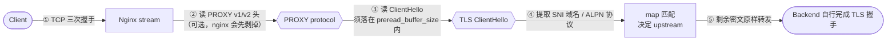
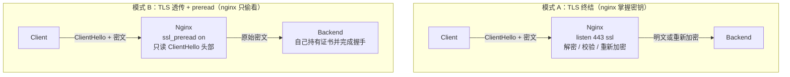
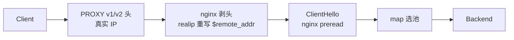

# Nginx L4 (stream 模块) 能力探索

> 目标：搞清楚 **Nginx 在四层（L4 / stream）到底能做什么、不能做什么**，以及 `ssl_preread` / SNI / PROXY protocol 这些指令能解决哪些真实问题。
>
> 适用读者：需要做 TCP 代理、SNI 分流、mTLS、非 HTTP 协议接入的架构决策者。
>
> 交叉阅读：SNI 与 Host 的概念差异见 [`../../explorer-sni.md`](../../explorer-sni.md)；stream 超时语义见 [`nginx-l4-proxy.md`](nginx-l4-proxy.md)；L4/L7 融合决策见 [`L7+L4.md`](L7+L4.md)；**集群内 Pod 统一出网的可落地方案见 [`nginx-l4-user-case.md`](nginx-l4-user-case.md)**。

---

## 目录

- [1. 一句话定位](#1-一句话定位)
- [2. L4 能解决与不能解决什么](#2-l4-能解决与不能解决什么)
- [3. 核心概念栈 TCP 字节流里能看到什么](#3-核心概念栈-tcp-字节流里能看到什么)
- [4. 两种工作模式 TLS 终结与 TLS 透传加 preread](#4-两种工作模式-tls-终结与-tls-透传加-preread)
- [5. ssl_preread 变量清单与重要澄清](#5-ssl_preread-变量清单与重要澄清)
- [6. ssl_preread 的工程限制](#6-ssl_preread-的工程限制)
- [7. 可落地场景清单](#7-可落地场景清单)
- [8. GCP 原生对位 什么时候不需要 Nginx L4](#8-gcp-原生对位-什么时候不需要-nginx-l4)
- [9. 可部署配置模板](#9-可部署配置模板)
- [10. 验证与排障](#10-验证与排障)
- [11. 安全与版本注意事项](#11-安全与版本注意事项)
- [12. 落地路线图 三层推进 Immediate Structural Long-term](#12-落地路线图-三层推进-immediate-structural-long-term)
- [13. 参考与相关文档](#13-参考与相关文档)

---

## 1. 一句话定位

> **Nginx L4 = 在不理解应用协议的前提下，对 TCP/UDP 字节流做转发、负载均衡和"浅层窥视"。**

它能在 **不解密、不解析业务语义** 的情况下做到三件事：

| 能力 | 手段 | 典型用途 |
|---|---|---|
| **转发** | `proxy_pass` + `upstream` | 通用 TCP/UDP 反向代理、数据库接入 |
| **负载均衡** | `upstream` + `least_conn` / `hash` / `random` | 多后端轮转、连接数均衡、源地址哈希 |
| **窥视 + 分流** | `ssl_preread on` + `map` + 变量 | 按 SNI 域名 / ALPN 协议选后端 |

> 关键边界：**能"看到"不等于能"理解"**。stream 只在握手前的那几百字节里做浅层识别，一旦进入加密数据流，它就退化成一条纯字节管道。

---

## 2. L4 能解决与不能解决什么

### ✅ 能解决

| 问题 | 对应机制 | 复杂度 |
|---|---|---|
| 把多个后端 TCP 服务统一成一个入口 VIP | `upstream` + `proxy_pass` | Simple |
| 按 SNI 域名把 HTTPS 流量分给不同后端 | `ssl_preread` + `map` + `proxy_pass $pool` | Moderate |
| 按 ALPN 协议区分 h2 / HTTP1 / 自定义协议 | `$ssl_preread_alpn_protocols` + `map` | Moderate |
| 拿到客户端真实 IP（后端在 LB 后面） | PROXY protocol v1/v2 + `realip` 模块 | Simple |
| 对非 HTTP 协议做连接级限流 / 真实 IP 识别 | `limit_conn` + `realip`（地理围栏需 GCP 防火墙，见第 8 节） | Moderate |
| 在 TLS 终结层做 mTLS（客户端证书校验） | `listen ssl` + `ssl_client_certificate` + `ssl_verify_client` | Moderate |
| MySQL / Redis / Kafka / SSH / MQTT / gRPC-over-TLS 接入 | 通用 TCP 代理 | Simple |
| UDP 服务代理（如内部 DNS） | `listen ... udp` + `proxy_responses` | Simple |
| 上游连接粘性 / 会话保持 | `hash $remote_addr consistent` | Simple |
| 半关闭、双向流式传输正确处理 | `proxy_half_close on` | Simple |

### ❌ 不能解决

| 问题 | 为什么不行 | 正确做法 |
|---|---|---|
| 按 **URL Path** 路由（`/api` vs `/web`） | stream 看到的是密文，无 Path 概念 | 换 `http` 模块，或用 GCLB HTTPS + URL map |
| 按 **HTTP Header / Cookie** 路由 | 同上 | 同上 |
| **内容改写**、响应压缩、缓存 | L4 不解密 | `http` 模块 |
| **WAF / SQL 注入检测** | Cloud Armor 也明确不支持 passthrough L4 | GCLB HTTPS + Cloud Armor |
| **请求级限流 / QPS 统计** | L4 只能看到连接，看不到请求 | `http` 模块的 `limit_req` |
| **精细日志**（URL、UA、状态码） | L4 没有请求概念 | `http` 模块的 `log_format` |
| **TLS 加解密后的内容审计** | 需要解密才有内容 | 终结 TLS 或上 L7 |

> **判据**：只要问题描述里出现 "HTTP / URL / Header / 请求体"，L4 就是错的工具。
> 只要问题描述里出现 "TCP 连接 / 域名 / 协议类型 / 客户端 IP"，L4 就成立。

---

## 3. 核心概念栈 TCP 字节流里能看到什么

一次 HTTPS 连接的字节流是有**固定顺序**的，Nginx stream 能利用的只有最前面那几段。



各层含义：

| 层 | 内容 | Nginx 是否可读 | 读取方式 |
|---|---|---|---|
| PROXY protocol | 真实客户端 IP、端口、协议 | ✅ | `listen ... proxy_protocol` / `set_real_ip_from` + `real_ip_header proxy_protocol` |
| TLS ClientHello | TLS 版本、**SNI 域名**、**ALPN 协议列表**、cipher 列表 | ✅（只读，不解密） | `ssl_preread on` + `$ssl_preread_*` |
| 握手报文 | ServerHello / Certificate | ❌ | 需真正终结 TLS（`listen ssl`） |
| 应用数据 | HTTP body / 私有协议 | ❌（密文） | — |

> SNI 是 **TLS 握手阶段** 客户端主动明文发送的"我想访问哪个域名"，与 HTTP 的 `Host` 头是两个不同层级的概念。完整辨析见 [`../../explorer-sni.md`](../../explorer-sni.md)。

---

## 4. 两种工作模式 TLS 终结与 TLS 透传加 preread

这是 L4 设计里最重要的一个岔路口。



| 维度 | 模式 A：TLS 终结 | 模式 B：TLS 透传 + preread |
|---|---|---|
| 配置 | `listen 443 ssl;` + 证书 | `listen 443;` + `ssl_preread on;` |
| nginx 持有私钥 | ✅ 必须 | ❌ 不需要 |
| 能看到应用层内容 | ✅（明文） | ❌（密文） |
| 能做 mTLS 客户端证书校验 | ✅ | ❌（只能看证书链字段，不做 CRL/OCSP 校验） |
| 能按 SNI 分流 | ✅（按 `server_name` 匹配） | ✅（按 `$ssl_preread_server_name` 匹配） |
| 后端证书到期需重启 nginx | ✅ 需要 | ❌ 不需要（后端自己换证） |
| 客户端 IP 传给后端 | 需 `proxy_protocol` 或改写 | 需 `proxy_protocol` |
| 适合 | 需要 WAF/内容改写/统一加解密 | 后端需自主管理证书、只按域名分流 |
| **复杂度** | Moderate（证书分发 + reload 流程） | Simple（只需逻辑配置） |

### 关键限制：同一个 server 块不能兼得

```nginx
# ❌ 不可行：同一 server 块不能同时终结 TLS 和启用 preread
server {
    listen 443 ssl;
    ssl_preread on;     # nginx 会以 emerg 错误拒绝启动
}
```

必须拆成**两个 server / 两个端口**：

```nginx
# ✅ 端口 443：纯透传 + preread 分流
server {
    listen 443;
    ssl_preread on;
    proxy_pass $backend_pool;
}

# ✅ 端口 8443：TLS 终结（如果另需 mTLS / 内容处理）
server {
    listen 8443 ssl;
    ssl_certificate     /etc/nginx/tls/server.crt;
    ssl_certificate_key /etc/nginx/tls/server.key;
    proxy_pass $backend_pool;
}
```

---

## 5. ssl_preread 变量清单与重要澄清

### OSS nginx 实际提供的变量（仅 3 个）

`ngx_stream_ssl_preread_module`（官方 OSS）在 `ssl_preread on;` 生效后提供：

| 变量 | 含义 | 示例 |
|---|---|---|
| `$ssl_preread_server_name` | ClientHello 中的 **SNI 域名** | `api.example.com` |
| `$ssl_preread_protocol` | 客户端发起本次会话使用的 **TLS 版本** | `TLSv1.3` |
| `$ssl_preread_alpn_protocols` | 客户端 **ALPN 协议列表**，逗号分隔 | `h2,http/1.1` |

### ⚠️ 关于 `ssl_preread_service_name`

**nginx OSS 的 stream 模块不存在 `ssl_preread_service_name` 这个指令或变量。**

- TLS 规范里确实有 **Service Name Indication**（RFC 6335 / ESNI / ECH），用于在握手早期隐藏真实域名（ECH）或标识内网服务名。
- 但 **nginx OSS stream 未实现** 对应的 `$ssl_preread_service_name` 变量，Plus 版本也不以该名称暴露。
- **能做替代的**（按能力从强到弱）：
  1. `$ssl_preread_server_name` — 常规 SNI，绝大多数场景够用；
  2. `$ssl_preread_alpn_protocols` — 区分协议族（h2 / http/1.1 / 自定义 ALPN）；
  3. PROXY protocol 的 **TLV 扩展** — 私自定义 metadata 由两端约定；
  4. 需要真 ECH/Service Name → 走 **L7 LB** 或 **CDN**（GCP Cloud CDN / External Application Load Balancer）的能力边界。

> 直接在配置里写 `set $x $ssl_preread_service_name;` 会得到 `unknown "ssl_preread_service_name" variable` 的启动错误。

### 也**不存在**的 preread 变量

官方 `ngx_stream_ssl_preread_module` 文档未列出 `$ssl_preread_cipher_name` / `$ssl_preread_cipher`，不要在配置里使用。

### 可用的组合

```nginx
map $ssl_preread_server_name $backend_pool {
    hostnames;
    default         default_pool;
    api.example.com api_pool;
    "~^svc-[0-9]+\." api_pool;      # OSS stream map 支持正则
}
```

> OSS 的 `ngx_stream_map_module` **支持正则**（`~` 区分大小写 / `~*` 不区分），不需要 NGINX Plus。但使用正则前请核对版本（见 [第 11 节](#11-安全与版本注意事项)）。
> NGINX Plus 提供的是**更丰富的动态能力**（`state`、`keyval`、API、`mirror`、`zone_sync`、upstream `health_check` 等），而不是"OSS 不支持正则"。

---

## 6. ssl_preread 的工程限制

| 限制 | 默认值 | 后果 / 应对 |
|---|---|---|
| ClientHello 必须完整落在 preread buffer 内 | `preread_buffer_size 16k` | 超大 ClientHello（大量证书链/扩展）会失败 → 调大到 `32k` |
| preread 等待有超时 | `preread_timeout 30s` | 非 TLS 流量打到 TLS 端口会挂 30s → 配短超时 + 单独 server 兜底 |
| 只在 **stream** 的 `server {}` 中可用 | — | `http` 模块里写会报 unknown directive |
| 不能与同块的 `listen ... ssl` 共存 | — | 拆成两个 server / 两个端口 |
| 不能解密 | — | 任何需要明文的校验（mTLS、OCSP、WAF）都得走 TLS 终结 |
| 不校验 ClientHello 合法性 | — | 畸形握手由**后端**承担，nginx 不做前置过滤 |
| 依赖 `map` 变量求值时机 | — | `proxy_pass $var;` 需在 preread 之后才有意义 |

### PROXY protocol 与 preread 的先后顺序

nginx 会**先剥掉 PROXY protocol 头**，再做 preread。因此两者可共存：



> ⚠️ **GCLB 的健康检查不会携带 PROXY header**。如果同一个端口既要接 GCLB 的业务流量（带 PROXY）又要接健康检查（不带），nginx 会因 PROXY 头缺失而报错。应对：健康检查走独立端口/独立 server，或改用 GCLB 的 `health_check` 配置配合单独的探测端口。详见 [`nginx-proxy_protocol.md`](nginx-proxy_protocol.md)。

---

## 7. 可落地场景清单

### 场景 1：SNI 多域名分流（最典型）

**问题**：多个域名共用一个 443 VIP，但各自后端不同；后端各自持有证书。

```nginx
map $ssl_preread_server_name $backend_pool {
    hostnames;
    default             default_pool;
    api.example.com     api_pool;
    static.example.com  static_pool;
}

upstream api_pool    { server 10.10.1.11:443; server 10.10.1.12:443; }
upstream static_pool { server 10.10.2.11:443; }
upstream default_pool{ server 10.10.9.11:443; }

server {
    listen 443;
    ssl_preread on;
    proxy_connect_timeout 5s;
    proxy_timeout 600s;
    proxy_pass $backend_pool;
}
```

> 当 `proxy_pass` 使用变量时：若变量值命中已定义的 **upstream 组名**，nginx 直接使用该组（**无需 `resolver`**）；若值是裸域名，则**必须**配置 `resolver`，否则运行时 DNS 解析失败返回 502。

**验证**：
```bash
openssl s_client -servername api.example.com -connect 127.0.0.1:443 </dev/null 2>&1 | grep -E "subject=|CN="
# 观察 nginx 日志中的 $ssl_preread_server_name 是否等于 api.example.com
```

### 场景 2：ALPN 感知分流

**问题**：同一个端口既接标准 HTTPS，又接自定义 TLS 协议（例如内部 RPC over TLS），希望按 ALPN 区分。

```nginx
map $ssl_preread_alpn_protocols $backend_pool {
    default            tls_pool;
    "~(^|,)grpc($|,)"  grpc_pool;
    "~(^|,)h2($|,)"     h2_pool;
}
```

> ALPN 解析依赖 **OpenSSL 版本**；老版本 OpenSSL 可能读不到 ALPN（表现为变量为空）。

### 场景 3：TLS 终结 + mTLS（客户端证书）

**问题**：内网服务要求双向 TLS，客户端用证书身份而非用户名授权。

```nginx
server {
    listen 8443 ssl;
    ssl_certificate           /etc/nginx/tls/server.crt;
    ssl_certificate_key       /etc/nginx/tls/server.key;
    ssl_client_certificate    /etc/nginx/tls/ca.crt;   # 签发客户端证书的 CA
    ssl_verify_client         on;                      # 可选: optional / optional_no_ca
    ssl_verify_depth          2;

    proxy_ssl_server_name     on;                      # 上游 TLS 用 SNI
    proxy_ssl_name            backend.internal;
    proxy_ssl_protocols       TLSv1.2 TLSv1.3;

    proxy_connect_timeout 5s;
    proxy_timeout 600s;
    proxy_pass backend_pool;
}
```

> 若需要把**证书主题**传给后端做授权，需要 `ngx_stream_ssl_module` 的 `$ssl_client_s_dn` / `$ssl_client_i_dn`（或 `$ssl_client_cert`）。
> 对比 HTTP 层的 mTLS 见 [`nginx-mtls.md`](nginx-mtls.md)。

### 场景 4：PROXY protocol 拿真实 IP + 连接限流

```nginx
stream {
    log_format l4 '$remote_addr [$time_local] $protocol $status '
                   'bytes=$bytes_sent/$bytes_received sni=$ssl_preread_server_name '
                   'up=$upstream_addr dur=$session_time';

    limit_conn_zone $binary_remote_addr zone=conn_per_ip:10m;

    server {
        listen 8080 proxy_protocol;      # 期望上游 LB 发 PROXY v1
        set_real_ip_from 10.0.0.0/8;    # 只有可信网段才能声明真实 IP
        real_ip_header   proxy_protocol;
        real_ip_recursive on;

        limit_conn conn_per_ip 50;
        proxy_connect_timeout 5s;
        proxy_timeout 300s;
        proxy_pass backend_pool;
    }
}
```

> **安全要点**：`listen ... proxy_protocol` 必须配合 `set_real_ip_from` 限定可信来源网段，否则任意客户端可伪造 PROXY 头冒充任意源 IP。
>
> ⚠️ **地理围栏的边界**：`geo` 模块在 stream 中可用，但 **OSS 无法基于 geo 变量直接阻断连接**——stream 的条件判断（`if` / `return`）属于 NGINX Plus 能力。OSS 下的可落地做法是：
> 1. 用 `set_real_ip_from` + `limit_conn_zone` 做**来源网段级别的连接数限制**（可拦截，超限直接断连）；
> 2. 真正的地域封禁交给 **GCP 防火墙规则**（在 NLB 之前按地域/网段过滤）；
> 3. 需要按变量做复杂动作（打标、转发到黑洞池）→ 评估 **NGINX Plus `if`/`return`** 或 **njs**。

### 场景 5：MySQL / Redis / Kafka / SSH 通用 TCP 代理

```nginx
upstream mysql_pool {
    zone mysql_pool 64k;
    least_conn;
    server 10.10.3.11:3306 max_fails=3 fail_timeout=10s;
    server 10.10.3.12:3306 max_fails=3 fail_timeout=10s;
}

server {
    listen 3306;
    proxy_connect_timeout 5s;
    proxy_timeout 600s;      # 注意: stream 没有 proxy_read_timeout / proxy_send_timeout
    proxy_socket_keepalive on;
    tcp_nodelay on;
    proxy_pass mysql_pool;
}
```

> `tcp_nodelay on` 关闭 Nagle 算法，对请求-响应型协议（DB、Redis）能显著降低延迟；对应 HTTP 层的 `tcp_nopush` 见 [`tcp_nopush.md`](tcp_nopush.md)。
> stream 层的超时语义（只有 `proxy_timeout` 和 `proxy_connect_timeout`）见 [`nginx-l4-proxy.md`](nginx-l4-proxy.md)。

### 场景 6：UDP 服务代理（如内部 DNS）

```nginx
server {
    listen 53 udp;
    proxy_responses 1;          # UDP 必须显式声明期望响应数
    proxy_timeout 5s;
    proxy_pass 10.10.0.53:53;
}
```

### 场景 7：会话保持（源地址哈希）

```nginx
upstream ssh_pool {
    hash $remote_addr consistent;
    server 10.10.4.11:22;
    server 10.10.4.12:22;
}
```

### 场景 8：集群内 Pod 统一出网（出口代理）

> 完整方案与可部署清单见 [`nginx-l4-user-case.md`](nginx-l4-user-case.md) 与 [`../gke-egress-proxy/`](../gke-egress-proxy/)。此处只列 L4 视角的要点。

把一个 Nginx 部署成 **ClusterIP**，集群内其他 Pod 通过它访问外部网络：

```nginx
stream {
    # OSS stream 没有 set 指令，变量型 upstream 只能用 map
    map $ssl_preread_server_name $egress_upstream {
        default            "fallback.partner.example.com:443";
        "api.partner.com"  "api.partner.com:443";
    }

    server {
        listen 8080;
        proxy_pass $egress_upstream;
        ssl_preread on;          # 用 SNI 决定往哪个外部 API 走
        proxy_connect_timeout 5s;
        proxy_timeout 300s;
    }
}
```

| 要点 | 说明 |
|---|---|
| SNI 分流天然适配 | 多个外部 API 共用一个端口，靠 ClientHello 里的 SNI 区分，不必让调用方指定目标 |
| 不终结 TLS | `ssl_preread on` 只窥探不解密，业务流量对代理透明 |
| 出网 IP 由谁决定 | **不是 nginx 决定的**，是 Cloud NAT / 节点池决定的 |
| 通用出口 | OSS **做不到**（无 `CONNECT`/`tunnel_pass`），定向出口才行 |
| 配套管控 | 用 NetworkPolicy 把业务 Pod 的直连出网掐断，"只能走代理"才成立 |

> 如果需求里包含"改写 Host / 注入凭证 / 按路径分流"，那就不是 L4 能做的，
> 要走 L7 HTTP 代理 —— 详见 [`nginx-l4-user-case.md`](nginx-l4-user-case.md) 的模式 B。

---

## 8. GCP 原生对位 什么时候不需要 Nginx L4

> **原则：GCP 原生优先。** 下面这些场景，标准 LB 已经解决，不要再叠 Nginx。

| 需求 | GCP 原生首选 | Nginx L4 仍有价值的场景 |
|---|---|---|
| Pod 统一出网 / 出口收敛 | **Cloud NAT**（+ NetworkPolicy / FQDNNetworkPolicy） | 需要凭证代理、身份透传、审计、限流时才有价值 |
| 通用 TCP/UDP 负载均衡 | Internal / External **passthrough NLB** | 需要 nginx 特有的 `map` 逻辑或后端不在 GCP |
| HTTP(S) 路由、WAF、缓存 | **GCLB**（HTTPS）+ **Cloud Armor** + Cloud CDN | 需要 njs/Lua 自定义逻辑，且可接受失去 Cloud Armor |
| 后端按 SNI 分流 | passthrough NLB 的 **SNI 感知 backend service** | 分流规则比 GCP 原生更复杂（如正则、多级回退） |
| mTLS | GCLB **Security Policy (mTLS)** | 后端不在 GCP，或需要自定义证书链策略 |
| 真实 IP 传递 | GCLB → backend service 启用 **PROXY protocol** | nginx 已是统一入口，只想收口一处 |
| UDP | passthrough NLB UDP | 基本不需要 nginx |

### ⚠️ Cloud Armor 的边界

**Cloud Armor 不支持 passthrough Network Load Balancer（L4）**，只支持 HTTP(S) LB。
如果目标是"给 TCP 流量做 WAF"，正确路径是：

```
GCLB (HTTPS, 终结 TLS) ──► Cloud Armor (WAF/边缘安全策略) ──► Backend
```

而不是：

```
passthrough NLB ──► Cloud Armor   # ❌ 不支持
```

### GKE 场景选型

| 场景 | 建议 |
|---|---|
| GKE `Service type=LoadBalancer` + 集群内 nginx | 先确认是否已由 GKE Ingress/Gateway 承担 L7 |
| 需要集群外访问 nginx 的 TCP 端口 | 内部 NLB（`type=LoadBalancer` + `annotation` 关闭 EXTERNAL）→ nginx stream |
| 多集群统一 TCP 入口 | 内部 passthrough NLB + Backend Service with SNI |
| 需要 WAF + 路径路由 | GKE Gateway API → GCLB → Cloud Armor（不要用 stream） |

---

## 9. 可部署配置模板

> 完整骨架，可直接落到 `nginx.conf` 的 `stream {}` 块（HTTP 配置在独立的 `http {}` 块，互不影响）。

```nginx
user  nxadm nxgrp;
worker_processes auto;
error_log /appvol/nginx/logs/error.log info;
pid        /appvol/nginx/logs/nginx.pid;

events {
    worker_connections 4096;
    multi_accept on;
}

stream {
    # ---------- 日志 ----------
    log_format l4 '$remote_addr [$time_local] $protocol $status '
                   'bytes_sent=$bytes_sent bytes_recv=$bytes_received '
                   'sni="$ssl_preread_server_name" alpn="$ssl_preread_alpn_protocols" '
                   'upstream=$upstream_addr upstream_time=$upstream_session_time '
                   'session=$session_time';
    access_log /appvol/nginx/logs/stream-access.log l4;

    # ---------- 分流映射 ----------
    map $ssl_preread_server_name $backend_pool {
        hostnames;
        default             default_pool;
        api.example.com     api_pool;
        static.example.com  static_pool;
        "~^svc-[0-9]+\."   api_pool;
    }

    # ---------- 上游池 ----------
    upstream api_pool {
        zone api_pool 64k;
        least_conn;
        server 10.10.1.11:443 max_fails=3 fail_timeout=10s;
        server 10.10.1.12:443 max_fails=3 fail_timeout=10s;
        keepalive 32;              # 仅在 upstream 支持且协议允许时有效
    }
    upstream static_pool {
        server 10.10.2.11:443;
    }
    upstream default_pool {
        server 10.10.9.11:443;
    }

    # ---------- SNI 透传分流 ----------
    server {
        listen 443;
        ssl_preread on;
        preread_buffer_size 32k;
        preread_timeout 10s;

        proxy_connect_timeout 5s;
        proxy_timeout 600s;
        proxy_socket_keepalive on;
        tcp_nodelay on;

        proxy_pass $backend_pool;
        # proxy_protocol on;     # 后端若是 GCLB/其他 L4 且需要真实 IP 时打开
    }

    # ---------- 纯 TCP 服务 ----------
    upstream mysql_pool {
        zone mysql_pool 64k;
        least_conn;
        server 10.10.3.11:3306 max_fails=3 fail_timeout=10s;
        server 10.10.3.12:3306 max_fails=3 fail_timeout=10s;
    }
    server {
        listen 3306;
        proxy_connect_timeout 5s;
        proxy_timeout 600s;
        proxy_socket_keepalive on;
        proxy_pass mysql_pool;
    }
}
```

### 指令速查（stream 上下文）

| 类别 | 指令 |
|---|---|
| 核心 | `listen` `server` `upstream` `proxy_pass` `proxy_connect_timeout` `proxy_timeout` `proxy_responses` `proxy_half_close` `proxy_bind` `proxy_socket_keepalive` `tcp_nodelay` `udp` |
| DNS | `resolver` `resolver_timeout` |
| preread | `ssl_preread` `preread_buffer_size` `preread_timeout` |
| 协议头 | `proxy_protocol`（发出） `listen ... proxy_protocol`（接收） |
| TLS | `listen ... ssl` `ssl_certificate` `ssl_certificate_key` `ssl_client_certificate` `ssl_verify_client` `proxy_ssl_server_name` `proxy_ssl_name` `proxy_ssl_protocols` |
| 负载均衡 | `hash` `least_conn` `random` `zone` `max_fails` `fail_timeout` |
| 限制/geo | `limit_conn` `limit_conn_zone` `geo` `geoip` `split_clients` `realip` (`set_real_ip_from` / `real_ip_header`) |
| 日志/映射 | `log_format` `access_log` `map` |

### OSS 与 NGINX Plus 边界

| 能力 | OSS | Plus |
|---|---|---|
| `map`（含正则 `~` / `~*`） | ✅ | ✅ |
| `ssl_preread` 三变量 | ✅ | ✅ |
| `limit_conn` / `geo` / `realip` / `split_clients` | ✅ | ✅ |
| `api` / `keyval` / `set` / `return` / `js`(njs) / `mirror` / `zone_sync` | ❌ | ✅ |
| upstream 主动 `health_check` | ❌ | ✅ |

---

## 10. 验证与排障

### 标准验证流程

```bash
# 1) 语法检查（改动后必做）
nginx -t

# 2) 重载（不中断现有连接）
nginx -s reload

# 3) 确认 SNI 被正确识别：观察 stream 日志的 sni= 字段
tail -f /appvol/nginx/logs/stream-access.log

# 4) 模拟真实 TLS 握手，指定 SNI
openssl s_client -servername api.example.com -connect 127.0.0.1:443 </dev/null 2>&1 | grep -E "subject=|Verify return"

# 5) 从客户端侧抓 ClientHello，确认 SNI 在传输路径上可见
tcpdump -i any -s0 -A 'tcp port 443' | grep -A2 -i 'hostname'
# 或
ngrep -d any -W byline port 443 'q'
```

### 常见故障对照

| 现象 | 可能原因 | 排查动作 |
|---|---|---|
| **502** | 后端不可达 / `proxy_connect_timeout` 太短 / `resolver` 解析失败 / 变量型 `proxy_pass` 无 `resolver` | 看 error_log 的 `connect() failed` / `no resolver defined` |
| **504** | `proxy_timeout` 空闲超时 | 调大 `proxy_timeout`；长连接场景确认后端有保活 |
| **preread 超时 / 客户端卡 30s** | 非 TLS 流量打到 TLS 端口 | 缩短 `preread_timeout`，或为非 TLS 流量单开端口 |
| **`$ssl_preread_server_name` 为空** | 上游不是 TLS / 该 server 没开 `ssl_preread` / 用了 `listen ssl` 终结 | 核对 server 块配置 |
| **`$ssl_preread_alpn_protocols` 为空** | OpenSSL 版本不支持 ALPN 解析 | 升级 OpenSSL，或改用 SNI 作为唯一依据 |
| **502 且日志提示 PROXY header 错误** | GCLB 健康检查不带 PROXY 头 | 健康检查改走独立端口（见第 6 节） |
| **SNI 分流不生效，全部落到 default** | `map` 未加 `hostnames;` / 域名写法不一致 / ClientHello 超 buffer | 检查 `map` 配置与 `preread_buffer_size` |
| **nginx 启动报 unknown variable** | 使用了不存在的 `$ssl_preread_service_name` | 改用 `$ssl_preread_server_name` 或 `$ssl_preread_alpn_protocols` |

---

## 11. 安全与版本注意事项

### 版本核对（重要）

nginx 官方安全公告中列有 **CVE-2026-42533**（使用 `map` 与正则时的缓冲区溢出），影响 **stream `map` + 正则** 场景。

👉 **在生产使用正则 map 前，务必核对当前 nginx 版本是否已包含官方修复补丁**（以 <https://nginx.org/en/security_advisories.html> 为准，不要以本文件为唯一依据）。

升级前建议：

```bash
nginx -v                      # 确认当前版本
nginx -t                      # 新二进制先做语法校验
# 灰度：先在 1~2 个实例换二进制 → 观察 stream 错误日志 → 再全量
# 回滚：保留旧二进制与配置副本，systemd 侧支持快速切回
```

### 其他安全要点

| 要点 | 说明 |
|---|---|
| **PROXY 头来源可信** | `listen ... proxy_protocol` 必须配 `set_real_ip_from` 限定可信网段 |
| **`ssl_preread` 不做校验** | preread 只窥视，畸形握手由后端承担；敏感入口建议 L7 |
| **证书私钥权限** | `ssl_certificate_key` 限 nginx worker 用户可读（`600` + owner 调整） |
| **日志中的 SNI 属于用户可控输入** | 写日志前确认格式，必要时截断，避免日志注入 |
| **TLS 版本与 cipher** | 在 `listen ssl` 终结侧显式收敛 `ssl_protocols` / `ssl_ciphers`，不用默认宽松值 |
| **Plus/OSS 指令混用** | Plus 独有指令（`api`/`keyval`/`set`/`return`/`js`）在 OSS 上会导致启动失败 |

---

## 12. 落地路线图 三层推进 Immediate Structural Long-term

### 🟢 Immediate fix（当天可做，复杂度 Simple）

- 用 `nginx -t` + 独立日志格式把当前 stream 的真实行为"照出来"，补齐 `$ssl_preread_server_name`、upstream、session_time 字段。
- 校正超时语义：`proxy_connect_timeout` 只管建连，传输空闲用 `proxy_timeout`（**别再找 `proxy_read_timeout`**）。
- 对暴露在公网的 TCP 端口做一次来源 IP 收敛 + `limit_conn`。

### 🟡 Structural improvement（1–2 个迭代，复杂度 Moderate）

- 引入 **SNI 分流**（`ssl_preread` + `map` + 多 upstream 池），把多域名共用 VIP 的问题下沉到 L4。
- 统一 **PROXY protocol** 真实 IP 传递，消除后端 XFF 缺失 / 伪造。
- 引入 **GCLB / NLB 的 PROXY protocol + 健康检查端口分离**，消除健康检查 502。
- 把 TCP 入口从 L7 nginx 里剥离出来，单独成 stream 实例，减少 L7 实例的连接数压力。

### 🔵 Long-term redesign（季度级，复杂度 Advanced / Enterprise）

- 评估 **passthrough NLB + SNI 感知 backend service** 是否可完全替掉自建 stream 分流（减少一个自运维组件）。
- 把 **mTLS** 交给 **GCLB Security Policy** 原生能力（证书轮换、吊销策略由平台托管）。
- 建立 **证书与密钥的集中管理**（Certificate Manager + Secret Manager + 自动 reload），消除手工换证风险。
- 建立 L4/L7 的**职责边界规范**：新需求进评审时先判定层级，避免用 stream 承载本该 L7 的能力。

---

## 13. 参考与相关文档

### 官方文档

- [ngx_stream_module](https://nginx.org/en/docs/stream/ngx_stream_module.html) — stream 核心指令
- [ngx_stream_ssl_preread_module](https://nginx.org/en/docs/stream/ngx_stream_ssl_preread_module.html) — preread 指令与**三个**变量
- [ngx_stream_map_module](https://nginx.org/en/docs/stream/ngx_stream_map_module.html) — map（含正则）
- [ngx_stream_proxy_module](https://nginx.org/en/docs/stream/ngx_stream_proxy_module.html) — proxy_pass / proxy_timeout
- [ngx_stream_upstream_module](https://nginx.org/en/docs/stream/ngx_stream_upstream_module.html) — 负载均衡算法
- [ngx_stream_ssl_module](https://nginx.org/en/docs/stream/ngx_stream_ssl_module.html) — stream 层 TLS 与 mTLS
- [nginx Security Advisories](https://nginx.org/en/security_advisories.html) — CVE 核对入口

### GCP 文档

- [TCP/UDP load balancing](https://cloud.google.com/load-balancing/docs/tcp) — passthrough NLB 能力与限制
- [Cloud Armor edge security policies](https://cloud.google.com/armor/docs/network-edge-security-policy) — 支持的 LB 类型边界
- [mTLS for HTTPS / TCP-SSL LB](https://cloud.google.com/load-balancing/docs/https#mtls) — Security Policy
- [PROXY protocol on backend service](https://cloud.google.com/load-balancing/docs/backend-service#proxy-protocol) — 启用方式与健康检查行为
- [Cloud NAT 设置与管理](https://cloud.google.com/nat/docs/using-nat) — Pod 出网的原生路径与参数限制
- [GKE 网络策略](https://cloud.google.com/kubernetes-engine/docs/how-to/network-policy) — 把出网收敛到代理的落地手段

### 仓库内相关文档

| 文档 | 关联点 |
|---|---|
| [`nginx-l4-user-case.md`](nginx-l4-user-case.md) | **落地篇**：集群内 Pod 经 Nginx 统一出网的选型、实现、验证、回滚 |
| [`../gke-egress-proxy/`](../gke-egress-proxy/) | 该 case 的可部署清单（ConfigMap / Deployment / NetworkPolicy / PDB / HPA） |
| [`nginx-l4-proxy.md`](nginx-l4-proxy.md) | stream 超时语义：`proxy_connect_timeout` vs `proxy_timeout` |
| [`L7+L4.md`](L7+L4.md) | L4 / L7 职责划分与融合决策 |
| [`nginx-proxy_protocol.md`](nginx-proxy_protocol.md) | `listen ssl` vs `+ proxy_protocol`、GCLB 健康检查不带 PROXY 头 |
| [`nginx-mtls.md`](nginx-mtls.md) | HTTP 层 mTLS（与 stream 层对照） |
| [`l4-enhance.md.md`](l4-enhance.md.md) | stream 调优与含 `$ssl_preread_server_name` 的日志配置 |
| [`nginx-map-enhance.md`](nginx-map-enhance.md) | map 进阶用法 |
| [`nginx-499-502.md`](nginx-499-502.md) / [`nginx-502.md`](nginx-502.md) | 502 排障 |
| [`../../explorer-sni.md`](../../explorer-sni.md) | SNI vs Host 概念辨析 |
