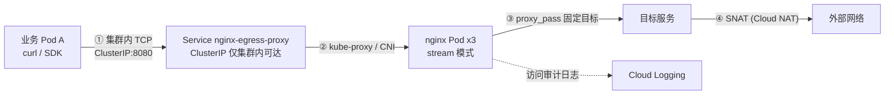
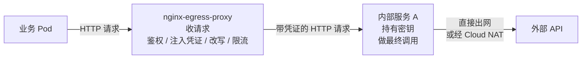
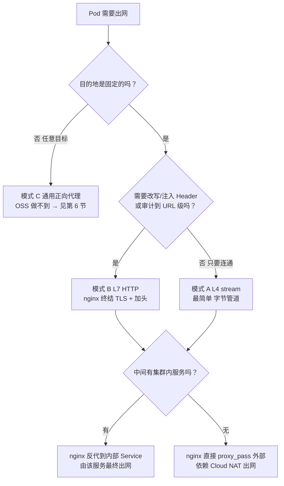
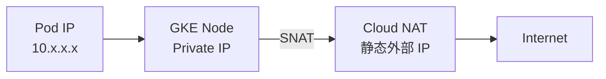
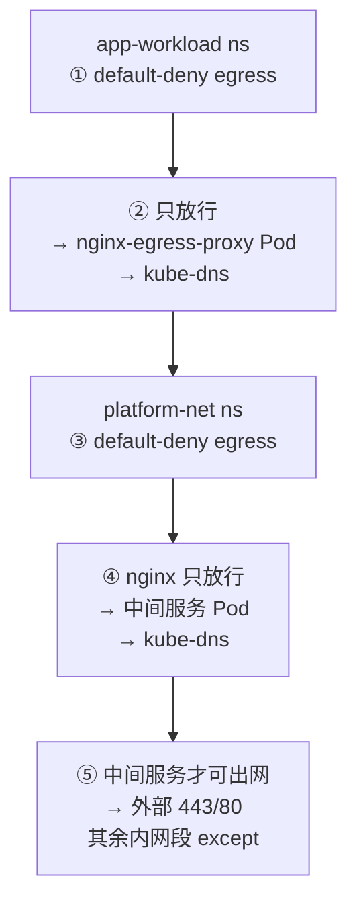
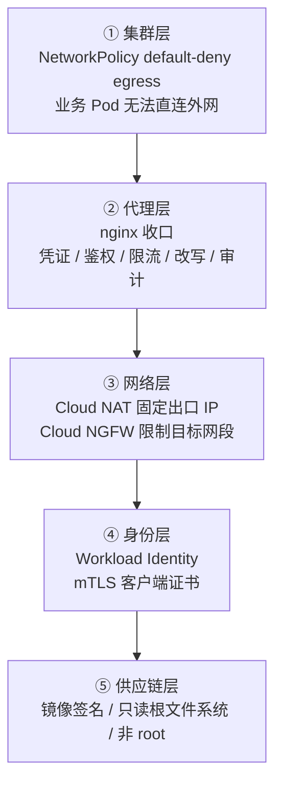

# Nginx L4 出口代理 User Case 实施方案

> **一句话需求**：在 GKE / K8s 中部署一个 Nginx，让集群内的其他 Pod 能通过这个 Nginx 反向代理访问外部网络；Nginx 收到请求后做一轮"流转"（鉴权、注入、改写、限流），再把请求转给"另外一个服务"，由那个服务带领用户最终出网。

> **文档定位**：这是 [`nginx-l4-stream-explorer.md`](nginx-l4-stream-explorer.md) 的**落地篇**。探索篇讲"L4 能做什么"，本篇讲"这个具体 case 怎么选型、怎么实现、怎么验证、怎么回滚"。

---

## 目录

- [1. 需求还原与语义澄清](#1-需求还原与语义澄清)
- [2. 架构总览](#2-架构总览)
- [3. 三种实现模式与选型](#3-三种实现模式与选型)
- [4. 模式 A L4 stream 定向出口](#4-模式-a-l4-stream-定向出口)
- [5. 模式 B L7 HTTP 出口与流量流转](#5-模式-b-l7-http-出口与流量流转)
- [6. 模式 C 通用正向代理的能力边界](#6-模式-c-通用正向代理的能力边界)
- [7. GKE 部署实现](#7-gke-部署实现)
- [8. GKE 与 GCP 前置条件清单](#8-gke-与-gcp-前置条件清单)
- [9. 安全模型与治理](#9-安全模型与治理)
- [10. 验证与排障](#10-验证与排障)
- [11. 成本与运维](#11-成本与运维)
- [12. 落地路线图与复杂度](#12-落地路线图与复杂度)
- [13. 参考](#13-参考)

---

## 1. 需求还原与语义澄清

你的描述里有三层意思，先拆开，因为**不同的解读对应完全不同的实现**：

| 层 | 你的原话 | 技术含义 |
|---|---|---|
| ① 入口 | "这个 Nginx 是接收用户请求进来" | 这里的"用户"是**集群内的其他 Pod**，不是终端用户。入口是一个 **ClusterIP Service**，不是公网入口 |
| ② 流转 | "然后做了对应的流转之后让他访问到外部" | Nginx 在中间做 **鉴权 / 头注入 / 改写 / 限流 / 审计**，这决定了它是 L7 还是 L4 |
| ③ 出口 | "转发到我的另外一个服务上面去，让这个服务带领用户最终出去" | Nginx **不直接出网**，而是转给一个中间服务（持有凭证 / 做最终调用 / 做业务编排） |

### ⚠️ 三个必须先定的问题

**问题 1：中间那个"服务"是集群内的，还是外部的？**

| 中间服务位置 | Nginx 角色 | 出网主体 | 对应模式 |
|---|---|---|---|
| 集群内 Service | 二级反代（Pod → nginx → 内部服务 → 外部） | 内部服务 | 模式 A / B（nginx 不直接出网） |
| 外部第三方 API | 一级出口代理（Pod → nginx → 外部） | nginx Pod | 模式 A / B（nginx 直接出网） |

> 你的描述更接近**第一种**。但要特别注意：**如果中间服务在集群内，nginx 的出网策略和中间服务的出网策略要分别设计**，别只在一个点做管控。

**问题 2：流量是明文 HTTP，还是 TLS？**

- Pod → nginx 是 **HTTPS** → nginx 需要证书（终结 TLS），这样才能看到 URL/Header 做"流转" → **L7 模式**。
- Pod → nginx 是 **裸 TCP / TLS 透传** → nginx 只做字节管道 → **L4 模式**。

**问题 3：这个 nginx 是"通用出口"还是"定向出口"？**

- **定向**：目的地是固定的 1~N 个（某几个外部 API）→ nginx OSS 就能做 ✅
- **通用**：目的地由调用方任意指定（像浏览器上网）→ **nginx OSS 做不到**，需要 NGINX Plus 或其他方案（见第 6 节）

> 这三个问题的答案决定了架构。先别写 YAML。

---

## 2. 架构总览

### 2.1 完整链路（模式 A：L4 定向出口）



**关键认知**：nginx 本身**不提供出口 IP 隔离**。最终对外面暴露的源 IP 由 **Cloud NAT / 节点池**决定，不是 nginx 决定的。

### 2.2 你描述的"两级流转"（nginx → 中间服务 → 外部）



这个模型的价值（也是 nginx 在这里的真正职责）：

| nginx 承担 | 不做会怎样 |
|---|---|
| **凭证隔离**：凭证写在 nginx 的 Secret 里，业务 Pod 永远拿不到 | 凭证下发到每个 Pod，泄露面 ×N |
| **调用点审计**：所有出网请求都有统一日志和调用方身份 | 无法回答"谁访问了外部 API" |
| **限流与配额**：按调用方 Pod/ServiceAccount 限速 | 单个 Pod 可以打爆外部配额 |
| **出口收敛**：业务 Pod 的 egress 被 NetworkPolicy 掐断，只能走 nginx | Pod 可以绕过管控直连外部 |

> **反直觉但重要**：nginx 在这个架构里的核心价值不是"转发"，而是**"收口 + 凭证代理 + 审计"**。如果不需要这些，直接上 Cloud NAT 更快更省。

---

## 3. 三种实现模式与选型

| 维度 | 模式 A：L4 stream 定向出口 | 模式 B：L7 HTTP 出口 | 模式 C：通用正向代理 |
|---|---|---|---|
| nginx 模块 | `stream {}` | `http {}` | `http {}` + Plus `ngx_http_tunnel_module` |
| 能看到 | SNI / ALPN / 连接元数据 | URL / Header / Body / 状态码 | CONNECT 目标 |
| 凭证注入 | ❌（密文无法改写） | ✅ | ❌（隧道内是密文） |
| 改写 / 审计到路径级 | ❌ | ✅ | ⚠️ 仅到 CONNECT 目标 |
| 外部 API 需固定公网 IP | ✅ | ✅ | ✅ |
| nginx OSS | ✅ | ✅ | ❌ **仅 NGINX Plus R36+** |
| 复杂度 | Simple | Moderate | Advanced |
| 适用 | 非 HTTP 协议 / 只需 SNI 分流 | **HTTP(S) 调用外部 API（你的主场景）** | 任意网站浏览类出口 |

### 选型决策树



> **给你的建议**：先用 **模式 B（L7）**。理由：你的描述里有"做了对应的流转"——这只有在 L7 才做得到（加凭证头、改 Host、按路径分流）。模式 A 适合后端协议是非 HTTP 的场景。

---

## 4. 模式 A L4 stream 定向出口

### 4.1 nginx 配置

```nginx
# ⚠️ 官方 Docker 镜像中 stream 是【动态模块】，
#    load_module 必须是第一条【指令】（注释可以写在它前面），且必须早于 stream {} 块
load_module modules/ngx_stream_module.so;

worker_processes auto;
pid /tmp/nginx.pid;
error_log /dev/stderr warn;

events {
    worker_connections 4096;
}

stream {
    log_format stream_out '$remote_addr [$time_local] '
                         'proto=$protocol status=$status '
                         'bytes=$bytes_sent/$bytes_received '
                         'upstream=$upstream_addr '
                         'connect_t=$upstream_connect_time '
                         'session=$session_time';

    access_log /dev/stdout stream_out;

    # 用 map 构造变量型目标，让 nginx 走【运行时 DNS】
    # （map 在 OSS stream 中支持，无需 Plus）
    map $remote_addr $partner_endpoint {
        default api.partner.com:443;
    }

    server {
        listen 8080;

        # 运行时解析外部域名；10.0.0.10 换成你集群的 kube-dns ClusterIP
        resolver 10.0.0.10 valid=30s ipv6=off;
        resolver_timeout 5s;

        proxy_connect_timeout 5s;
        proxy_timeout 300s;
        proxy_socket_keepalive on;
        tcp_nodelay on;

        proxy_pass $partner_endpoint;
    }
}
```

### 4.2 两个 DNS 陷阱

| 写法 | 行为 | 风险 |
|---|---|---|
| `proxy_pass api.partner.com:443;` | **启动时解析一次**，之后一直用旧 IP | 对方 IP 变更 / DNS 轮转 → 连接打到老 IP → 502 或异常 |
| `proxy_pass $partner_endpoint;` + `resolver` | **每次新连接运行时解析** | 必须配 `resolver`，否则 502 `no resolver defined` |

> ⚠️ 变量型 `proxy_pass` 还有一个规则：变量值若命中已定义的 **upstream 组名**，直接用该组（不需要 resolver）；只有裸域名才走 resolver。所以 map 的值要写成 `host:port` 形式，不能只写 `host`。

### 4.3 SNI 感知的定向出口（一个代理多个外部 API）

```nginx
map $ssl_preread_server_name $partner_endpoint {
    default                    api.partner.com:443;
    api.partner.com            api.partner.com:443;
    files.partner.com          files.partner.com:443;
}

server {
    listen 8443;
    ssl_preread on;
    preread_buffer_size 32k;
    preread_timeout 10s;

    resolver 10.0.0.10 valid=30s ipv6=off;

    proxy_connect_timeout 5s;
    proxy_timeout 300s;
    proxy_pass $partner_endpoint;
}
```

> Pod 侧需要用 `openssl s_client -servername` 或在 HTTP 层设置 SNI 才能触发不同分流。**注意**：Pod 用 `curl https://files.partner.com` 时，ClientHello 里的 SNI 就是 `files.partner.com`，可以直接分流。

---

## 5. 模式 B L7 HTTP 出口与流量流转

### 5.1 nginx 配置（推荐主方案）

> 先分清两种变体，配置不同：
>
> | 变体 | 链路 | `proxy_pass` 指向 | 凭证放在哪 |
> |---|---|---|---|
> | **B-1 nginx 直接出网** | Pod → nginx → 外部 API | 外部域名 | nginx（Secret） |
> | **B-2 nginx → 中间服务**（你的 case） | Pod → nginx → 集群内中间服务 → 外部 API | 中间服务的 Service | 中间服务（Secret） |
>
> 下面先给 **B-1** 的完整配置；**B-2** 只需把 `proxy_pass` 改成中间服务地址，
> 并删掉 nginx 侧的 `Authorization` 注入（凭证由中间服务持有）。
> **B-2 的完整可部署清单见 [`../gke-egress-proxy/`](../gke-egress-proxy/)。**

```nginx
load_module modules/ngx_stream_module.so;

worker_processes auto;
pid /tmp/nginx.pid;
error_log /dev/stderr warn;

events {
    worker_connections 4096;
}

http {
    log_format http_out '$remote_addr [$time_local] "$request" $status '
                        'upstream=$upstream_addr rt=$request_time '
                        'ua="$http_user_agent" '
                        'caller="$http_x_caller_service"';

    access_log /dev/stdout http_out;

    # 运行时 DNS。GKE 里用集群 DNS 名即可，nginx 启动时用系统 resolver
    # 解析出 CoreDNS 地址，之后用这个 resolver 做动态解析。
    resolver kube-dns.kube-system.svc.cluster.local valid=30s ipv6=off;
    resolver_timeout 5s;

    # 临时目录（只读根文件系统下必须指向可写卷）
    proxy_temp_path      /tmp/proxy_temp;
    client_body_temp_path /tmp/client_temp;
    fastcgi_temp_path    /tmp/fastcgi_temp;
    uwsgi_temp_path      /tmp/uwsgi_temp;
    scgi_temp_path       /tmp/scgi_temp;

    # ---------- 健康检查端口 ----------
    server {
        listen 8081;
        access_log off;
        location = /healthz {
            add_header Content-Type text/plain;
            return 200 "ok\n";
        }
    }

    # ---------- 出口代理 ----------
    server {
        listen 8082;

        # 只允许集群内业务命名空间访问（在 Service/NetworkPolicy 层做）

        location / {
            # 用变量走运行时 DNS
            set $partner_host api.partner.com;

            proxy_pass https://$partner_host;

            # ---- 上游 TLS 校验（必开，否则是假 HTTPS）----
            proxy_ssl_server_name         on;
            proxy_ssl_name                api.partner.com;
            proxy_ssl_verify              on;
            proxy_ssl_trusted_certificate /etc/ssl/certs/ca-certificates.crt;
            proxy_ssl_protocols           TLSv1.2 TLSv1.3;

            # ---- 流量流转（这里是 nginx 的核心价值）----
            proxy_set_header Host              api.partner.com;
            proxy_set_header Authorization     "Bearer ${PARTNER_TOKEN}";   # 由 envsubst 注入
            proxy_set_header X-Caller-Service  $http_x_caller_service;      # 调用方身份透传
            proxy_set_header X-Forwarded-For   $proxy_add_x_forwarded_for;

            # ---- 超时与缓冲 ----
            proxy_connect_timeout 5s;
            proxy_send_timeout    60s;
            proxy_read_timeout    60s;
            proxy_buffering       on;
            proxy_buffers         8 16k;
            proxy_buffer_size     16k;
        }
    }
}
```

> ⚠️ **凭证不要写在 nginx.conf 里**。上面的 `${PARTNER_TOKEN}` 需通过官方镜像的模板机制（`/etc/nginx/templates/*.template` + `envsubst`）或 init 容器注入。生产环境更推荐 **njs / Lua 从 Secret 拉取**，或用 **Workload Identity + Secret Manager** 动态取短期 token。

> 💡 清单里采用的是**更稳的做法**：把 Secret 以文件形式挂到 `/etc/nginx/secrets/`，
> 文件内容是 `set $internal_token "真实令牌";`，nginx.conf 用 `include /etc/nginx/secrets/*.conf;` 读入。
> 这样做不依赖 entrypoint 的 envsubst，因此在 `readOnlyRootFilesystem` 下也成立
> （代价是 Secret 内容会出现在进程内存里，与 env 注入等价）。

### 5.2 三种"流转"能力清单

| 流转能力 | nginx 指令 | 用途 |
|---|---|---|
| **凭证注入** | `proxy_set_header Authorization "Bearer ..."` | 业务 Pod 不接触外部 API 密钥 |
| **身份透传** | `proxy_set_header X-Caller-Service $http_x_caller_service` | 外部侧可识别调用方；也用于审计 |
| **Host 改写** | `proxy_set_header Host api.partner.com` | 对方按 Host 路由 / 虚拟主机 |
| **路径改写** | `proxy_pass https://$host/api/v2/;` | 外部 API 路径与内部 API 路径解耦 |
| **请求改写** | `proxy_set_header X-Trace-Id $request_id` | 全链路追踪 ID 注入 |
| **限流** | `limit_req_zone $binary_remote_addr zone=api:10m rate=20r/s;` | 按调用方限速，防打爆配额 |
| **超时熔断** | `proxy_connect_timeout` / `proxy_read_timeout` | 外部抖动不打垮业务 Pod |

### 5.3 调用方身份怎么传进来

业务 Pod 侧加一个 header，nginx 记录并转发：

```bash
curl -H "X-Caller-Service: order-service" \
     http://nginx-egress-proxy.platform-net.svc.cluster.local:8082/v1/orders
```

> **信任边界**：这个 header 是调用方自称，nginx 应把它写进审计日志（`$http_x_caller_service` 已包含在 log_format），但**不要**用它做授权决策——要做授权请用 mTLS（见下）。

### 5.4 高安全场景：加 mTLS

如果外部 API 要求客户端证书，把凭证进一步收敛到 nginx：

```nginx
server {
    listen 8443 ssl;
    ssl_certificate           /etc/nginx/tls/server.crt;
    ssl_certificate_key       /etc/nginx/tls/server.key;
    ssl_client_certificate    /etc/nginx/tls/ca.crt;   # 校验调用方 Pod 证书
    ssl_verify_client         on;

    location / {
        set $partner_host api.partner.com;
        proxy_pass https://$partner_host;
        proxy_ssl_server_name on;
        proxy_ssl_name        api.partner.com;
        proxy_ssl_verify      on;
        proxy_ssl_trusted_certificate /etc/ssl/certs/ca-certificates.crt;
    }
}
```

> 此时业务 Pod 必须持有**客户端证书**才能连 nginx——凭证暴露面缩小到"签发流程"，而不是"每个 Pod 都有 API Key"。

---

## 6. 模式 C 通用正向代理的能力边界

### ❌ nginx OSS 做不到通用正向代理

**事实**：HTTP CONNECT 隧道（`ngx_http_tunnel_module` / `tunnel_pass` 指令）是 **NGINX Plus R36+ 专属**，OSS 版本没有这个模块，写 `tunnel_pass` 会直接启动失败。

Plus 的写法（供评估 Plus 授权时参考）：

```nginx
map $host $allowed_hosts {
    hostnames;
    nginx.org 1;
    "*.nginx.org" 1;
}
geo $allowed_nets {
    default 0;
    203.0.113.0/24 1;
}
num_map $request_port $allowed_ports {
    443 1;
}

server {
    listen 3128;
    resolver 10.0.0.10;

    tunnel_allow_upstream $allowed_nets $allowed_ports $allowed_hosts;
    tunnel_pass;
}
```

### ✅ OSS 的三种替代路径

| 方案 | 做法 | 复杂度 | 适用 |
|---|---|---|---|
| **A. Cloud NAT（首选）** | 不做通用代理，Pod 直接出网，用 Cloud NAT 提供 NAT + 静态出口 IP；目的地管控交给 **Cloud NGFW / VPC firewall** | Simple | **GCP 原生优先原则下的正解** |
| **B. FQDNNetworkPolicy** | GKE 原生 CRD，按**域名**限制 Pod 出站目标（底层 snoops DNS 响应后编程 eBPF 策略） | Moderate | 只需"允许某几个外部域名" |
| **C. SOCKS5 sidecar** | 第三方（如 `microsocks` / `3proxy` / `dante`）作为 sidecar 提供 SOCKS5 出口 | Moderate | 需要客户端支持 SOCKS5 |

> **FQLDN 策略的坑**（务必按当前 GKE 版本核对）：
> - 是 **alpha** CRD，API 组 `networking.gke.io/v1alpha1`；
> - 依赖 **kube-dns / Cloud DNS**，**自定义 CoreDNS 不支持**；
> - 走 DNS 驱动，**用裸 IP 直连会绕过规则**（要配 CIDR 兜底）；
> - 不覆盖 Windows 节点池 / Cloud Service Mesh sidecar。

```yaml
apiVersion: networking.gke.io/v1alpha1
kind: FQDNNetworkPolicy
metadata:
  name: allow-partner-api
  namespace: apps
spec:
  podSelector:
    matchLabels:
      app: order-service
  egress:
    - matches:
        - name: "api.partner.com"
      ports:
        - protocol: TCP
          port: 443
```

### 选型建议

> 通用出口这件事，**先问一句"真的需要通用吗？"**。绝大多数"Pod 要访问外部 API"的场景是**定向**的（就那么几个目标），定向用模式 A/B 就够了，别为了"通用"引入 Plus 授权或第三方代理。

---

## 7. GKE 部署实现

完整可部署清单见同目录 [`gke-egress-proxy/`](../gke-egress-proxy/)：

```
webservice/nginx/gke-egress-proxy/
├── 00-namespace.yaml        # platform-net（代理组件）+ app-workload（示例业务 ns）
├── 10-configmap-nginx.yaml  # nginx.conf：L7 出口(8082) + L4 stream(8080) + 健康检查(8081)
├── 20-deployment-nginx.yaml # 3 副本、非 root、只读根文件系统、滚动更新、跨可用区打散
├── 25-partner-service.yaml  # "中间服务"示例：持有第三方凭证，由它最终出网
├── 30-service.yaml          # ClusterIP，仅集群内可达
├── 40-networkpolicy.yaml    # 五条策略：两个 ns 各一条 default-deny + 放行代理 / 代理只放行中间服务 / 中间服务才可出网
├── 50-pdb-hpa.yaml          # PDB(minAvailable 2) + HPA(CPU 60%, 3~10 副本)
├── examples/
│   ├── secret.example.yaml  # 凭证模板（生产用 External Secrets 同步）
│   └── test-client.yaml     # 验证 Pod：经代理访问 + 直连被拦截
└── README.md                # 部署顺序 + 验证命令 + 回滚 + 常见问题
```

> 清单里的"中间服务"是一个最小可运行的 Python 示例。换成你真实服务时，
> 保留契约即可：**监听 8080、`GET /fetch` 返回上游结果、凭证从环境变量读**。

### 7.1 部署顺序

```bash
cd webservice/nginx/gke-egress-proxy

kubectl apply -f 00-namespace.yaml
kubectl apply -f examples/secret.example.yaml   # 先替换掉里面的 REPLACE_
kubectl apply -f 10-configmap-nginx.yaml
kubectl apply -f 20-deployment-nginx.yaml
kubectl apply -f 25-partner-service.yaml
kubectl apply -f 30-service.yaml

# ⚠️ 网络策略会改变集群内连通性，先在预发验证，再在生产应用
kubectl apply -f 40-networkpolicy.yaml

kubectl apply -f 50-pdb-hpa.yaml

# 观察
kubectl -n platform-net rollout status deploy/nginx-egress-proxy
kubectl -n platform-net get pods,svc
```

### 7.2 几个关键实现细节

**① `load_module` 必须是 nginx.conf 的第一条【指令】**

官方 Docker 镜像（`nginx:alpine` / `nginxinc/nginx-unprivileged`）把 stream 编译成**动态模块**：

```bash
# 确认镜像里有没有这个 .so
kubectl -n platform-net exec deploy/nginx-egress-proxy -- ls -l /etc/nginx/modules/
```

```bash
# 配置语法自检（进容器跑，失败时直接看报错原文）
kubectl -n platform-net exec deploy/nginx-egress-proxy -- nginx -t
```

| 情况 | 处理 |
|---|---|
| 官方镜像（有 `.so`） | nginx.conf 第一条指令写 `load_module modules/ngx_stream_module.so;` |
| 自行编译 / 静态包含 stream | **删掉**这行，否则报 `cannot load module` |

> 这是本 case 里最容易踩的一个坑：**不加这行，stream 配置会被当成未知指令，整个容器起不来**。

**② 健康检查不能只靠 stream 端口**

OSS 的 stream 模块没有 `return` 指令（那是 Plus 能力），所以在 stream 里做不了 HTTP 健康检查。做法是**同时开一个 http server 端口**专供探针：

```nginx
http {
    server {
        listen 8081;
        access_log off;
        location = /healthz { return 200 "ok\n"; }
    }
}
```

**③ 只读根文件系统**

`readOnlyRootFilesystem: true` 时 `/tmp` 也不可写，必须挂 emptyDir，并把 `pid` 和所有 `*_temp_path` 指到 `/tmp`：

```yaml
volumeMounts:
  - name: nginx-tmp
    mountPath: /tmp
```

**④ ConfigMap 变更不会自动生效**

用 `subPath` 挂载的 ConfigMap 不会热更新，且 nginx 不会自动 reload。变更后：

```bash
kubectl -n platform-net rollout restart deploy/nginx-egress-proxy
```

（生产建议用 Kustomize 的 `checksum/config` annotation 自动触发滚动。）

**⑤ 滚动更新必须零中断**

```yaml
strategy:
  type: RollingUpdate
  rollingUpdate:
    maxUnavailable: 0
    maxSurge: 1
```

配合 PDB：

```yaml
apiVersion: policy/v1
kind: PodDisruptionBudget
metadata:
  name: nginx-egress-proxy
  namespace: platform-net
spec:
  minAvailable: 2
  selector:
    matchLabels:
      app.kubernetes.io/name: nginx-egress-proxy
```

> **注意**：`maxUnavailable: 0` + `maxSurge: 1` 在节点资源紧张时可能卡住。如果集群 Pod 调度有 quota 限制，考虑 `maxUnavailable: 1` + `minAvailable: 2`，或预先扩容 node pool。

---

## 8. GKE 与 GCP 前置条件清单

> **这一节是最容易漏的部分。** nginx 容器起来了但出不去网，90% 是这里的项没做。

### 8.1 Cloud NAT（必需，除非节点有外网 IP）



**创建（公共 NAT + 静态 IP）**：

```bash
# 1. 预留静态出口 IP（对方 API 需要 IP 白名单时必须用静态）
gcloud compute addresses create egress-nat-ip \
    --region=asia-southeast1 \
    --network=VPC_NAME

# 2. Cloud Router
gcloud compute routers create egress-router \
    --network=VPC_NAME --region=asia-southeast1

# 3. Cloud NAT（覆盖节点子网的主 IP + Pod 次级 IP 范围）
gcloud compute routers nats create egress-nat \
    --router=egress-router \
    --region=asia-southeast1 \
    --nat-external-ip-pool=egress-nat-ip \
    --nat-custom-subnet-ip-ranges=NODE_SUBNET:ALL \
    --enable-endpoint-independent-mapping \
    --enable-logging \
    --log-filter=ERRORS_ONLY
```

| 关键参数 | 说明 |
|---|---|
| `--nat-custom-subnet-ip-ranges=SUBNET:ALL` | **`:ALL` 表示包含主 IP 范围和次级（Pod）IP 范围**。只写主 IP 范围的话，**Pod 出不去网**——这是最常见的坑 |
| `--nat-external-ip-pool` | 用预留静态 IP（`MANUAL_ONLY` 语义），别用自动分配，否则对方白名单会漂 |
| `--enable-endpoint-independent-mapping` | 同一内网 IP+端口映射到同一外部 IP+端口，外部侧看到的源更稳定。**注意：与动态端口分配、NAT Rules 互斥** |
| `--log-filter=ERRORS_ONLY` | 稳态用 ERRORS_ONLY；`ALL` 会产生大量 Cloud Logging 费用 |

**Private cluster 特别注意**：私有集群的**控制面**流量走独立路径（`Private Service Connect`），需要**单独**为控制面出网配置（`master-ipv4-cidr` 的 NAT），别和业务 NAT 混为一谈。

### 8.2 NetworkPolicy（管控"只能走 nginx"）

**五条策略**（与 [`../gke-egress-proxy/40-networkpolicy.yaml`](../gke-egress-proxy/40-networkpolicy.yaml) 一一对应）：



> ③④⑤ 的分界就是本方案的核心：**nginx 自己没有出网权限，出网主体是中间服务**。
> 如果你要的是"nginx 直接出网"（变体 B-1），把 ④ 和 ⑤ 合并成一个策略，
> 直接给 nginx 放行 `0.0.0.0/0`（except 内网段），中间服务那条删掉。
>
> ⚠️ ③ 这条 `platform-net` 的 default-deny 经常被漏掉。没有它，`platform-net` 里
> 任何没被 ④⑤ 选中的 Pod（比如临时 debug Pod、误部署的 Job）都能自由出网，
> 管控就出现缺口。

**① 工作负载命名空间：默认拒绝所有出站**

```yaml
apiVersion: networking.k8s.io/v1
kind: NetworkPolicy
metadata:
  name: default-deny-egress
  namespace: app-workload
spec:
  podSelector: {}
  policyTypes:
    - Egress
  egress: []
```

**② 只放行到 nginx-egress-proxy + DNS**

```yaml
apiVersion: networking.k8s.io/v1
kind: NetworkPolicy
metadata:
  name: allow-egress-via-proxy
  namespace: app-workload
spec:
  podSelector: {}
  policyTypes:
    - Egress
  egress:
    - to:
        - namespaceSelector:
            matchLabels:
              kubernetes.io/metadata.name: platform-net
          podSelector:
            matchLabels:
              app.kubernetes.io/name: nginx-egress-proxy
      ports:
        - protocol: TCP
          port: 8082
        - protocol: TCP
          port: 8080
    - to:
        - namespaceSelector:
            matchLabels:
              kubernetes.io/metadata.name: kube-system
          podSelector:
            matchLabels:
              k8s-app: kube-dns
      ports:
        - protocol: UDP
          port: 53
        - protocol: TCP
          port: 53
```

**③ proxy 命名空间：默认拒绝一切出站**

```yaml
apiVersion: networking.k8s.io/v1
kind: NetworkPolicy
metadata:
  name: default-deny-egress
  namespace: platform-net
spec:
  podSelector: {}
  policyTypes:
    - Egress
  egress: []
```

**④ proxy 命名空间：nginx 只放行到中间服务 + DNS（本身不能出网）**

```yaml
apiVersion: networking.k8s.io/v1
kind: NetworkPolicy
metadata:
  name: nginx-egress-proxy-egress
  namespace: platform-net
spec:
  podSelector:
    matchLabels:
      app.kubernetes.io/name: nginx-egress-proxy
  policyTypes:
    - Egress
  egress:
    - to:
        - namespaceSelector:
            matchLabels:
              kubernetes.io/metadata.name: platform-net
          podSelector:
            matchLabels:
              app.kubernetes.io/name: egress-partner-client
      ports:
        - protocol: TCP
          port: 8080
    - to:
        - namespaceSelector:
            matchLabels:
              kubernetes.io/metadata.name: kube-system
          podSelector:
            matchLabels:
              k8s-app: kube-dns
      ports:
        - protocol: UDP
          port: 53
        - protocol: TCP
          port: 53
```

**⑤ 中间服务：才允许出网到外部**

```yaml
apiVersion: networking.k8s.io/v1
kind: NetworkPolicy
metadata:
  name: egress-partner-client-egress
  namespace: platform-net
spec:
  podSelector:
    matchLabels:
      app.kubernetes.io/name: egress-partner-client
  policyTypes:
    - Egress
  egress:
    - to:
        - ipBlock:
            cidr: 0.0.0.0/0
            except:
              - 10.0.0.0/8
              - 172.16.0.0/12
              - 192.168.0.0/16
              - 169.254.169.254/32
    - to:
        - namespaceSelector:
            matchLabels:
              kubernetes.io/metadata.name: kube-system
          podSelector:
            matchLabels:
              k8s-app: kube-dns
      ports:
        - protocol: UDP
          port: 53
        - protocol: TCP
          port: 53
```

> ⚠️ **`except` 掉内网段是有意为之**：防止代理被当成跳板访问集群内部（SSRF 式的横向移动）。
> 但如果你的外部 API 就在对等 VPC 的私有网段里，**必须**把那个网段从 `except` 里去掉。

### 8.3 NetworkPolicy 的三个 GKE 特有坑

| 坑 | 现象 | 解法 |
|---|---|---|
| **Dataplane V2 下 `ipBlock` 不覆盖 Pod 流量** | 写了 `ipBlock: 0.0.0.0/0` 却仍然连不上别的 Pod | Pod 之间的放行必须用 `podSelector` / `namespaceSelector`；`ipBlock` 只用于外部网段 |
| **default-deny egress 会掐断 DNS 和元数据服务** | 解析失败、Workload Identity 拿不到 token、**节点升级被卡住** | 单独放行 kube-dns；Workload Identity 需放行 `169.254.169.254/32` 的 80/8080（Dataplane V2）或 `169.254.169.252/32` 的 987/988 |
| **启用 NetworkPolicy 会关闭 container-native load balancing** | 其他 Service 变成 NodePort 路径 | 给受影响的 Service 手动加注解 `cloud.google.com/neg: '{"ingress": true}'` |

> 第三条是集群级的副作用，会影响**其他**服务的 LB 路径。上线前请在预发集群先开启 NetworkPolicy 做回归。

### 8.4 前置条件核对表

| # | 项目 | 怎么确认 | 不做的后果 |
|---|---|---|---|
| 1 | Cloud NAT 已创建且覆盖 Pod IP 范围 | `gcloud compute routers nats describe egress-nat` | Pod 出不去网，502/超时 |
| 2 | 静态出口 IP 已预留 | `gcloud compute addresses list` | 对方白名单漂移，间歇性 403 |
| 3 | NAT 开了 endpoint-independent mapping | 同上，查看 `enableEndpointIndependentMapping` | 外部看到的源 IP 不稳定 |
| 4 | DNS 能解析外部域名 | 在 nginx Pod 内 `nslookup api.partner.com` | `no resolver defined` → 502 |
| 5 | NetworkPolicy 五条策略已应用 | `kubectl get networkpolicy -A` | 管控失效或完全断网 |
| 6 | PDB / HPA / 多副本就位 | `kubectl -n platform-net get pdb,hpa` | 单点故障 / 无法承载突发 |
| 7 | 镜像能从 Artifact Registry 拉取 | `kubectl -n platform-net describe pod -l app.kubernetes.io/name=nginx-egress-proxy` | ImagePullBackOff |
| 8 | 集群有 egress 配额（NAT 端口） | Cloud Monitoring `nat/port_usage`、`nat/dropped_sent_packets_count` | 高并发时随机失败 |

> **第 8 条容易被忽略**：每个 NAT IP 大约提供 64,000 个源端口/协议。端口耗尽的表现是"低峰正常、高峰随机失败"，很难定位。

---

## 9. 安全模型与治理

### 9.1 分层防御模型



### 9.2 威胁与对策

| 威胁 | 对策 | 落地位置 |
|---|---|---|
| 业务 Pod 被攻陷后直接外联 C2 | default-deny egress，只放行 proxy | NetworkPolicy |
| nginx 被当成横向移动跳板 | 代理侧 egress `except` 内网段 | NetworkPolicy（情况一） |
| 凭证从 nginx 配置泄露 | 不落盘明文；Secret 注入 / Secret Manager 动态取 | ConfigMap + Secret |
| nginx 沦为开放代理 | 只 ClusterIP 暴露；不暴露公网；目标固定 | Service type + 配置 |
| 单一出口 IP 被对方封禁 | 多 NAT IP 池 + 监控告警 | Cloud NAT |
| 外部 API 遭中间人 | `proxy_ssl_verify on` + SNI 正确 | nginx 配置 |
| nginx 容器被逃逸 | 非 root + 只读根 + drop ALL capabilities + seccomp | Pod securityContext |
| 调用无法审计 | 结构化日志 + Cloud Logging + 标签化 | log_format |

### 9.3 治理：这个组件归谁

| 职责 | 归属 | 说明 |
|---|---|---|
| nginx 配置变更 | 平台团队 | 出口策略是平台级资产 |
| 外部 API 白名单 | 平台团队 + 业务方 | 业务方提需求，平台方执行 |
| 配额与限流 | 平台团队 | 按调用方维度 |
| 审计日志留存 | 安全团队 | 建议接入 SIEM |
| 故障值班 | 平台团队 | 出口故障 = 全集群业务故障 |

> **重要提醒**：一旦引入这个代理，**它就成为集群所有外部调用的单点**。所以第 7 节里的多副本 + PDB + 跨可用区分布 + 滚动更新零中断不是"锦上添花"，是**必须项**。

---

## 10. 验证与排障

### 10.1 标准验证流程

```bash
NS=platform-net

# ① 代理自身是否健康
kubectl -n $NS rollout status deploy/nginx-egress-proxy
kubectl -n $NS get pods -l app.kubernetes.io/name=nginx-egress-proxy -o wide

# ② 配置语法（进容器验）
kubectl -n $NS exec deploy/nginx-egress-proxy -- nginx -t
kubectl -n $NS exec deploy/nginx-egress-proxy -- nginx -T | head -50

# ③ 代理健康检查（8081 是专用健康端口）
kubectl -n $NS run health-test --rm -it --image=curlimages/curl:8.10.1 --restart=Never -- \
  curl -sS http://nginx-egress-proxy.$NS.svc.cluster.local:8081/healthz

# ④ 从业务 Pod 经代理访问外部（走 /proxy 这个唯一入口）
APP_NS=app-workload
kubectl -n $APP_NS run egress-test --rm -it --image=curlimages/curl:8.10.1 --restart=Never -- \
  curl -sS -v -H "X-Caller-Identity: order-service" \
  http://nginx-egress-proxy.$NS.svc.cluster.local:8082/proxy

# ⑤ 确认出口 IP 是 NAT 静态 IP（而不是 Pod IP）
#    注意：要在【中间服务】所在的 namespace 跑，业务 Pod 直连是被策略拦掉的
kubectl -n $NS run ip-test --rm -it --image=curlimages/curl:8.10.1 --restart=Never -- \
  curl -sS https://api.ipify.org
# 期望输出 == 你预留的静态出口 IP

# ⑥ 确认业务 Pod 直连外网已被拦截（应当失败）
kubectl -n $APP_NS run block-test --rm -it --image=curlimages/curl:8.10.1 --restart=Never -- \
  curl -sS --max-time 10 https://example.com ; echo "exit=$?"
# 期望：连接超时 / Connection refused，不是正常返回

# ⑦ 审计日志
kubectl -n $NS logs deploy/nginx-egress-proxy --tail=50
```

### 10.2 故障对照表

| 现象 | 最可能原因 | 定位动作 |
|---|---|---|
| **502 `no resolver defined`** | 用了变量型 `proxy_pass` 但没配 `resolver` | 检查 stream server 里有没有 `resolver` |
| **502 `connect() failed ... Connection timed out`** | Cloud NAT 没建 / NAT 没覆盖 Pod IP 范围 / 防火墙拦截 | 在 nginx Pod 内 `nc -vz api.partner.com 443`；查 NAT 配置 |
| **502 upstream 拿到的是旧 IP** | `proxy_pass` 用了静态域名（启动时解析） | 改成变量型 + `resolver` |
| **504 / 客户端长时间挂起** | `proxy_timeout` 太小 / 外部响应慢 / DNS 慢 | 调大 `proxy_timeout`；`resolver_timeout` |
| **Pod 里 `nslookup` 失败** | egress 默认拒绝把 DNS 也掐了 | NetworkPolicy 放行 kube-dns |
| **业务 Pod 完全连不上 proxy Service** | default-deny egress 但没放行 proxy | 检查 allow-egress-via-proxy 策略 |
| **外部返回 403 / IP 被拒** | 出口 IP 不在对方白名单 / 用了非预留 IP | 对比 `api.ipify.org` 与预留地址 |
| **TLS 握手失败 `certificate verify failed`** | `proxy_ssl_verify on` 但 CA 不对，或 `proxy_ssl_name` 与证书 CN/SAN 不匹配 | 检查 `proxy_ssl_trusted_certificate` 与 SNI |
| **Pod 一直 ImagePullBackOff** | 私有 Artifact Registry 需拉取凭证 | 配 ImagePullSecret 或用节点级 SA |
| **改了 ConfigMap 没生效** | `subPath` 挂载不热更新，nginx 也不自动 reload | `kubectl rollout restart deploy/nginx-egress-proxy` |
| **nginx 启动即失败** | 缺 `load_module`（或镜像无该 .so 却写了） | 查 `nginx -t` 的报错原文 |

### 10.3 应急回滚

```bash
# 关掉网络策略（恢复直连，代价是管控失效）
kubectl delete -f networkpolicy.yaml

# 回滚配置
kubectl -n $NS rollout history deploy/nginx-egress-proxy
kubectl -n $NS rollout undo deploy/nginx-egress-proxy

# 紧急旁路：业务 Pod 临时改直连（需先放开 egress）
kubectl -n app-workload patch networkpolicy allow-egress-via-proxy --type=json \
  -p='[{"op":"add","path":"/spec/egress/-","value":{"to":[{"ipBlock":{"cidr":"0.0.0.0/0"}}]}}]'
```

> 建议把"回滚网络策略"写进 runbook，并**演练过一次**——出口链路故障时，能救火的是提前准备好的旁路，不是临场发挥。

---

## 11. 成本与运维

### 11.1 成本构成

| 项 | 计费 | 说明 |
|---|---|---|
| nginx Pod（3 副本 × 100m/128Mi） | 按量 | 成本可忽略 |
| **Cloud NAT** | **每小时 + 每 GB + 每 IP** | 主要成本项；流量翻倍时数据处理费也翻倍 |
| 静态外部 IP | 每 IP 每小时 | 通常 1~2 个足够 |
| Cloud Logging（访问日志） | 按 GB | 高 QPS 时可能超过 NAT 成本；用 `log_format` 精简字段 |
| 节点资源（多副本跨 AZ） | 按量 | 建议独立 node pool，避免挤占业务资源 |

### 11.2 nginx 带来的额外开销

| 开销 | 量级 | 说明 |
|---|---|---|
| 延迟 | 亚毫秒 ~ 数毫秒 | 集群内一次额外转发；跨 AZ 更明显 |
| 带宽 | **×2** | 集群内 Pod→nginx 和 nginx→外部都计流量 |
| CPU | 低（透传场景）<br>中（L7 + TLS 终结） | L7 终结 TLS 的 CPU 开销主要在加解密 |

> **成本判断**：如果只是"Pod 要访问外部 API"，**直接 Cloud NAT 的成本远低于走 nginx**（少一跳内部流量、无额外 CPU）。nginx 的价值来自**管控维度**（凭证代理、审计、限流、目的地白名单），不是来自转发本身。**先想清楚你在为什么付费。**

### 11.3 日常运维

| 事项 | 频率 | 手段 |
|---|---|---|
| nginx 版本升级 / CVE 补丁 | 季度 | 灰度 1 个副本 → 观察 → 全量；保留回滚镜像 |
| 外部 API 契约变更 | 不定 | 改 upstream 定义 + `rollout restart` |
| 出口 IP 轮换 | 半年/年度 | Cloud NAT `drain` 旧 IP，新旧并行一周 |
| 容量评估 | 月度 | 看 `nat/port_usage`、`nat/dropped_sent_packets_count`、nginx QPS |
| 审计日志抽查 | 周 | 检查调用方与目的地是否在白名单内 |

---

## 12. 落地路线图与复杂度

### 🟢 Immediate fix（1~3 天，复杂度 Simple）

- 在目标集群确认 **Cloud NAT 存在且覆盖 Pod IP 范围**（大概率已有，但要去核对 `:ALL`）。
- 部署单副本 nginx（模式 B），先只开放给**一个测试 Pod**，验证连通性 + 出口 IP。
- 打通审计日志：确认 nginx 日志能看到调用方与目的地。

**交付判据**：一个 Pod 能经代理访问外部 API，出口 IP 是预留的静态 IP，日志可查。

### 🟡 Structural improvement（2~4 周，复杂度 Moderate）

- 补齐生产化：3 副本 + PDB + HPA + 跨 AZ 分布 + 零中断滚动 + 非 root + 只读根文件系统。
- 上齐五条 NetworkPolicy，两个命名空间都做 default-deny egress。
- 凭证从 ConfigMap 明文改为 **Secret 注入 / Secret Manager 动态取**。
- 加限流（`limit_req`）与调用方配额。
- 接入 Cloud Monitoring 告警：NAT 端口使用率、NAT 丢包、nginx 5xx、POD 未就绪。

**交付判据**：业务 Pod 无法直连外网，只能经代理；代理故障有告警；出口 IP 稳定。

### 🔵 Long-term redesign（季度级，复杂度 Advanced / Enterprise）

- 引入 **多集群共享出口**：多个 GKE 集群的 Pod 都走同一组出口代理（跨 VPC 对等 / Cloud NGFW 层级）。
- 引入 **统一出口 SDK**：业务方不用手写目标地址，改成调平台提供的抽象接口，平台侧路由到不同出口。
- 评估把通用出口需求交给 **GKE FQDNNetworkPolicy** 或 **Istio/Cloud Service Mesh egress gateway**，减少自维护 nginx 出口组件。
- 建立 **出口策略即代码**（目的地白名单、限流策略走 GitOps + 审批流）。
- 引入**双栈/多出口供应商**（主备出口、跨云出口）与自动故障切换。

**交付判据**：出口策略可审计、可回滚、可灰度；多集群共享出口且互不影响。

---

## 13. 参考

### 官方文档

- [ngx_stream_module](https://nginx.org/en/docs/stream/ngx_stream_module.html) — stream 核心指令
- [ngx_http_proxy_module](https://nginx.org/en/docs/http/ngx_http_proxy_module.html) — `proxy_pass` / `proxy_ssl_*`
- [ngx_http_core_module](https://nginx.org/en/docs/http/ngx_http_core_module.html) — `resolver` / `limit_req`
- [HTTP CONNECT forward proxy (Plus)](https://docs.nginx.com/nginx/admin-guide/web-server/http-connect-proxy/) — `tunnel_pass` 能力边界

### GCP / GKE

- [GKE 网络策略](https://cloud.google.com/kubernetes-engine/docs/how-to/network-policy) — `ipBlock` 在 Dataplane V2 下的行为、Workload Identity 放行要求
- [Cloud NAT 设置与管理](https://cloud.google.com/nat/docs/using-nat) — 网关参数、endpoint-independent mapping 限制
- [GKE 自定义网络隔离（私有节点出网）](https://cloud.google.com/kubernetes-engine/docs/how-to/network-isolation) — 私有节点出网与 Cloud NAT
- [GKE 安全性总览](https://cloud.google.com/kubernetes-engine/docs/concepts/security-overview) — NetworkPolicy 默认策略
- [Cloud Service Mesh 输出网关最佳实践](https://cloud.google.com/service-mesh/docs/security/egress-gateways-best-practices) — Istio 侧的替代架构参考

### 仓库内相关文档

| 文档 | 关联点 |
|---|---|
| [`nginx-l4-stream-explorer.md`](nginx-l4-stream-explorer.md) | L4 能力全景、`ssl_preread` 变量、SNI 分流 |
| [`../gke-egress-proxy/`](../gke-egress-proxy/) | **可部署清单**：本篇方案的 ConfigMap / Deployment / NetworkPolicy / PDB / HPA |
| [`nginx-l4-proxy.md`](nginx-l4-proxy.md) | stream 超时语义 |
| [`nginx-proxy_protocol.md`](nginx-proxy_protocol.md) | 真实 IP 传递与 GCLB 健康检查 |
| [`nginx-mtls.md`](nginx-mtls.md) | mTLS 配置细节 |
| [`nginx-502.md`](nginx-502.md) / [`nginx-499-502.md`](nginx-499-502.md) | 502 排障 |
| [`L7+L4.md`](L7+L4.md) | L4/L7 职责边界 |
