# WebService 知识点分析

Analyze the `webservice/` knowledge base. Categorize the Nginx / Apache / Squid / egress-proxy documents by technical domain, summarize the key knowledge points, and present everything as a Markdown document with a Mermaid mindmap.

本文档覆盖 `webservice/` 下的 **163 篇文档 / 4 个子域**：
Nginx（最大）、Apache Airflow、Squid、Egress 代理架构。

> **一句话结论**
> ★ 这个目录是**流量经过的每一跳**的操作手册：
> Nginx 负责 L7 路由与 TLS、Squid 负责出网与 SNI 提取、
> Egress 负责公网出口的架构与可行性、Airflow 负责编排。
> 它同时也是全库**"配置项级"知识最密**的地方（Nginx 有 80+ 篇）。

---

## 文档体系分析

1. **`nginx/`（~85 篇）** — L7 路由、TLS 与 session、buffering 与超时、
   Ingress Controller、多入口与配置治理、证书动态更新、日志轮转、L4 stream、双网卡
2. **`squid/`（~20 篇）** — L4 还是 L7、SNI 提取、大文件上传与 Token 时效、
   多配置部署、GCS 配置同步
3. **`egress/`（~12 篇）** — GKE Egress Proxy 架构设计、可行性、流程图、Squid 配置
4. **`apache/`（4 篇）** — Airflow DAG、Harbor + Airflow，已有 mindmap
5. **横向** — `explorer-sni.md`：**Nginx / Squid 与 TLS SNI 的端到端行为**

---

## 知识点 MindMap

```mermaid
mindmap
  root((WebService\n流量每一跳))
    Nginx
      L7路由
        upstream
        proxy_pass与rewrite
        map模块
        split_clients
        sub模块
      Header语义
        proxy_set_header
        X-Forwarded-Proto
        hide_header
        remote_ip
        下划线兼容
      TLS
        mTLS客户端证书
        多域名共享证书
        session缓存与tickets
        超时参数
        PFS检测
        HSTS
      Buffer与超时
        proxy_request_buffering
        client_header_buffer
        proxy_buffer
        proxy_temp权限
        499与502
      Ingress Controller
        准入Webhook
        单与多控制器
        路径重写
        TLS问题
      治理
        多入口配置统一
        角色视角
        NGINX Plus评估
        证书动态更新
        日志轮转
      L4
        stream模块
        出口代理
        双网卡路由
      诊断
        debug日志
        masterworker模型
        502排查
    Squid
      L4还是L7
      SNI提取
      CONNECT与HTTPS代理
      上传体积与缓冲
      Token时效
      多配置部署
      GCS同步
    Egress代理
      架构设计
      可行性分析
      流程图集合
      实施指南
      Blue Coat
      网络流量图
    Apache
      Airflow
        DAG定义
        调度与重试
        Harbor集成
    横向
      SNI端到端行为
```



---

## 主要知识领域详解

### 1. Nginx（`nginx/`）—— 全库最"配置项级"的知识库

#### 1.1 L7 路由
- `docs/upstream.md`、`docs/proxy-pass/`：`proxy_pass` 的行为差异、
  `proxy_pass` + **SNI 注入**逐行精读、`X-Forwarded-Proto` 的最佳实践、
  用户改写、**默认 Nginx 前门到 ASM LB** 的探索；
- `docs/nginx-map-*.md`：`map $host` 做入口白名单 + `proxy_ssl_server_name`；
- `docs/nginx-split.md`：`split_clients` 模块；
- `docs/nginx-sub-model.md`：`ngx_http_sub_module` 评估。

#### 1.2 Header 语义（和 SRE 的 header-tracing 直接对应）
`docs/nginx-header.md`、`nginx-header-debug.md`、`proxy-pass/nginx-proxy-pass.md`、
`Proxy_set_header-Connection.md`、`nginx-remoteip.md`、`nginx-underscores_in_header.md`。

#### 1.3 TLS
- `docs/nginx-mtls.md`、`docs/ssl_client_certificate_chain.md`：客户端证书链；
- `docs/nginx-multip-ssl.md`：**两个 server 块共用同一套证书文件**（含两组域名）；
- `docs/nginx-ssl-session-timeout-and-tickets-explained.md`：
  **`ssl_session_timeout` 与 `ssl_session_tickets`** 详解；
- `docs/nginx-tls-pfs-check.md`：**PFS（Perfect Forward Secrecy）检测与配置**；
- `docs/Strict-Transport-Security.md`、`docs/hsts-best-practices.md`：**多层架构下的 HSTS**；
- `docs/GCLB-Certificate-Management.md`、`gcp-certificate-manager-tls.md`：与 GCP 侧协同。

#### 1.4 Buffer 与超时（最容易踩性能坑的地方）
- `buffer/nginx-request-buffering.md` 等 4 篇：**`proxy_request_buffering` 详解**，
  复杂代理链路中的**大文件上传与 Token 超时**问题；
- `buffer/client_header_buffer_size.md`、`large-client-header-buffers`；
- `buffer/summary-buffer.md`：整组 buffer 配置的总结；
- `docs/nginx-timeout.md`、`docs/drainingTimeout.md`、`docs/nginx-499-502.md`：
  **499 与 502 的含义**。

#### 1.5 Ingress Controller
`ingress-control/`：准入 Webhook 深度解析、单控制器 vs 多控制器、
API 版本号重写、路径重写、RBAC 验证、TLS 问题总结、`k3s-install.md`。

#### 1.6 治理与运维
- `docs/nginx-Reuse-confd.md`：**统一多个 API 入口的配置管理**；
- `docs/nginx-role-perspectives.md`：**Nginx 的"角色"视角分析**——
  当有人把它收窄成「网络路由 + 授权」时；
- `docs/nginx-plus.md` / `nginx-plus-English.md`：**F5 NGINX Plus vs 开源版**评估
  （功能、迁移、GCP 环境优化）；
- `nginx-cert/nginx-cert-dynamic-update.md`：**多租户 SSL 证书热更新架构**；
- `nginx-logs/`：logrotate 的**高频轮转**与**磁盘受限**两种最佳实践。

#### 1.7 L4 与诊断
- `docs/nginx-l4-proxy.md`、`l4-stream-explorer.md`、`l4-enhance.md.md`：
  stream 模块能力、**L4 出口代理 User Case**；
- `gce-nginx-l4-enhance/`：**双网卡 Nginx 的增强型路由**（systemd 依赖配置、启动顺序、调试流程）；
- `docs/nginx-debug-log-example.md`、`nginx-master-worker.md`、`nginx-502.md`。

### 2. Squid（`squid/`）
- `squid-l4-or-l7.md` / `squid-l4-explorer.md`：**Squid 到底是 L4 还是 L7**（这是本目录的第一个问题）；
- `squid-sni.md`：**SNI 提取机制——从 URL 到 TLS ClientHello**；
- `squid-as-https-proxy.md`、`Squid-client_request_buffer_max_size.md`：HTTPS 代理与缓冲上限；
- `codebuddy-enhance.md` / `gemini-enhance-squid.md`：
  **大文件上传与 Token 认证时效性**优化；
- `squid-deploy-claude.md`：多配置部署最佳实践；`squid-gcs-sync-exploration.md`：GCS 配置同步。

### 3. Egress 代理（`egress/`）
一套完整的 GKE 公网出口方案：`architecture-design.md` → `feasibility-analysis.md` →
`explorer-egress-flow.md` / `explorer-egress-flow-enhance.md`（**流程图集合**）→
`network-flow-diagram.md` → `implementation-guide.md` → `squid-configs.md` → `blue-coat.md`。

### 4. Apache 与横向
`apache/docs/`：Airflow DAG 定义、调度与重试、Harbor 集成；
已有 `apache/docs/mindmap.md`（本目录的既有 mindmap 范例）。
`explorer-sni.md`：**Nginx、Squid 与 TLS SNI 的端到端行为探索**——把两个子域串起来。

---

## 三条阅读路线

```
路线 A · 排查一个 502 / 上传超时（2 小时）
  nginx/docs/nginx-502.md → nginx/buffer/nginx-request-buffering.md
  → nginx/docs/nginx-timeout.md → nginx/buffer/summary-buffer.md

路线 B · 搞清 SNI 在链路里怎么走（2 小时）
  explorer-sni.md → nginx/docs/proxy-pass/nginx-proxy-pass-sni.md
  → squid/docs/squid-sni.md → ../gcp/cross-project/public-mtls-ingress/Why-missing-sni.md

路线 C · 做公网出口（1 天）
  egress/docs/architecture-design.md → feasibility-analysis.md
  → squid/docs/squid-conf.md → ../linux/network/smtp-egress-nhf-squid-analysis.md
```

---

## 结论

1. **Nginx 部分的价值在"参数级"**：buffer、timeout、session cache、TLS ticket——
   这些默认值往往就是线上问题的根因，而绝大多数人从未读过它们的文档。
2. **`proxy_request_buffering` 是最值得单独理解的一个参数**：
   它直接决定了大文件上传与流式响应的行为，也决定了 Token 超时怎么算。
3. **Squid 那个问题必须先问清楚**：**L4 还是 L7** 决定了它能不能做域名级路由、
   能不能提取 SNI——后面所有 egress 设计都建立在这个答案上。
4. **"Nginx 的角色"那篇值得单独一读**：它提醒你 Nginx 不只是路由，
   把它当"网络路由 + 授权"会丢掉一大块能力。

---

## 关联文档

- [../knowledge-mindmap.md](../knowledge-mindmap.md) ·
  [../linux/linux-mindmap.md](../linux/linux-mindmap.md) ·
  [../sre/sre-mindmap.md](../sre/sre-mindmap.md) ·
  [../gateway/gateway-mindmap.md](../gateway/gateway-mindmap.md) ·
  [../safe/safe-mindmap.md](../safe/safe-mindmap.md)
- [README.md](./README.md) ·
  [nginx/README.md](./nginx/README.md) ·
  [nginx/buffer/summary-buffer.md](./nginx/buffer/summary-buffer.md) ·
  [nginx/docs/nginx-ssl-session-timeout-and-tickets-explained.md](./nginx/docs/nginx-ssl-session-timeout-and-tickets-explained.md) ·
  [squid/docs/squid-l4-or-l7.md](./squid/docs/squid-l4-or-l7.md) ·
  [squid/docs/squid-sni.md](./squid/docs/squid-sni.md) ·
  [egress/docs/architecture-design.md](./egress/docs/architecture-design.md) ·
  [apache/docs/mindmap.md](./apache/docs/mindmap.md)
